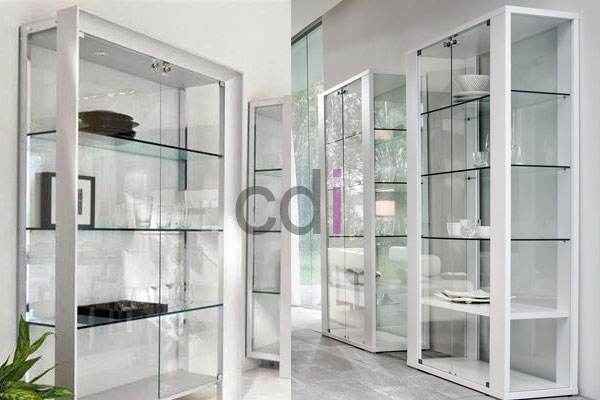

**Harga Lemari Dapur Kaca: Estimasi Biaya & Pilihan Terbaik 2026** - Mitra CDI yang budiman, pernahkah Mitra mempertimbangkan penggunaan kaca pada lemari dapur untuk memberikan kesan luas dan modern? Pemilihan material yang tepat pada lemari dapur kaca akan sangat memengaruhi estetika dan fungsionalitas ruangan. Kami memahami pentingnya mendapatkan informasi yang akurat mengenai perkiraan biayanya.

### Estimasi Harga Lemari Dapur Kaca Berdasarkan Material

Harga lemari dapur kaca sangat dipengaruhi oleh jenis kaca yang dipilih. Terdapat beberapa pilihan yang umum digunakan, masing-masing dengan karakteristik dan rentang harga yang berbeda.

*   **Kaca Polos:** Pilihan paling ekonomis, namun kurang tahan terhadap goresan dan memerlukan perawatan ekstra. Harga kaca polos berkisar antara Rp 300.000 – Rp 500.000 per meter persegi.
*   **Kaca Tempered:** Lebih kuat dan aman dibandingkan kaca polos, karena jika pecah akan menjadi butiran kecil yang tidak tajam. Harga kaca tempered berkisar antara Rp 600.000 – Rp 1.200.000 per meter persegi.
*   **Kaca Laminasi:** Terdiri dari dua lapisan kaca yang disatukan dengan lapisan plastik di antaranya. Memberikan keamanan dan ketahanan yang lebih baik, serta kedap suara. Harga kaca laminasi berkisar antara Rp 800.000 – Rp 1.800.000 per meter persegi.
*   **Kaca Satin/Buram:** Memberikan privasi tambahan dan kesan mewah. Harga kaca satin berkisar antara Rp 700.000 – Rp 1.500.000 per meter persegi.

Harga ini bersifat estimasi dan dapat berubah sewaktu-waktu — hubungi Kami untuk penawaran terbaru dan paling akurat sesuai kebutuhan proyek Mitra CDI. Selain jenis kaca, ketebalan kaca juga memengaruhi harga. Kaca dengan ketebalan 8mm umumnya lebih mahal daripada kaca 5mm.

### Pertimbangkan Desain Lemari Dapur Kaca dan Biaya Tambahan

Desain lemari dapur kaca juga memengaruhi total biaya. Lemari dengan desain yang kompleks, banyak detail, atau menggunakan fitur khusus seperti *soft-close* akan lebih mahal. Berikut beberapa pertimbangan:

*   **Model Pintu:** Pintu swing, pintu geser, atau pintu lipat memiliki biaya pemasangan yang berbeda. Pintu geser biasanya lebih mahal karena memerlukan mekanisme rel dan roda.
*   **Ukuran Lemari:** Semakin besar ukuran lemari, semakin banyak bahan yang dibutuhkan, sehingga biaya juga akan meningkat.
*   **Finishing:** Finishing melamin, HPL, atau cat duco akan memengaruhi tampilan dan harga lemari. Cat duco umumnya lebih mahal karena proses pengecatan yang lebih rumit.
*   **Pencahayaan:** Penambahan lampu LED di dalam lemari dapur kaca dapat meningkatkan fungsionalitas dan estetika, namun juga menambah biaya.

Selain biaya material dan desain, Mitra CDI juga perlu mempertimbangkan biaya tambahan seperti biaya pengukuran, biaya pemasangan, dan biaya pengiriman. Kami di Creative Design Interior menawarkan skema harga *all-in-one* yang sudah termasuk material, pengiriman, dan bongkar muat, sehingga Mitra CDI dapat menghindari biaya tersembunyi.

### Kitchen Set Kaca Custom dari Creative Design Interior

Sebagai perusahaan yang telah berpengalaman lebih dari 10 tahun dalam pembuatan *kitchen set*, furniture interior, dan pengadaan material bangunan, Kami menawarkan solusi lemari dapur kaca *custom* yang sesuai dengan kebutuhan dan anggaran Mitra CDI. Kami menyediakan berbagai pilihan material kaca, desain, dan finishing yang dapat disesuaikan dengan preferensi Mitra.

Kami memiliki tim kerja berpengalaman dengan sistem kerja terjadwal agar pengerjaan tepat waktu dan kualitas terjaga. Produk dapat ditukar jika tidak sesuai spesifikasi, selama belum dipakai atau dibongkar dan maksimal 1 hari. Untuk melihat contoh desain lemari kaca modern, Mitra CDI dapat mengunjungi [Contoh Lemari Buku Kaca: Desain Modern dan Hemat Ruang](/blog/contoh-lemari-buku-kaca/) untuk mendapatkan inspirasi.

Kami juga menyediakan berbagai pilihan pembayaran yang fleksibel, termasuk COD, transfer bank, DP 50%, transfer setelah barang terkirim, bayar bertahap, atau transfer setelah pekerjaan selesai. Untuk mengetahui lebih detail mengenai [harga lemari aluminium dapur](/blog/harga-lemari-aluminium-dapur/) dan pilihan material lainnya, Kami sarankan untuk melihat referensi dari proyek-proyek sebelumnya.

Untuk konsultasi lebih lanjut, tombol **Telepon** dan **WhatsApp** di bawah halaman ini dapat langsung digunakan untuk menghubungi Kami.
