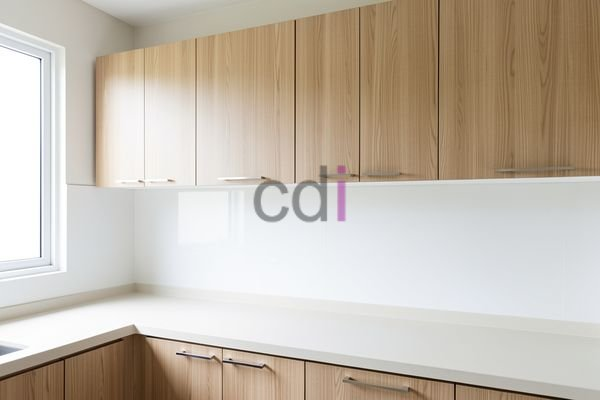

**Harga Lemari Dapur Kayu: Estimasi & Tips Cerdas 2026** - Mitra CDI di mana pun berada, apakah Anda sedang merencanakan renovasi dapur atau membangun dapur baru? Memilih lemari dapur yang tepat merupakan keputusan penting, dan mengetahui perkiraan biayanya sangat membantu perencanaan anggaran Anda.

Mempertimbangkan investasi pada lemari dapur kayu adalah langkah bijak untuk menciptakan ruang memasak yang fungsional dan estetis. Kami akan membahas secara rinci mengenai perkiraan harga, material yang umum digunakan, serta faktor-faktor yang memengaruhi biaya pembuatan lemari dapur kayu.

## Memahami Rentang Harga Lemari Dapur Kayu

Harga lemari dapur kayu sangat bervariasi, tergantung pada beberapa faktor kunci. Material kayu yang dipilih adalah penentu utama biaya. Kayu solid seperti jati atau mahoni umumnya memiliki harga yang lebih tinggi dibandingkan dengan kayu olahan seperti MDF atau particle board yang dilapisi veneer kayu. Ukuran dapur, kompleksitas desain, dan jenis finishing juga berperan dalam menentukan harga akhir.

Sebagai gambaran, lemari dapur kayu dengan material MDF dan finishing HPL (High-Pressure Laminate) biasanya memiliki rentang harga sekitar Rp 2.500.000 hingga Rp 4.000.000 per meter lari. Sedangkan lemari dapur kayu solid seperti jati atau mahoni dengan finishing melamin atau cat duco dapat mencapai Rp 5.000.000 hingga Rp 10.000.000 atau lebih per meter lari. Harga ini bersifat estimasi dan dapat berubah sewaktu-waktu — hubungi Kami untuk penawaran terbaru dan paling akurat sesuai kebutuhan proyek Anda.

Perlu diingat bahwa harga tersebut belum termasuk biaya pemasangan. Biaya pemasangan biasanya berkisar antara 10% hingga 20% dari total biaya lemari. Untuk mendapatkan gambaran yang lebih jelas, sebaiknya Anda meminta penawaran harga dari beberapa penyedia jasa desain interior.

## Material Kayu yang Umum Digunakan dan Perbandingannya

Pemilihan material kayu sangat memengaruhi tampilan, ketahanan, dan tentu saja, harga lemari dapur Anda. Berikut adalah beberapa material kayu yang umum digunakan beserta perbandingannya:

<table class="table">
  <caption>Perbandingan Material Kayu untuk Lemari Dapur</caption>
  <thead>
    <tr><th>Material</th><th>Kelebihan</th><th>Kekurangan</th><th>Estimasi Harga (per meter lari)</th></tr>
  </thead>
  <tbody>
    <tr><td>MDF (Medium Density Fiberboard)</td><td>Harga terjangkau, mudah dibentuk, permukaan halus</td><td>Kurang tahan lama, mudah rusak jika terkena air, perlu dilapisi veneer atau HPL</td><td>Rp 2.500.000 - Rp 3.500.000</td></tr>
    <tr><td>Particle Board</td><td>Harga paling terjangkau, ringan</td><td>Kurang kuat, mudah melembung jika terkena air, kurang tahan lama</td><td>Rp 1.800.000 - Rp 2.500.000</td></tr>
  </tbody>
</table>

Dengan memahami perbedaan masing-masing material, Anda dapat memilih yang paling sesuai dengan anggaran dan kebutuhan Anda. Jika Anda menginginkan lemari dapur yang tahan lama dan terlihat mewah, kayu jati atau mahoni adalah pilihan yang tepat. Namun, jika anggaran Anda terbatas, MDF atau particle board dengan lapisan yang baik juga dapat menjadi solusi yang baik.

## Rencanakan Dapur Impian Anda Bersama Kami

Kami, Creative Design Interior, berpengalaman lebih dari 10 tahun dalam pembuatan *kitchen set*, furniture interior, dan pengadaan material bangunan. Kami menawarkan solusi *all in one* untuk kebutuhan dapur Anda, mulai dari desain, pembuatan, hingga pemasangan. Dengan tim kerja berpengalaman yang bekerja sesuai jadwal, Kami memastikan pengerjaan tepat waktu dan kualitas terjaga.

Kami memahami bahwa setiap dapur memiliki karakteristik yang unik. Oleh karena itu, Kami menawarkan layanan desain custom yang disesuaikan dengan kebutuhan dan preferensi Anda. Kami akan membantu Anda memilih material, warna, dan desain yang paling sesuai dengan gaya dapur Anda. [Pelajari lebih lanjut tentang layanan furniture custom Kami di sini](/blog/harga-lemari-baju-kayu/).

## Kemudahan Pemesanan dan Pembayaran

Kami menyediakan berbagai pilihan pembayaran yang fleksibel untuk memudahkan Anda. Anda dapat memilih metode COD (Cash on Delivery), transfer bank, DP 50%, transfer setelah barang terkirim, bayar bertahap, atau transfer setelah pekerjaan selesai. Kami juga menyediakan gratis ongkir untuk wilayah layanan Kami, termasuk Jakarta, Bogor, Depok, Tangerang, Bekasi, Cikarang, Karawang, Bandung, Serang, Purwakarta, Cilegon, Cikampek, Subang, dan Rangkasbitung. Untuk informasi lebih detail mengenai [daftar harga](URL), silakan kunjungi halaman Kami.

Apabila masih terdapat hal yang ingin ditanyakan, jangan ragu menghubungi Kami melalui tombol **WhatsApp** atau **Telepon** pada halaman ini.
