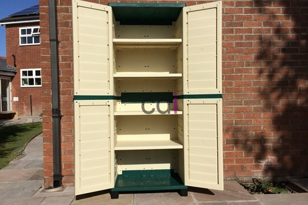

**Harga Lemari Dapur Plastik: Pilihan Hemat & Tahan Lama** - Mitra CDI di mana pun berada, apakah Anda sedang merencanakan renovasi dapur dengan anggaran terbatas? Memilih lemari dapur yang tepat adalah keputusan penting, dan lemari dapur plastik bisa menjadi solusi cerdas untuk Anda.

Memilih lemari dapur yang sesuai dengan kebutuhan dan anggaran merupakan pertimbangan utama. Lemari dapur plastik menawarkan kombinasi menarik antara harga terjangkau, daya tahan, dan kemudahan perawatan. Pilihan ini sangat ideal bagi Anda yang mencari solusi praktis tanpa mengorbankan estetika.

## Keunggulan Lemari Dapur Plastik Dibanding Material Lain

Lemari dapur plastik menawarkan beberapa keunggulan dibandingkan material lain seperti kayu atau aluminium. Salah satu yang paling menonjol adalah ketahanannya terhadap air dan kelembapan. Hal ini sangat penting di lingkungan dapur yang sering terpapar air dan uap. Material plastik tidak akan memuai, menyusut, atau berkarat seperti logam, sehingga menjamin umur pakai yang lebih panjang. Selain itu, lemari dapur plastik umumnya lebih ringan dan mudah dibersihkan. 

Sebagai perbandingan, berikut adalah tabel yang memetakan perbedaan material lemari dapur berdasarkan beberapa faktor:

<table class="table">
  <caption>Perbandingan Material Lemari Dapur</caption>
  <thead>
    <tr><th>Material</th><th>Harga (Estimasi)</th><th>Ketahanan Air</th><th>Perawatan</th><th>Estetika</th></tr>
  </thead>
  <tbody>
    <tr><td>Plastik</td><td>Rp 800.000 - Rp 3.000.000</td><td>Sangat Baik</td><td>Sangat Mudah</td><td>Modern/Minimalis</td></tr>
    <tr><td>Kayu Solid</td><td>Rp 3.000.000 - Rp 10.000.000+</td><td>Sedang (Membutuhkan Pelapis)</td><td>Menengah</td><td>Klasik/Natural</td></tr>
    <tr><td>Aluminium</td><td>Rp 1.500.000 - Rp 5.000.000</td><td>Baik</td><td>Mudah</td><td>Modern/Industrial</td></tr>
    <tr><td>Particle Board (MDF)</td><td>Rp 500.000 - Rp 2.000.000</td><td>Buruk (Mudah Rusak)</td><td>Sedang</td><td>Fleksibel (Bisa Dilapisi)</td></tr>
  </tbody>
</table>

Harga ini bersifat estimasi dan dapat berubah sewaktu-waktu — hubungi Kami untuk penawaran terbaru dan paling akurat sesuai kebutuhan proyek Mitra CDI.

## Faktor yang Mempengaruhi Harga Lemari Dapur Plastik

Terdapat beberapa faktor yang memengaruhi harga lemari dapur plastik. Ukuran lemari adalah salah satu faktor utama. Semakin besar lemari, semakin banyak material yang dibutuhkan, dan semakin tinggi pula harganya. Selain itu, desain dan kompleksitas lemari juga berpengaruh. Lemari dengan desain yang rumit atau fitur tambahan seperti laci dan rak yang dapat disesuaikan biasanya lebih mahal.

Kualitas plastik yang digunakan juga memengaruhi harga. Plastik dengan kualitas yang lebih baik akan lebih tahan lama dan memiliki tampilan yang lebih menarik, tetapi juga lebih mahal. Pilihan warna dan finishing juga dapat memengaruhi harga. Warna-warna yang unik atau finishing yang khusus mungkin dikenakan biaya tambahan.

## Creative Design Interior: Solusi Lemari Dapur Plastik All-in-One

Kami di Creative Design Interior memahami kebutuhan Anda akan lemari dapur yang fungsional, tahan lama, dan terjangkau. Kami menyediakan berbagai pilihan lemari dapur plastik dengan desain modern dan minimalis yang cocok untuk berbagai ukuran dan gaya dapur. Harga ini sudah termasuk material, pengiriman, dan bongkar muat — memberikan Anda kemudahan dan transparansi.

Kami telah berpengalaman lebih dari 10 tahun dalam pembuatan furniture custom, termasuk kitchen set dan lemari dapur plastik. Tim kerja Kami berpengalaman dan bekerja dengan sistem terjadwal, memastikan pengerjaan tepat waktu dan kualitas terjaga. Kami juga menyediakan layanan konsultasi gratis untuk membantu Anda memilih desain lemari dapur plastik yang paling sesuai dengan kebutuhan dan anggaran Anda.

Jangan ragu untuk mengeksplorasi pilihan desain lemari dapur lainnya, termasuk [Buat Lemari Gantung Dapur: Solusi Ruang Rapi & Estetis](/blog/buat-lemari-gantung-dapur/) untuk memaksimalkan ruang dapur Anda. Untuk mengetahui lebih lanjut tentang [Harga Lemari Aluminium Dapur: Sebelum Memesan, Cek Estimasi 2026](/blog/harga-lemari-aluminium-dapur/), Anda juga dapat melihat perbandingan material yang tersedia.

Tim Kami siap membantu mewujudkan proyek Anda — silakan hubungi melalui tombol **Telepon** atau **WhatsApp** yang tersedia di bawah.
