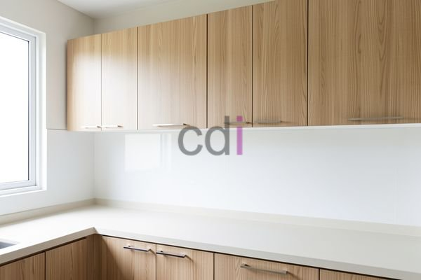

**Harga Lemari Dapur Stainless Jabodetabek: Estimasi & Pilihan 2026** - Mitra CDI yang berbahagia, dapur adalah jantung rumah, bukan? Data menunjukkan bahwa renovasi dapur dapat meningkatkan nilai properti hingga 15%—investasi yang menjanjikan! Salah satu elemen kunci dalam renovasi dapur adalah pemilihan lemari yang tepat, dan lemari dapur stainless steel semakin populer karena daya tahan, tampilan modern, serta kemudahan perawatannya. Artikel ini akan membahas secara detail mengenai harga lemari dapur stainless di wilayah Jabodetabek, faktor-faktor yang mempengaruhinya, serta apa yang Kami tawarkan sebagai solusi terbaik untuk kebutuhan Mitra CDI.

## Estimasi Harga Lemari Dapur Stainless di Jabodetabek

Mitra CDI, menentukan anggaran untuk renovasi dapur memang penting. Harga lemari dapur stainless bervariasi tergantung pada beberapa faktor, termasuk material, ukuran, desain, dan kompleksitas pemasangan. Secara umum, harga berkisar antara Rp 2.500.000 hingga Rp 4.500.000 per meter persegi. Harga ini bersifat estimasi dan dapat berubah sewaktu-waktu — hubungi Kami untuk penawaran terbaru dan paling akurat sesuai kebutuhan proyek Mitra CDI.

Perbedaan harga tersebut dipengaruhi oleh jenis stainless steel yang digunakan. Stainless steel grade 201 umumnya lebih ekonomis, sementara grade 304 lebih tahan karat dan memiliki kualitas yang lebih baik. Selain itu, desain custom dengan banyak laci, rak, atau fitur tambahan tentu akan meningkatkan biaya. Kami di Creative Design Interior menawarkan berbagai pilihan material dan desain sesuai dengan anggaran dan preferensi Mitra CDI.

## Keunggulan Memilih Lemari Dapur Stainless Steel dari Kami

Sebagai perusahaan yang telah berpengalaman lebih dari 10 tahun dalam pembuatan furniture custom dan pengadaan material bangunan, Kami memahami betul kebutuhan Mitra CDI. Lemari dapur stainless steel yang Kami produksi memiliki beberapa keunggulan, antara lain:

*   **Daya Tahan Tinggi:** Stainless steel tahan terhadap karat, korosi, dan kerusakan akibat benturan.
*   **Perawatan Mudah:** Permukaan stainless steel mudah dibersihkan dan tidak meninggalkan noda.
*   **Desain Modern:** Tampilan stainless steel memberikan kesan modern dan elegan pada dapur.
*   **Customizable:** Kami dapat menyesuaikan desain lemari sesuai dengan ukuran dan gaya dapur Mitra CDI.
*   **Skema Harga All-In-One:** Harga yang Kami tawarkan sudah termasuk material, pengiriman, dan bongkar muat.

Selain itu, Kami menawarkan layanan konsultasi gratis untuk membantu Mitra CDI menentukan desain dan material yang paling sesuai. Kami juga memberikan garansi produk dan layanan purna jual yang memuaskan. [Daftar harga lengkap](/daftar-harga/) Kami tersedia untuk referensi, tetapi Kami sarankan untuk menghubungi Kami langsung untuk mendapatkan penawaran yang paling akurat.

## Faktor-Faktor yang Mempengaruhi Harga dan Tips Pemilihan

Mitra CDI, sebelum memutuskan untuk membeli lemari dapur stainless steel, ada beberapa faktor yang perlu dipertimbangkan. Selain material dan desain, ukuran dapur juga sangat berpengaruh. Dapur yang lebih besar tentu membutuhkan lebih banyak material dan waktu pengerjaan, sehingga biaya akan lebih tinggi.

Berikut adalah beberapa tips memilih lemari dapur stainless steel yang tepat:

*   **Tentukan Anggaran:** Buat anggaran yang realistis sebelum memulai proyek renovasi dapur.
*   **Pilih Material Berkualitas:** Stainless steel grade 304 adalah pilihan terbaik untuk daya tahan dan kualitas.
*   **Pertimbangkan Desain:** Pilih desain yang sesuai dengan gaya dapur dan kebutuhan penyimpanan.
*   **Cari Penyedia Terpercaya:** Pilih penyedia yang berpengalaman dan memiliki reputasi baik.
*   **Bandingkan Harga:** Bandingkan harga dari beberapa penyedia sebelum membuat keputusan.

Kami di Creative Design Interior siap membantu Mitra CDI dalam memilih lemari dapur stainless steel yang tepat. Dengan pengalaman dan keahlian Kami, Kami dapat memberikan solusi terbaik untuk kebutuhan dapur Mitra CDI. Jangan ragu untuk berkonsultasi dengan tim Kami untuk mendapatkan informasi lebih lanjut.

## Kemudahan Pemesanan dan Pilihan Pembayaran

Mitra CDI, Kami menyadari bahwa proses pemesanan dan pembayaran haruslah semudah mungkin. Oleh karena itu, Kami menyediakan berbagai pilihan pembayaran yang fleksibel, termasuk COD, transfer bank, DP 50%, transfer setelah barang terkirim, bayar bertahap, atau transfer setelah pekerjaan selesai. Kami juga menawarkan gratis ongkir untuk wilayah tertentu.

Kami melayani wilayah Jakarta, Bogor, Depok, Tangerang, Bekasi, Cikarang, Karawang, Bandung, Serang, Purwakarta, Cilegon, Cikampek, Subang, dan Rangkasbitung. Jam operasional Kami adalah Senin sampai Sabtu pukul 08.00 sampai 17.00. Tim Kami yang berpengalaman bekerja dengan sistem terjadwal untuk memastikan pengerjaan tepat waktu dan kualitas terjaga. Produk dapat ditukar jika tidak sesuai spesifikasi, selama belum dipakai atau dibongkar dan maksimal 1 hari.

Membutuhkan bantuan langsung untuk kebutuhan proyek Mitra CDI? Silakan klik tombol **WhatsApp** atau **Telepon** di bawah untuk berkonsultasi dengan tim Kami.
