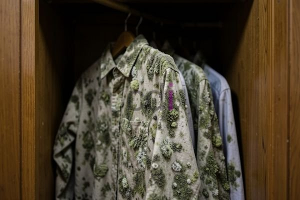

**Harga Lemari Etalase Baju: Cek Estimasi Biaya & Pesan Custom** - Hai Mitra CDI! Pernahkah terpikir untuk memberikan sentuhan mewah sekaligus solusi penyimpanan yang cerdas untuk koleksi pakaian Mitra? Lemari etalase baju bukan sekadar tempat menyimpan, tapi juga cara elegan untuk memajang busana kesayangan. Di (not detected), kami hadir untuk mewujudkannya!

### Kenapa Pilih Lemari Etalase Baju?

Lemari etalase baju menawarkan lebih dari sekadar fungsi. Bayangkan, Mitra bisa langsung melihat seluruh koleksi pakaian tanpa repot membuka-buka pintu lemari! Kemudahan ini sangat berguna bagi Mitra yang punya banyak pilihan busana. Selain itu, desainnya yang menarik bisa jadi pemanis ruangan, memberikan kesan mewah di kamar tidur.

Di Creative Design Interior, kami percaya lemari bisa jadi bagian dari gaya hidup. Itulah mengapa kami menyediakan berbagai pilihan, mulai dari desain minimalis yang modern hingga model klasik yang elegan. Material yang kami gunakan pun beragam – kayu solid, MDF, hingga aluminium – semuanya dipilih untuk kualitas dan keindahan. Setiap lemari etalase kami dirancang untuk memaksimalkan ruang dan mempercantik tampilan kamar Mitra CDI di (not detected).

### Apa Saja yang Mempengaruhi Harga Lemari Etalase Baju?

Harga lemari etalase baju bisa bervariasi. Nah, supaya Mitra punya gambaran yang lebih jelas, yuk kita lihat faktor-faktor yang mempengaruhinya:

*   **Ukuran:** Semakin besar lemari yang Mitra inginkan, tentu saja material yang dibutuhkan juga lebih banyak, dan harganya pun akan menyesuaikan.
*   **Material:** Pilihan material memainkan peran besar dalam menentukan harga. Kayu solid biasanya memiliki harga yang lebih tinggi dibandingkan MDF atau aluminium. 
*   **Desain:** Desain yang rumit dengan ukiran atau ornamen khusus tentu akan lebih mahal daripada model yang simpel dan minimalis.
*   **Kualitas Kaca/Akrilik:** Kualitas kaca atau akrilik yang digunakan juga penting. Kaca tempered lebih kuat dan aman, namun harganya memang lebih mahal dari kaca biasa.
*   **Finishing:** Finishing seperti cat duco, veneer, atau lapisan lainnya akan menambah nilai estetika, tapi juga menambah biaya produksi.

Sebagai panduan, harga lemari etalase baju custom di Creative Design Interior mulai dari sekitar Rp 3.500.000 untuk ukuran standar (tinggi 180 cm, lebar 120 cm, kedalaman 60 cm) dengan material MDF dan finishing melamin. Untuk material kayu solid dengan desain yang lebih rumit, harganya bisa mencapai Rp 10.000.000 atau lebih. Untuk detail harga yang lebih akurat dan sesuai dengan kebutuhan Mitra, silakan lihat  atau hubungi tim kami!

### Solusi Custom dari Creative Design Interior untuk Mitra

Kami di Creative Design Interior mengerti betul bahwa setiap Mitra CDI memiliki selera dan kebutuhan yang berbeda. Karena itu, kami menyediakan layanan custom untuk lemari etalase baju sesuai keinginan Mitra di (not detected). Mitra bisa menentukan sendiri ukuran, material, desain, serta finishing yang paling cocok dengan gaya interior rumah.

Prosesnya mudah: Mitra bisa mendapatkan konsultasi gratis dengan desainer interior kami. Bersama mereka, Mitra bisa merancang lemari etalase impian, dengan mempertimbangkan gaya interior, anggaran, dan kebutuhan penyimpanan. Kami juga menyediakan layanan pemasangan profesional, memastikan lemari terpasang dengan rapi dan aman.

Untuk kemudahan transaksi, kami menawarkan berbagai pilihan metode pembayaran: COD, transfer bank, DP 50%, transfer setelah barang terkirim, bayar bertahap, atau transfer setelah pekerjaan selesai. Bahkan, kami juga menawarkan gratis ongkir untuk wilayah tertentu di sekitar (not detected)!

### Yuk, Dapatkan Penawaran dan Konsultasi Gratis!

Mitra CDI, jangan tunda lagi! Wujudkan lemari etalase baju impian Mitra sekarang juga. Hubungi kami melalui tombol **Telepon** atau **WhatsApp** yang tersedia di bawah ini untuk mendapatkan penawaran harga terbaik dan konsultasi gratis. Atau, kunjungi [harga kitchen set modern](/blog/harga-kitchen-set-modern/) untuk melihat inspirasi desain dapur yang selaras dengan lemari etalase baju dari Creative Design Interior. [Harga Lemari Baju Kayu](/blog/harga-lemari-baju-kayu/) juga bisa menjadi rujukan yang menarik! Tim kami siap membantu mewujudkan proyek Mitra CDI di (not detected) – hubungi via tombol **Telepon** atau **WhatsApp** di bawah.