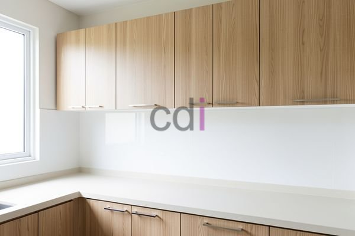

**Harga Lemari Etalase Dapur: Estimasi & Pilihan Terbaik 2026** - Mitra CDI yang budiman, mitra CDI yang budiman, seringkali Anda menemukan kesulitan dalam menentukan anggaran untuk renovasi dapur, terutama ketika mempertimbangkan lemari etalase? Mengetahui kisaran harga di awal perencanaan akan membantu Anda mengalokasikan dana dengan lebih efektif. Lemari etalase tidak hanya berfungsi sebagai tempat penyimpanan, tetapi juga menjadi elemen penting dalam estetika dapur Anda. Artikel ini akan membahas secara rinci mengenai perkiraan harga lemari etalase dapur, faktor-faktor yang mempengaruhinya, serta solusi yang ditawarkan oleh Creative Design Interior.

## Estimasi Harga Lemari Etalase Dapur Berdasarkan Material

Pemilihan material merupakan faktor utama yang menentukan harga lemari etalase dapur. Material yang berbeda menawarkan karakteristik dan harga yang bervariasi. Secara umum, material yang umum digunakan antara lain:

*   **Multipleks:** Pilihan yang paling ekonomis, dengan harga mulai dari Rp 400.000 hingga Rp 700.000 per meter. Namun, multipleks rentan terhadap kelembapan dan perlu dilapisi *finishing* yang baik.
*   **Kayu Solid (Jati, Mahoni, Meranti):** Memberikan kesan mewah dan tahan lama, dengan harga mulai dari Rp 1.200.000 hingga Rp 3.000.000 per meter, tergantung jenis kayu.
*   **Aluminium:** Pilihan populer karena tahan karat dan perawatannya mudah, dengan harga mulai dari Rp 600.000 hingga Rp 1.500.000 per meter.
*   **Stainless Steel:** Ideal untuk dapur modern dan higienis, dengan harga mulai dari Rp 800.000 hingga Rp 2.000.000 per meter.

Harga ini bersifat estimasi dan dapat berubah sewaktu-waktu — hubungi Kami untuk penawaran terbaru dan paling akurat sesuai kebutuhan proyek Anda. Penting untuk mempertimbangkan kualitas material agar lemari etalase Anda awet dan tahan lama.

## Pertimbangan Ukuran dan Desain Lemari Etalase Dapur

Selain material, ukuran dan desain lemari etalase juga memengaruhi harga. Semakin kompleks desainnya dan semakin besar ukurannya, tentu saja biayanya akan semakin tinggi. Lemari etalase standar biasanya memiliki tinggi 60-80 cm, lebar 40-60 cm, dan kedalaman 30-40 cm. Namun, Anda dapat menyesuaikan ukuran dan desain sesuai dengan kebutuhan dan ruang dapur Anda.

Desain lemari etalase juga memengaruhi harga. Model sederhana dengan pintu polos biasanya lebih murah daripada model dengan ukiran atau detail dekoratif. Pertimbangkan gaya dapur Anda (minimalis, modern, klasik) saat memilih desain lemari etalase. Jika Anda memiliki konsep yang unik, Kami di Creative Design Interior siap mewujudkannya melalui layanan *furniture custom*.

## Creative Design Interior: Solusi Lengkap untuk Lemari Etalase Dapur Anda

Kami di Creative Design Interior menyediakan layanan pembuatan lemari etalase dapur *custom* dengan berbagai pilihan material, ukuran, dan desain. Dengan pengalaman lebih dari 10 tahun di bidang *kitchen set* dan *furniture interior*, Kami menjamin kualitas produk dan kepuasan pelanggan. Kami menawarkan skema harga *all in one* yang sudah termasuk material, pengiriman, dan bongkar muat, sehingga Anda tidak perlu khawatir akan biaya tambahan.

Memilih lemari etalase dapur tidak harus rumit. [Daftar Harga](/daftar-harga/) Kami akan memberikan gambaran jelas mengenai estimasi biaya berdasarkan material dan ukuran yang Anda inginkan. Kami juga menyediakan layanan konsultasi gratis untuk membantu Anda menentukan desain yang paling sesuai dengan kebutuhan dan anggaran Anda. Kami melayani wilayah Jakarta, Bogor, Depok, Tangerang, Bekasi, Cikarang, Karawang, Bandung, Serang, Purwakarta, Cilegon, Cikampek, Subang, dan Rangkasbitung.

## Kemudahan Pemesanan dan Pembayaran di Creative Design Interior

Kami memahami bahwa proses renovasi dapur dapat memakan waktu dan energi. Oleh karena itu, Kami berusaha memberikan kemudahan dalam proses pemesanan dan pembayaran. Anda dapat memilih berbagai opsi pembayaran, seperti COD, transfer bank, DP 50%, transfer setelah barang terkirim, bayar bertahap, atau transfer setelah pekerjaan selesai. Tim kerja Kami berpengalaman dengan sistem kerja terjadwal agar pengerjaan tepat waktu dan kualitas terjaga. Produk dapat ditukar jika tidak sesuai spesifikasi, selama belum dipakai atau dibongkar dan maksimal 1 hari. Jangan tunda lagi mewujudkan dapur impian Anda! Hubungi Kami sekarang juga untuk mendapatkan penawaran terbaik.

Untuk konsultasi lebih lanjut, tombol **Telepon** dan **WhatsApp** di bawah halaman ini dapat langsung digunakan untuk menghubungi Kami.
