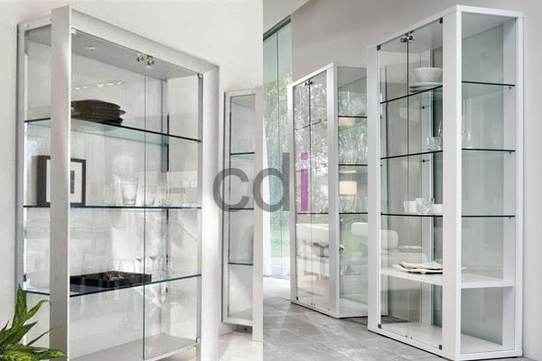

**Harga Lemari Full Kaca Jabodetabek: Estimasi & Pilihan Terbaik 2026** - Mitra CDI dimana saja berada, mencari lemari full kaca yang sesuai dengan gaya dan anggaran Anda bisa menjadi tantangan. Kami akan membahas estimasi harga, faktor-faktor yang memengaruhi biaya, serta pilihan material kaca yang tersedia untuk membantu Anda membuat keputusan terbaik.

### Apa yang Mempengaruhi Harga Lemari Full Kaca?

Harga lemari full kaca sangat bervariasi, bergantung pada beberapa faktor utama. Ukuran lemari adalah penentu utama; semakin besar lemari, semakin banyak material yang dibutuhkan, dan semakin tinggi biayanya. Jenis kaca yang dipilih juga berpengaruh signifikan. Kaca biasa memiliki harga paling terjangkau, sedangkan kaca tempered atau kaca es menawarkan kekuatan dan estetika yang lebih baik dengan harga yang lebih tinggi. Selain itu, kompleksitas desain, seperti jumlah pintu, rak, dan desain interior, turut memengaruhi harga akhir.

Selain material dan ukuran, biaya tambahan seperti finishing (misalnya, cat duco, veneer, atau HPL) dan aksesoris (engsel, handle, lampu LED) juga perlu diperhitungkan. Skema *all in one* yang Kami tawarkan di Creative Design Interior mencakup material, pengiriman, dan bongkar muat, sehingga Anda tidak perlu khawatir dengan biaya tersembunyi. Harga ini bersifat estimasi dan dapat berubah sewaktu-waktu — hubungi Kami untuk penawaran terbaru dan paling akurat sesuai kebutuhan proyek Mitra CDI.

### Pilihan Material Kaca dan Estimasi Biaya

Memilih material kaca yang tepat untuk lemari full kaca Anda akan memengaruhi tampilan dan daya tahannya. Berikut adalah beberapa pilihan yang umum digunakan:

*   **Kaca Bening:** Pilihan paling ekonomis, memberikan tampilan yang bersih dan minimalis. Cocok untuk ruangan yang membutuhkan kesan luas.
*   **Kaca Es:** Memberikan privasi lebih dengan menyamarkan isi lemari, namun tetap memungkinkan cahaya masuk.
*   **Kaca Tempered:** Lebih kuat dan aman daripada kaca biasa, tahan terhadap benturan dan pecah menjadi pecahan kecil yang tidak tajam. Ideal untuk rumah tangga dengan anak-anak atau hewan peliharaan.
*   **Kaca Refleksi:** Memberikan efek cermin, memberikan kesan mewah dan modern pada ruangan.

Sebagai gambaran, untuk lemari full kaca ukuran standar (tinggi 200 cm, lebar 120 cm, kedalaman 60 cm) dengan kaca bening, estimasi biayanya berkisar antara Rp 3.500.000 hingga Rp 7.000.000. Untuk kaca tempered atau kaca es, harga dapat meningkat menjadi Rp 5.000.000 hingga Rp 10.000.000 atau lebih, tergantung pada ketebalan dan fitur tambahannya. Sebagai perbandingan, lemari dengan kaca refleksi biasanya memiliki harga yang sedikit lebih tinggi daripada kaca tempered.

### Layanan Custom Lemari Full Kaca dari Creative Design Interior

Kami di Creative Design Interior menawarkan layanan custom lemari full kaca yang dapat disesuaikan dengan kebutuhan dan preferensi Anda. Tim Kami akan bekerja sama dengan Anda untuk merancang lemari yang sempurna, mulai dari pemilihan material, ukuran, desain, hingga finishing. Kami menyediakan berbagai pilihan material kaca, termasuk kaca bening, kaca es, kaca tempered, dan kaca refleksi. 

Dengan pengalaman lebih dari 10 tahun di bidang furniture custom, Kami menjamin kualitas produk dan kepuasan pelanggan. Sistem kerja terjadwal Kami memastikan pengerjaan tepat waktu dan kualitas terjaga. Produk dapat ditukar jika tidak sesuai spesifikasi, selama belum dipakai atau dibongkar dan maksimal 1 hari. Untuk konsultasi desain dan mendapatkan daftar harga lengkap, silakan kunjungi [halaman Daftar Harga](URL). Jangan ragu untuk menghubungi Kami melalui tombol **Telepon** atau **WhatsApp** yang tersedia di bawah.

Tim Kami siap membantu mewujudkan proyek Anda — silakan hubungi melalui tombol **Telepon** atau **WhatsApp** yang tersedia di bawah.
