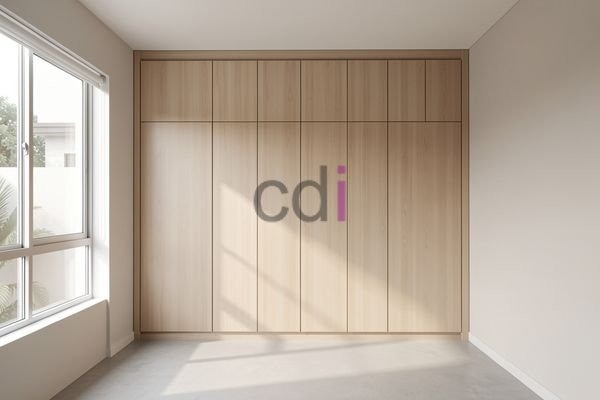

**Harga Lemari Full Plafon: Solusi Hemat Ruang & Estimasi Biaya** - Mitra CDI di mana pun berada, kerap kali kita menghadapi tantangan memaksimalkan ruang penyimpanan di rumah, terutama di area perkotaan dengan lahan terbatas. Salah satu solusi yang populer adalah penggunaan lemari *full plafon*. Banyak Mitra CDI yang belum memahami dengan baik bagaimana menentukan anggaran yang tepat untuk proyek ini.

### Memaksimalkan Ruang Vertikal dengan Lemari Full Plafon

Lemari *full plafon* menawarkan keuntungan utama berupa pemanfaatan ruang vertikal secara optimal. Dengan menjangkau hingga plafon, lemari ini memberikan ruang penyimpanan ekstra yang signifikan tanpa memakan luas lantai. Ini sangat ideal untuk kamar tidur, ruang keluarga, atau area lain yang membutuhkan penyimpanan tambahan. Selain itu, lemari *full plafon* memberikan kesan visual ruangan yang lebih tinggi dan luas.

Pemilihan material juga krusial. Material seperti multipleks dengan finishing HPL atau *melamine* adalah pilihan ekonomis dan tahan lama. Namun, jika anggaran memungkinkan, material solid seperti kayu jati atau kayu mahoni akan memberikan kesan mewah dan kualitas yang lebih tinggi. Perlu diingat, material akan memengaruhi **harga lemari full plafon** secara signifikan.

### Estimasi Harga Lemari Full Plafon Berdasarkan Material

Untuk memberikan gambaran, Kami akan menyajikan estimasi **harga lemari full plafon** berdasarkan material yang umum digunakan. Harga ini bersifat estimasi dan dapat berubah sewaktu-waktu — hubungi Kami untuk penawaran terbaru dan paling akurat sesuai kebutuhan proyek Mitra CDI.

| Material        | Rentang Harga (per meter lari) | Kelebihan                                  | Kekurangan                               |
|-----------------|---------------------------------|---------------------------------------------|-------------------------------------------|
| Multipleks HPL  | Rp 400.000 - Rp 700.000         | Ekonomis, pilihan warna dan motif beragam     | Kurang tahan terhadap kelembapan          |
| Multipleks Melamine | Rp 500.000 - Rp 800.000         | Lebih tahan gores, mudah dibersihkan        | Pilihan motif terbatas                      |
| Kayu Jati       | Rp 1.200.000 - Rp 2.500.000      | Kuat, tahan lama, tampilan mewah          | Harga relatif mahal                        |
| Kayu Mahoni     | Rp 800.000 - Rp 1.800.000      | Tahan lama, mudah dikerjakan, harga menengah | Membutuhkan perawatan berkala            |

Perlu diperhatikan bahwa harga di atas adalah estimasi untuk pekerjaan *custom*. Jika Mitra CDI memilih lemari *full plafon* yang sudah jadi (pre-fabricated), harganya mungkin akan berbeda.

### Keunggulan Memesan Lemari Full Plafon Custom di Creative Design Interior

Kami di Creative Design Interior berpengalaman lebih dari 10 tahun dalam pembuatan *furniture custom*, termasuk lemari *full plafon*. Kami memahami bahwa setiap ruangan memiliki karakteristik dan kebutuhan yang berbeda. Oleh karena itu, Kami menawarkan solusi *custom* yang dirancang sesuai dengan preferensi dan anggaran Mitra CDI.

Dengan memilih layanan *custom* dari Kami, Mitra CDI mendapatkan beberapa keuntungan, antara lain:

*   **Desain Fleksibel:** Mitra CDI dapat menentukan ukuran, warna, material, dan desain lemari sesuai dengan keinginan.
*   **Kualitas Terjamin:** Kami menggunakan material berkualitas tinggi dan dikerjakan oleh tenaga ahli yang berpengalaman.
*   **Harga Transparan:** Kami memberikan rincian harga yang jelas dan transparan, termasuk biaya material, pengerjaan, pengiriman, dan bongkar muat. Skema harga Kami adalah *all in one*, sehingga Mitra CDI tidak perlu khawatir akan biaya tambahan.
*   **Pilihan Pembayaran:** Kami menawarkan berbagai pilihan pembayaran yang fleksibel, termasuk COD, transfer bank, DP 50%, transfer setelah barang terkirim, bayar bertahap, atau transfer setelah pekerjaan selesai.
*   **Gratis Ongkir:** Kami menyediakan gratis ongkir untuk wilayah layanan Kami (Jakarta, Bogor, Depok, Tangerang, Bekasi, Cikarang, Karawang, Bandung, Serang, Purwakarta, Cilegon, Cikampek, Subang, dan Rangkasbitung).

Untuk mengetahui lebih detail mengenai **harga lemari full plafon** dan mendapatkan penawaran terbaik, Mitra CDI dapat mengunjungi halaman [daftar harga](/daftar-harga/) Kami. Di sana, Mitra CDI akan menemukan informasi lengkap mengenai estimasi biaya dan pilihan material yang tersedia. Jangan ragu untuk berkonsultasi dengan tim Kami jika Mitra CDI memiliki pertanyaan atau kebutuhan khusus.

Tim Kami siap membantu mewujudkan proyek Mitra CDI — silakan hubungi melalui tombol **Telepon** atau **WhatsApp** yang tersedia di bawah.
