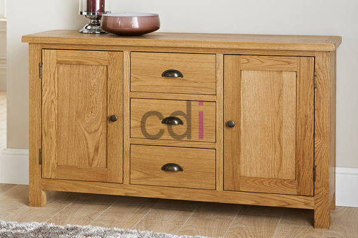

**Investasi Terbaik: Harga Lemari Kayu Jati dan Tips Memilih** - Hai Mitra CDI! Sedang memikirkan perombakan interior? Atau sekadar mencari lemari yang awet dan menawan untuk hunian di (not detected)? Kami punya solusinya!

Lemari kayu jati adalah pilihan yang tepat. Keindahan alaminya, kekuatannya yang tak tertandingi, dan daya tahannya yang luar biasa membuatnya menjadi investasi cerdas. Tapi, sebelum berburu lemari jati impian, ada baiknya kita pahami dulu apa saja yang memengaruhi harganya.

## Faktor yang Mempengaruhi Harga Lemari Kayu Jati

Harga lemari kayu jati bisa bervariasi, lho. Ada beberapa faktor utama yang mempengaruhinya. Salah satunya adalah kualitas kayu jati itu sendiri. Kayu jati dari pohon yang lebih tua dan bagian yang unggul memiliki serat lebih rapat dan warna yang lebih kaya. Tentu saja, kayu jati berkualitas tinggi ini akan ditawarkan dengan harga yang lebih baik.

Ukuran dan desain lemari juga berperan penting. Lemari berukuran besar, atau yang detail desainnya rumit, umumnya membutuhkan lebih banyak material dan waktu pengerjaan. Akibatnya, harganya pun akan lebih tinggi. Jika Mitra menginginkan lemari custom yang dirancang khusus, siap-siap harganya akan berbeda dari yang standar. Lokasi Mitra CDI di (not detected) dan reputasi penjual juga turut memengaruhi harga.

## Kisaran Harga Lemari Kayu Jati di Pasaran

Sebagai gambaran, berikut ini perkiraan harga lemari kayu jati berdasarkan ukuran dan desainnya:

| Jenis Lemari | Ukuran (Estimasi) | Harga (Estimasi) |
|---|---|---|
| Lemari Pakaian 2 Pintu | 120 cm x 60 cm x 200 cm | Rp 8.000.000 – Rp 18.000.000 |
| Lemari Pakaian 3 Pintu | 180 cm x 60 cm x 200 cm | Rp 12.000.000 – Rp 25.000.000 |
| Lemari Pajangan | 150 cm x 45 cm x 220 cm | Rp 10.000.000 – Rp 22.000.000 |
| Lemari Dapur | Custom (tergantung desain) | Rp 7.000.000 – Rp 30.000.000+ |

Ingat, harga-harga di atas hanyalah estimasi. Untuk penawaran yang paling akurat dan sesuai dengan kebutuhan proyek Mitra CDI, yuk hubungi Kami! Detail desain, finishing, dan penjual juga bisa memengaruhi harga akhir.

## Tips Memilih Lemari Kayu Jati Berkualitas

Nah, sebelum memutuskan, simak beberapa tips berikut agar tidak salah pilih:

1.  **Perhatikan Kualitas Kayu:** Pastikan kayu jati yang digunakan benar-benar asli, ya. Cek serat kayu, warna, dan teksturnya. Kayu jati asli biasanya memiliki serat yang jelas, warna kecoklatan kemerahan yang khas, dan permukaan yang halus.
2.  **Cek Kekuatan Konstruksi:** Periksa dengan teliti bagaimana lemari itu dirakit. Pastikan sambungan antar bagiannya kuat dan rapi. Hindari lemari dengan sambungan yang kendur atau tampak cacat.
3.  **Nilai Finishingnya:** Finishing yang baik akan melindungi kayu dan membuat tampilannya lebih cantik. Pastikan finishingnya rata, halus, dan bebas dari goresan atau noda.
4.  **Sesuaikan dengan Desain:** Pilih desain lemari yang cocok dengan gaya interior rumah Mitra CDI dan kebutuhan penyimpanan.

## Mengapa Berinvestasi pada Lemari Kayu Jati? Manfaatnya Jangka Panjang!

Memilih lemari kayu jati memang membutuhkan investasi awal yang lebih besar dibandingkan material lain. Tapi, percayalah, ini akan memberikan manfaat jangka panjang. Kayu jati terkenal sangat tahan terhadap rayap dan jamur, sehingga lemari akan awet bertahun-tahun. Selain itu, lemari jati juga mudah dirawat dan diperbaiki. Dengan perawatan yang tepat, lemari ini bisa menjadi pusaka keluarga yang bernilai tinggi.

Di Creative Design Interior, Kami siap membantu Mitra CDI mewujudkan lemari kayu jati impian yang berkualitas dan sesuai kebutuhan. Pengalaman dan keahlian Kami akan memberikan solusi desain dan konstruksi terbaik untuk proyek interior di (not detected).

Jangan ragu untuk berkonsultasi lebih lanjut. Silakan gunakan tombol **Telepon** atau **WhatsApp** yang tersedia di bagian bawah halaman ini untuk menghubungi Kami. [Lemari Jati 3 Pintu: Investasi Furnitur Abadi untuk Ruang Tidur Anda](/blog/lemari-jati-3-pintu/) bisa menjadi inspirasi desain yang menarik!