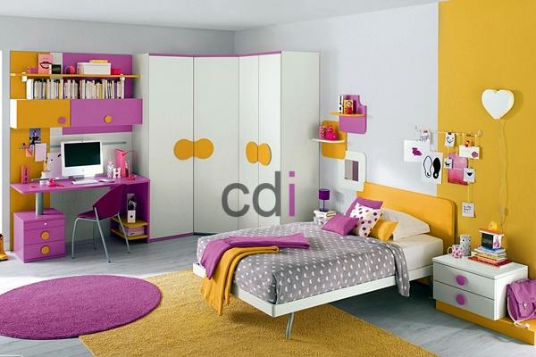

**Harga Lemari Pakaian Anak [Terbaru]** - Hai Mitra CDI! Gimana kabarnya? Membesarkan anak memang penuh tantangan ya. Selain mendidik dan memberikan kasih sayang, kita juga harus memenuhi kebutuhan mereka sehari-hari. Mulai dari makanan, perlengkapan sekolah, hingga perabotan kamar. Nah, salah satu perabot penting yang wajib ada di kamar anak adalah lemari pakaian. Dengan lemari pakaian, anak bisa belajar mandiri mengatur pakaiannya, dan kamarnya pun jadi lebih rapi.

Memilih lemari pakaian anak memang butuh pertimbangan. Ada banyak model dan harga yang ditawarkan. Jangan khawatir, kami dari Creative Design Interior (CDI) siap membantu Anda menemukan lemari pakaian anak yang paling sesuai dengan kebutuhan dan budget Anda di (not detected). Yuk, simak ulasan lengkapnya!

*Harga Lemari Pakaian Anak*

## Pilihan Model Lemari Anak yang Cocok untuk Si Kecil

Bingung mau pilih lemari anak yang mana? Tenang, kami punya beberapa rekomendasi yang bisa jadi inspirasi:

### 1. Lemari Anak dengan Banyak Rak

Model ini sangat praktis untuk memilah pakaian berdasarkan jenisnya. Celana di rak satu, baju di rak lain, sehingga anak lebih mudah menemukan pakaian yang diinginkan. Ini juga melatih mereka untuk mengatur barang-barang sendiri, lho!

### 2. Lemari Anak Model Minimalis (Menyesuaikan Dinding)

Ingin lemari yang awet dan bisa digunakan dalam jangka waktu lama? Model minimalis yang ukurannya menyesuaikan dinding kamar bisa jadi pilihan tepat. Lemari ini biasanya didesain simpel namun fungsional, cocok untuk kamar anak-anak di (not detected) yang memiliki luas terbatas. Misalnya, lebar kamar 3m, lemari bisa dibuat sepanjang 3m, bahkan dikombinasikan dengan rak buku atau meja belajar.

### 3. Lemari Anak Model *Built-In*

Lemari *built-in* sedang jadi favorit banyak orang tua. Dengan desain yang menyatu dengan dinding, lemari ini memberikan kesan rapi dan memaksimalkan ruang penyimpanan. Kalian akan lebih mudah mengatur berbagai jenis pakaian anak dengan model ini.

### 4. Lemari Pakaian Anak yang Multifungsi (Sekaligus Tempat Tidur)

Mau memaksimalkan ruang di kamar anak? Kalian bisa memilih lemari pakaian anak yang sekaligus berfungsi sebagai tempat tidur! Desainnya yang unik dan praktis pasti akan disukai anak-anak. Selain hemat tempat, model ini juga memberikan kesan kamar yang lebih kreatif dan menyenangkan.

## Kisaran Harga Lemari Pakaian Anak

Soal harga, tentu saja bervariasi tergantung model, ukuran, dan kualitas bahan. Semakin berkualitas bahan yang digunakan, umumnya semakin tinggi pula harganya. Untuk lemari pakaian anak dengan kualitas baik dan ukuran standar, harga mulai dari Rp. 2 jutaan.

Nah, bagaimana? Sudah punya gambaran lemari pakaian anak yang Anda inginkan? Jangan ragu untuk menghubungi kami untuk mendapatkan penawaran terbaik dan desain yang sesuai dengan selera Anda dan si kecil. Kami siap membantu mewujudkan kamar impian anak Anda di (not detected)!

Jangan tunda lagi, segera konsultasikan kebutuhan Anda dengan tim ahli kami. Produk yang kami tawarkan dibuat dengan material berkualitas dan desain yang menarik, sehingga tidak hanya tahan lama tetapi juga mempercantik tampilan kamar anak Anda. Kami juga menawarkan layanan custom, jadi Anda bisa mendapatkan lemari pakaian anak yang benar-benar sesuai dengan keinginan Anda. [Model Lemari Pakaian Anak yang Unik](/blog/model-lemari-pakaian-anak-yang-unik/) — yuk, intip inspirasi desainnya!