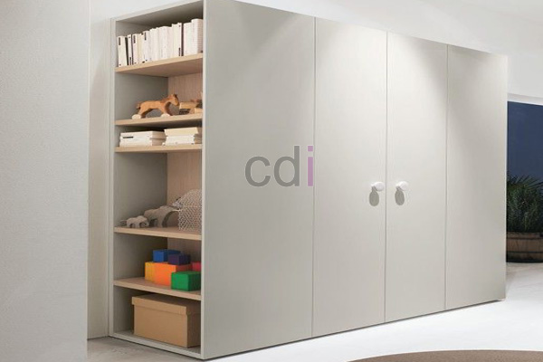

**5 Pertimbangan Saat Membeli Harga Lemari Pakaian Plastik** - Hai Mitra CDI! Pakaian berserakan dan lemari terasa penuh? Nah, itu masalah umum. Menyimpan pakaian dengan rapi dan efisien penting banget, lho. Salah satu solusinya adalah lemari pakaian plastik. Tapi, sebelum memutuskan membeli, ada beberapa hal yang perlu diperhatikan. Artikel ini akan memandu Mitra CDI dalam memilih lemari pakaian plastik yang tepat di (not detected).

### Menjelajahi Kisaran Harga Lemari Pakaian Plastik

Berbicara soal harga, lemari pakaian plastik punya rentang yang cukup lebar. Beberapa ratus ribu rupiah hingga jutaan, tergantung banyak faktor. Ukuran jelas berpengaruh, begitu juga kualitas bahan, desain yang dipilih, dan merek. Ingat, harga mahal belum tentu menjamin kualitas terbaik. Di artikel ini, Kami akan bantu Mitra memahami apa saja yang memengaruhi harga dan bagaimana memilih lemari yang pas dengan budget.

### 1. Ukuran dan Kapasitas: Sesuaikan dengan Kebutuhan

Hal pertama yang harus dipikirkan adalah ukuran lemari. Pertimbangkan luas ruangan di (not detected) dan seberapa banyak pakaian yang mau disimpan. Lemari plastik tersedia dalam berbagai ukuran, dari yang kecil untuk satu orang, sampai yang besar dengan banyak ruang. Pastikan ukurannya sesuai dengan ruangan dan cukup untuk menampung semua pakaian Mitra. Semakin besar lemari, biasanya harganya juga semakin tinggi.

Sebagai contoh, lemari pakaian plastik berukuran kecil (tinggi 180 cm, lebar 60 cm, kedalaman 45 cm) biasanya ada di kisaran Rp 300.000 – Rp 600.000. Untuk lemari berukuran besar (200 cm x 120 cm x 50 cm) bisa mencapai Rp 800.000 hingga Rp 1.500.000 atau lebih, tergantung fitur dan kualitas bahannya.

### 2. Kualitas Bahan Plastik: Investasi Jangka Panjang

Kualitas bahan plastik sangat menentukan daya tahan dan harga lemari. Bahan yang umum digunakan adalah polipropilen (PP) dan polietilen (PE). PP lebih kuat dan tahan lama daripada PE. Cari lemari yang bahannya cukup tebal supaya awet menahan beban pakaian tanpa mudah pecah atau melengkung.

Selain ketebalan, perhatikan juga apakah plastik tersebut punya perlindungan terhadap sinar UV. Paparan sinar matahari langsung bisa membuat plastik jadi rapuh dan warnanya pudar. Lemari berkualitas biasanya sudah dilapisi pelindung UV supaya lebih tahan lama.

### 3. Desain dan Fitur Tambahan: Pilih yang Sesuai Gaya Anda

Desain lemari juga memengaruhi harganya, lho. Lemari dengan desain rumit atau fitur tambahan seperti kunci, cermin, atau laci biasanya lebih mahal daripada yang sederhana. Pikirkan gaya interior ruangan di (not detected) dan pilih lemari yang cocok.

Berikut ini perbandingan desain dan fitur lemari pakaian plastik:

<table class="table">
  <caption>Perbandingan Desain dan Fitur Lemari Pakaian Plastik</caption>
  <thead>
    <tr><th>Desain/Fitur</th><th>Harga (Estimasi)</th><th>Kelebihan</th><th>Kekurangan</th></tr>
  </thead>
  <tbody>
    <tr><td>Lemari Standar (Rak dan Gantungan)</td><td>Rp 300.000 – Rp 600.000</td><td>Harga terjangkau, fungsi dasar terpenuhi</td><td>Pilihan desain terbatas</td></tr>
    <tr><td>Lemari dengan Laci</td><td>Rp 500.000 – Rp 1.000.000</td><td>Ruang penyimpanan tambahan, lebih rapi</td><td>Harga lebih mahal</td></tr>
    <tr><td>Lemari dengan Cermin</td><td>Rp 700.000 – Rp 1.200.000</td><td>Praktis untuk berdandan, memberi kesan ruangan lebih luas</td><td>Lebih berat dan rentan pecah</td></tr>
    <tr><td>Lemari dengan Kunci</td><td>Rp 600.000 – Rp 1.100.000</td><td>Keamanan lebih terjamin</td><td>Harga lebih mahal</td></tr>
  </tbody>
</table>

### 4. Reputasi Merek: Jaminan Kualitas dan Pelayanan

Merek lemari pakaian plastik bisa jadi indikator kualitas. Merek yang sudah lama dikenal biasanya punya standar kualitas lebih tinggi dan menawarkan garansi produk. Sebaiknya pilih merek yang punya reputasi baik dan banyak ulasan positif dari pelanggan lain. Untuk referensi lebih lanjut, Mitra juga bisa melihat artikel Kami tentang [Harga Custom Lemari Pakaian Di Abadijaya Depok]([/lemari/harga-custom-lemari-pakaian-di-abadijaya-depok/]) untuk perbandingan harga dan kualitas lemari custom.

Ingin tahu harga terbaru dan penawaran terbaik? Jangan ragu untuk menghubungi Kami! [Harga Custom Lemari Pakaian Di Balaraja](/lemari/harga-custom-lemari-pakaian-di-balaraja/) juga bisa jadi referensi menarik. Untuk konsultasi lebih lanjut, gunakan tombol **Telepon** atau **WhatsApp** yang ada di bawah halaman ini. Kami siap membantu Mitra CDI menemukan lemari pakaian plastik yang sempurna di (not detected)!