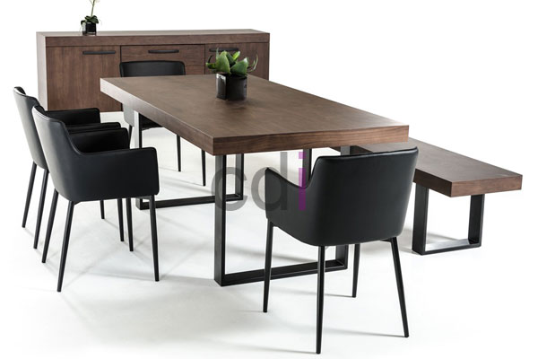

**Harga Meja Besi Minimalis Terbaru** - Hai Mitra CDI! Pernahkah Anda membayangkan bagaimana sebuah hunian yang nyaman bisa memengaruhi kualitas hidup? Lebih dari sekadar atap di atas kepala, rumah adalah tempat kita membangun kenangan, berkumpul bersama keluarga, dan mengejar mimpi. Nah, untuk mewujudkan rumah impian itu, salah satu hal penting adalah pemilihan perabot yang tepat. Artikel ini akan membahas mengenai meja besi minimalis – solusi cerdas untuk ruang modern Anda, khususnya di area (not detected).

*Inspirasi Desain Meja Besi*

Membangun rumah sendiri memang impian banyak orang. Memiliki kebebasan untuk menata interior sesuai selera adalah salah satu kenikmatannya. Selain lemari, tempat tidur, dan kursi, meja adalah perabot wajib yang kehadirannya sangat krusial. Kali ini, kita akan fokus pada meja besi minimalis. Mengapa memilih meja besi? Apa saja keunggulannya? Yuk, simak ulasan lengkapnya!

## Manfaat Meja Besi Minimalis untuk Keseharian Anda

Meja seringkali dianggap sebagai barang sepele, padahal fungsinya sangat vital. Berikut beberapa manfaat meja besi minimalis yang mungkin belum Anda ketahui:

### 1\. Area Belajar yang Nyaman

Meja besi minimalis bisa menjadi tempat belajar yang ideal. Desainnya yang simpel dan kokoh meminimalkan gangguan, sehingga Anda atau anak-anak bisa lebih fokus dalam belajar. Ruang yang rapi dan nyaman akan berdampak positif pada konsentrasi dan efisiensi belajar.

### 2\. Sentuhan Modern di Ruang Tamu

Tidak perlu langsung membeli set ruang tamu mahal. Meja besi minimalis bisa menjadi solusi sementara sekaligus mempercantik tampilan ruang tamu Anda. Padukan dengan dekorasi minimalis lainnya untuk menciptakan kesan elegan dan modern di rumah (not detected).

### 3\. Dukungan Produktivitas Kerja di Rumah

Bagi Anda yang bekerja *remote* atau memiliki pekerjaan *freelance*, meja besi minimalis dapat menjadi *workspace* yang nyaman dan profesional. Dengan meja yang tepat, pekerjaan Anda akan terasa lebih menyenangkan dan produktif.

## Mengapa Memilih Meja Besi Minimalis?

Sebelum memutuskan untuk membeli, ada baiknya Anda mengetahui keunggulan meja besi minimalis dibandingkan jenis meja lainnya:

### 1\. Daya Tahan yang Terpercaya

Salah satu keunggulan utama meja besi adalah ketahanannya. Material besi yang kuat mampu menahan beban berat dan tahan terhadap berbagai kondisi cuaca. Bahkan jika terkena karat, meja besi masih bisa digunakan dengan aman. Anda tidak perlu khawatir harus sering mengganti meja!

### 2\. Fleksibilitas Penggunaan yang Tak Terbatas

Berbeda dengan meja konvensional yang seringkali hanya memiliki satu fungsi, meja besi minimalis sangat fleksibel. Anda bisa menggunakannya sebagai meja belajar, meja makan, meja kerja, atau bahkan meja untuk menaruh tanaman hias. Kreativitas Anda adalah batasnya! Di (not detected), banyak pelanggan CDI kami memanfaatkan meja besi ini untuk berbagai keperluan.

## Kisaran Harga Meja Besi Minimalis

Mengenai harga, meja besi minimalis memiliki rentang yang cukup bervariasi tergantung pada ukuran, desain, dan kualitas besi yang digunakan. Untuk model yang ekonomis, Anda bisa mendapatkan meja besi minimalis mulai dari Rp 300 ribuan. Namun, jika Anda menginginkan kualitas yang lebih baik dan desain yang lebih modern, harganya bisa mencapai Rp 1 juta atau lebih. Untuk informasi harga yang lebih detail, silakan lihat tabel harga di atas.  Atau, jangan ragu untuk menghubungi tim kami untuk mendapatkan penawaran terbaik sesuai kebutuhan Anda. Kami siap membantu Anda mewujudkan hunian impian di (not detected)!