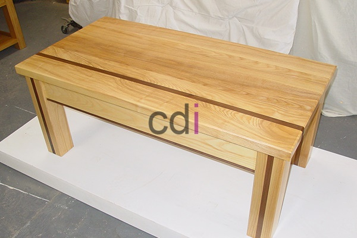

**Harga Meja Jati Belanda Terbaru** - Hai Mitra CDI! Apakah Anda sedang mencari perabot yang fungsional sekaligus memberikan sentuhan alami pada ruangan? Meja adalah elemen penting dalam setiap rumah. Ia bukan hanya permukaan untuk meletakkan barang, tapi juga bagian integral dari desain interior yang tertata. Baik meja berukuran kecil maupun besar, keberadaannya selalu dibutuhkan.

Di (not detected), semakin banyak orang memilih meja berbahan kayu jati Belanda untuk melengkapi rumah mereka. Terutama bagi Anda yang memiliki anggaran menengah ke bawah, kayu jati Belanda menawarkan solusi ideal. Yuk, kita cari tahu apa saja yang membuat meja ini begitu digemari!

## Mengapa Memilih Meja Kayu Jati Belanda?

### 1. Investasi Cerdas dengan Harga Terjangkau

Bagi Mitra yang tengah memikirkan anggaran, harga adalah faktor penting. Meja dari kayu jati Belanda dikenal lebih bersahabat di kantong dibandingkan meja dari kayu jati lainnya yang cenderung lebih mahal.

Mengapa demikian? Kayu jati Belanda memiliki siklus pertumbuhan yang lebih cepat. Artinya, masa panen lebih singkat, sehingga ketersediaannya lebih tinggi dan harganya lebih terjangkau. Ini menjadi keuntungan bagi Anda yang ingin mendapatkan meja berkualitas tanpa harus menguras dompet.

### 2. Warna Alami yang Menawan

Selain harga, meja jati Belanda juga memikat karena warnanya yang lebih cerah. Warna ini memberikan kesan hangat dan menyegarkan pada ruangan Anda. 

Meja jati Belanda sangat cocok untuk Anda yang menerapkan konsep rumah cerah dan minimalis. Perabot ini akan menyatu sempurna dan memperkuat estetika ruangan. Walaupun begitu, jika Anda memiliki dekorasi rumah yang lebih gelap, meja ini tetap bisa menjadi pilihan menarik, tergantung pada preferensi pribadi Anda.

### 3. Keunikan Tekstur Mata Kayu

Salah satu ciri khas kayu jati adalah adanya mata kayu. Meskipun sebagian orang mungkin menganggapnya kekurangan, bagi yang lain, mata kayu justru menambah karakter dan keunikan pada perabot. 

Jika Anda menyukai tampilan alami dan tekstur yang berbeda pada setiap produk, meja jati Belanda adalah pilihan yang tepat. Setiap meja memiliki pola mata kayu yang unik, menjadikannya karya seni tersendiri.

### 4. Ringan dan Mudah Dipindahkan

Memiliki meja yang mudah dipindahkan adalah keuntungan tersendiri, terutama jika Anda suka menata ulang ruangan atau sering berpindah tempat tinggal. 

Meja jati Belanda memiliki bobot yang lebih ringan dibandingkan jenis kayu jati lainnya dengan ukuran yang sama. Ini membuatnya lebih mudah untuk diangkat dan dipindahkan, sesuai dengan kebutuhan Anda. Namun, perlu diingat bahwa kekokohan meja ini mungkin tidak sebanding dengan kayu jati yang lebih berat.

Dengan berbagai keunggulan tersebut, tak heran jika semakin banyak orang yang memilih meja jati Belanda untuk hunian mereka. Di (not detected), Anda bisa mendapatkan meja jati Belanda berkualitas sesuai dengan desain yang Anda inginkan. Kami siap membantu mewujudkan interior impian Anda!

## Kisaran Harga Meja Jati Belanda di (not detected)

Harga meja jati Belanda di (not detected) bervariasi, tergantung pada ukuran dan model yang Anda pilih. Secara umum, kisarannya dimulai dari Rp 150.000 hingga Rp 5.000.000. Harga Rp 150.000 biasanya untuk meja kecil yang ideal untuk lesehan atau sebagai meja belajar anak, dengan ukuran sekitar 90cm x 40cm. Sementara itu, harga Rp 5.000.000 biasanya untuk meja makan berukuran besar yang dapat menampung hingga 6 orang, atau untuk kebutuhan restoran dan warung makan.

Anda bisa menemukan meja jati Belanda di toko furniture terdekat atau langsung memesannya kepada kami dengan desain yang Anda inginkan. Jangan ragu untuk menghubungi kami untuk informasi lebih lanjut dan penawaran terbaik!