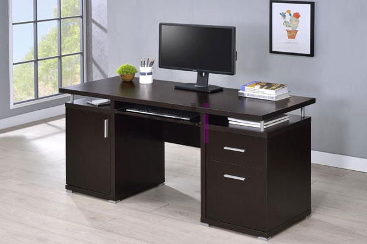

**Harga Meja Komputer Minimalis** - Hai Mitra CDI! Di era digital ini, komputer sudah jadi bagian tak terpisahkan dari keseharian kita. Mulai dari bekerja, belajar, hingga mencari penghasilan tambahan, komputer menawarkan kemudahan yang luar biasa. Nah, bagi Anda yang sering bekerja atau menghabiskan waktu di depan komputer, penting banget untuk menciptakan ruang kerja yang nyaman dan efisien. Salah satu kuncinya? Memilih meja komputer yang tepat! Meja komputer yang didesain dengan baik bisa meningkatkan produktivitas dan kenyamanan Anda saat bekerja. Gimana, yuk simak lebih lanjut!

*Meja Komputer Minimalis untuk Ruang Kerja yang Optimal*

## Mengapa Anda Perlu Meja Komputer Khusus?

Sebenarnya, apa sih kelebihan menggunakan meja komputer khusus dibandingkan meja biasa? Berikut beberapa alasannya:

### 1. Kenyamanan Optimal

Pernahkah Anda merasa tidak nyaman saat bekerja di depan komputer dengan meja biasa? Posisi yang kurang ergonomis bisa menyebabkan pegal linu dan gangguan kesehatan lainnya. Meja komputer dirancang khusus untuk memastikan postur tubuh yang baik dan nyaman saat bekerja. Dengan meja yang tepat, Anda bisa bekerja berjam-jam tanpa merasa lelah.

### 2. Desain Lebih Efisien dan Rapi

Meja komputer biasanya dilengkapi dengan fitur-fitur yang mendukung kebutuhan Anda, seperti *keyboard tray*, tempat kabel, dan rak untuk penyimpanan. Fitur-fitur ini membantu Anda mengatur ruang kerja dengan lebih efisien dan rapi. Tidak ada lagi kabel yang berantakan atau barang-barang yang berserakan di meja.

### 3. Daya Tahan yang Terjamin

Meja komputer yang berkualitas baik biasanya dibuat dari bahan yang kuat dan tahan lama, seperti kayu solid, baja, atau *particle board* berkualitas tinggi. Dengan perawatan yang tepat, meja komputer Anda bisa bertahan bertahun-tahun tanpa perlu diganti. Pastikan Anda memilih material yang sesuai dengan kebutuhan dan budget Anda.

## Kisaran Harga Meja Komputer Minimalis di (not detected)

Popularitas meja komputer minimalis terus meningkat, seiring dengan semakin banyaknya orang yang bekerja dan belajar dari rumah. Ini juga membuka peluang bisnis yang menarik bagi para pengusaha furnitur. Nah, kalau Anda tertarik untuk membeli meja komputer minimalis di (not detected), berikut adalah perkiraan harganya.

Harga meja komputer minimalis sangat bervariasi, tergantung pada beberapa faktor, seperti bahan, ukuran, desain, dan fitur tambahan. Secara umum, meja komputer kayu memiliki harga yang lebih terjangkau dibandingkan meja komputer besi. Meja kayu berkualitas dengan finishing yang rapi bisa Anda dapatkan mulai dari 1 juta rupiah hingga 3 juta rupiah.

Sementara itu, meja komputer besi menawarkan daya tahan dan estetika yang lebih modern. Namun, harganya juga cenderung lebih mahal, mulai dari 1,5 juta rupiah hingga 4 juta rupiah atau lebih. Perlu diingat bahwa meja besi rentan terhadap karat jika terkena air, jadi pastikan Anda merawatnya dengan baik.

Butuh konsultasi lebih lanjut terkait pilihan meja komputer yang tepat untuk kebutuhan Anda? Atau ingin tahu lebih detail tentang  yang sedang kami tawarkan? Jangan ragu untuk menghubungi tim kami sekarang juga! Kami siap membantu Anda menemukan meja komputer impian Anda di (not detected). Kami berpengalaman melayani pelanggan di (not detected) dan sekitarnya. Jangan tunda lagi, ciptakan ruang kerja yang nyaman dan produktif dengan meja komputer minimalis dari CDI! [Harga Custom Meja Komputer Di Bedahan Depok](/meja/harga-custom-meja-komputer-di-bedahan-depok/) atau [Harga Custom Meja Komputer Di Bantar Gebang Bekasi](/meja/harga-custom-meja-komputer-di-bantar-gebang-bekasi/) bisa jadi referensi tambahan untuk Anda.

<table class="table">
  <caption>Perbandingan Material Meja Komputer</caption>
  <thead>
    <tr><th>Material</th><th>Kelebihan</th><th>Kekurangan</th><th>Kisaran Harga</th></tr>
  </thead>
  <tbody>
    <tr><td>Kayu Solid</td><td>Tahan lama, Estetik, Kuat</td><td>Perawatan ekstensif, Rentan terhadap serangga</td><td>Rp 1.000.000 - Rp 3.000.000</td></tr>
    <tr><td>Besi</td><td>Kuat, Modern, Anti-rayap</td><td>Rentan karat, Berat, Dapat terasa dingin</td><td>Rp 1.500.000 - Rp 4.000.000</td></tr>
    <tr><td>Particle Board</td><td>Terjangkau, Ringan, Pilihan warna banyak</td><td>Tidak tahan air, Mudah rusak jika terkena benturan</td><td>Rp 500.000 - Rp 1.500.000</td></tr>
  </tbody>
</table>
