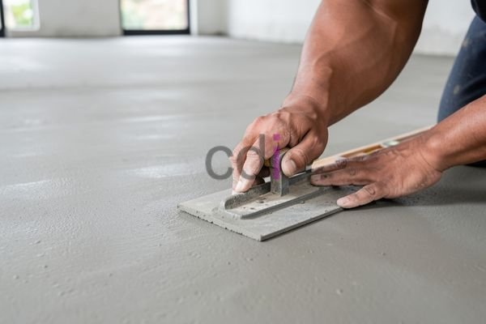

**Harga Rabatan Lantai Per M2: Panduan Lengkap & Estimasi Biaya 2026** - Hai Mitra CDI! Sedang memikirkan bagaimana memberikan sentuhan unik dan tahan lama pada lantai properti Anda di (not detected)? Lantai rabatan bisa jadi jawabannya! Permukaan lantai yang satu ini menawarkan kesan artistik sekaligus kokoh, bisa jadi investasi yang tepat untuk rumah atau bisnis Anda.

Lantai rabatan, yang juga dikenal sebagai *exposed aggregate concrete*, semakin digemari karena daya tahannya, kemudahan perawatannya, dan tampilan visual yang menarik. Tentunya, memahami **harga rabatan lantai per m2** menjadi hal utama sebelum Anda memutuskan untuk menggunakannya. Artikel ini akan memandu Anda melalui faktor-faktor yang memengaruhi harga, berbagai jenis rabatan yang ada, serta perkiraan biaya yang perlu Anda siapkan.

## Apa Saja yang Mempengaruhi Biaya Rabatan Lantai?

Ada beberapa hal penting yang memengaruhi besaran biaya yang perlu Anda keluarkan untuk rabatan lantai. Mengetahui faktor-faktor ini akan membantu Anda merencanakan anggaran proyek dengan lebih akurat.

Pertama, jenis agregat yang dipilih sangat berpengaruh. Agregat alami seperti kerikil sungai atau batu pecah cenderung lebih ekonomis dibandingkan material premium seperti marmer, granit, atau batuan khusus lainnya. Kemudian, desain pola dan tekstur juga punya peran. Semakin detail dan rumit pola yang Anda inginkan, semakin banyak waktu dan keahlian yang dibutuhkan – dan ini tentu memengaruhi biaya. Luas area yang akan dikerjakan juga langsung proporsional dengan total biaya. Semakin luas, semakin besar pula biaya material dan upah yang dibutuhkan.

Selain itu, kondisi lantai dasar juga penting diperhatikan. Jika lantai memerlukan perbaikan atau perataan sebelum rabatan dipasang, ada biaya tambahan yang perlu dianggarkan. Terakhir, biaya transportasi material ke (not detected) dan tarif tenaga kerja juga bisa bervariasi. Jangan ragu untuk meminta detail penawaran harga untuk mendapatkan gambaran yang jelas.

## Pilihan Jenis Rabatan Lantai dan Perkiraan Biayanya

Ada banyak pilihan jenis rabatan lantai yang bisa disesuaikan dengan gaya dan anggaran Anda. Berikut beberapa opsi populer beserta estimasi biayanya:

*   **Rabatan Batu Kali:** Material ini menawarkan tampilan alami dan harga yang relatif ramah di kantong. Biasanya berkisar antara Rp 180.000 – Rp 300.000 per m2 (termasuk material dan jasa pemasangan).
*   **Rabatan Batu Pecah:** Dengan pecahan batu sebagai agregat, jenis ini menawarkan daya tahan yang baik dan variasi warna yang lebih menarik. Harganya sedikit lebih tinggi, yaitu antara Rp 250.000 – Rp 400.000 per m2.
*   **Rabatan Marmer:** Pilihan yang tepat jika Anda menginginkan tampilan mewah dan elegan. Namun, harganya tentu lebih mahal, yaitu Rp 450.000 – Rp 700.000 per m2.
*   **Rabatan Granit:** Memberikan kesan kuat dan tahan lama dengan perawatan minimal. Harganya sebanding dengan rabatan marmer, yaitu Rp 400.000 – Rp 650.000 per m2.

Sebagai catatan, estimasi biaya di atas bersifat perkiraan dan dapat berubah tergantung lokasi proyek, penyedia jasa, dan spesifikasi detail yang Anda inginkan. Untuk informasi harga terkini, Kami sarankan untuk menghubungi Kami langsung untuk mendapatkan penawaran yang sesuai dengan kebutuhan proyek Anda di (not detected).

## Bedah Material Rabatan: Kelebihan, Kekurangan, dan Biaya – Mana yang Terbaik?

Berikut adalah tabel perbandingan yang akan membantu Anda mempertimbangkan pilihan material yang tepat:

<table class="table">
  <caption>Perbandingan Material Rabatan Lantai</caption>
  <thead>
    <tr><th>Material</th><th>Kelebihan</th><th>Kekurangan</th><th>Estimasi Biaya (per m2)</th></tr>
  </thead>
  <tbody>
    <tr><td>Batu Kali</td><td>Harga terjangkau</td><td>Kurang tahan terhadap abrasi, Pilihan warna terbatas</td><td>Rp 180.000 – Rp 300.000</td></tr>
    <tr><td>Batu Pecah</td><td>Tahan lama, Pilihan warna lebih beragam</td><td>Permukaan lebih kasar, Membutuhkan perawatan lebih</td><td>Rp 250.000 – Rp 400.000</td></tr>
    <tr><td>Marmer</td><td>Tampilan mewah, Pilihan warna dan pola beragam</td><td>Harga mahal, Membutuhkan perawatan khusus</td><td>Rp 450.000 – Rp 700.000</td></tr>
    <tr><td>Granit</td><td>Sangat tahan lama, Minim perawatan, Tampilan elegan</td><td>Harga mahal, Pemasangan lebih rumit</td><td>Rp 400.000 – Rp 650.000</td></tr>
  </tbody>
</table>

## Tips Jitu Memilih Jasa Pemasangan Rabatan Lantai

Setelah Anda menentukan jenis rabatan yang diinginkan, penting untuk memilih penyedia jasa yang kompeten dan terpercaya. Ini beberapa hal yang perlu Anda perhatikan:

Pertama, telusuri portofolio mereka. Perhatikan proyek-proyek rabatan lantai yang pernah mereka kerjakan untuk menilai kualitas hasil pekerjaan mereka. Kedua, bandingkan beberapa penawaran harga dari penyedia jasa yang berbeda. Jangan hanya terpaku pada harga, tapi perhatikan juga apa saja yang termasuk dalam penawaran tersebut. Ketiga, cari tahu reputasi mereka. Cek ulasan *online* atau minta rekomendasi dari teman atau kerabat. Keempat, pastikan mereka memiliki izin usaha yang jelas dan menawarkan garansi atas pekerjaan yang dilakukan. Jangan lupa, pertimbangkan juga layanan konsultasi dan dukungan purna jual yang mereka tawarkan. Anda juga bisa mencari tahu lebih lanjut mengenai [Bekisting Plat Lantai: Panduan Lengkap Material, Aplikasi, dan Estimasi Biaya 2026](/blog/bekisting-plat-lantai/) untuk memahami lebih jauh proses konstruksi lantai.

Kami dari CDI siap membantu Anda mewujudkan lantai rabatan impian Anda! Silakan hubungi Kami melalui tombol **Telepon** atau **WhatsApp** di bawah untuk konsultasi gratis dan penawaran terbaik di (not detected).