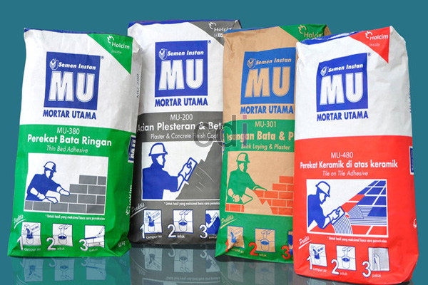

**Harga Semen Buat Hebel Terbaru 2026: Panduan Lengkap dan Estimasi Biaya** - Hai Mitra CDI! Sedang merencanakan pembangunan dengan dinding hebel tapi bingung soal biaya? Salah satu komponen penting yang perlu diperhatikan adalah harga semen. Fluktuasi harga material ini seringkali bikin perencanaan anggaran jadi rumit. Nah, di artikel ini kami akan kupas tuntas panduan lengkap harga semen buat hebel, lengkap dengan estimasi biaya yang perlu Anda siapkan.

## Mengapa Semen Jadi Kunci dalam Pemasangan Hebel?

Hebel, atau *Autoclaved Aerated Concrete* (AAC), makin jadi favorit karena ringan, presisi, dan hemat energi. Tapi ingat, pemasangan hebel butuh lebih dari sekadar menumpuk batanya saja. Semen berperan vital sebagai 'perekat' yang menyatukan setiap blok hebel menjadi dinding kokoh. Semen digunakan untuk membuat mortar, adukan yang mengisi celah antar blok dan menciptakan ikatan yang kuat. Memilih jenis semen yang tepat akan memengaruhi kekuatan dan umur dinding hebel Anda.

Adukannya sendiri butuh proporsi pas antara semen, pasir, dan air. Umumnya, rasio 1:3 atau 1:4 (semen:pasir) masih jadi andalan, meski sebaiknya cek rekomendasi pabrikan semen yang Anda gunakan. Partikel semen yang halus akan bikin mortar lebih mudah diaplikasikan dan daya rekatnya lebih bagus. Jangan lupa, pastikan semen yang dipilih sudah bersertifikasi SNI ya, Mitra!

## Apa Saja yang Memengaruhi Harga Semen Buat Hebel?

Harga semen buat hebel itu dinamis, alias mudah berubah. Ada beberapa hal yang jadi pemicunya. Pertama, **jenis semen** yang Anda pilih. Ada semen Portland (PC), semen Portland Komposit (PCC), dan semen khusus. Semen PCC biasanya lebih hemat di kantong, tapi soal kekuatan dan daya tahan, mungkin ada sedikit perbedaan dengan PC.

Kedua, **merek semen**. Masing-masing merek punya harga berbeda, tergantung kualitas, reputasi, dan jaringan distribusi mereka. Merek yang sudah terkenal biasanya menjamin kualitas, tapi harganya juga sesuai.

Ketiga, **lokasi geografis**. Harga semen bisa beda-beda tiap daerah karena biaya transportasi dan ketersediaan barang. Semakin jauh lokasinya, biasanya harganya lebih mahal.

Keempat, **jumlah pembelian**. Beli dalam jumlah besar biasanya bisa dapat diskon khusus. Jadi, kalau proyeknya besar, pertimbangkan untuk beli sekaligus biar lebih hemat.

## Kalkulasi Biaya: Estimasi Harga Semen dan Total Biaya Pemasangan

Yuk, kita hitung perkiraan biaya semen untuk dinding hebel seluas 10 meter persegi dengan tinggi 3 meter. Kita anggap tebal dindingnya 10 cm ya.

Untuk dinding seluas 10 m² x tinggi 3 m, total luasnya jadi 30 m². Kalau kita pakai blok hebel standar ukuran 7.5 cm x 20 cm x 60 cm, kira-kira butuh sekitar 250 blok.

Untuk memasang 250 blok itu, mortar yang dibutuhkan sekitar 0.25 – 0.3 meter kubik. Anggap saja kita pakai rasio adukan 1:3 (semen:pasir) dan butuh 7 sak semen (50 kg/sak) per meter kubik mortar. Jadi, total semen yang diperlukan adalah sekitar 1.75 sak sampai 2.1 sak.

Dengan harga semen PCC per sak (50 kg) sekitar Rp 40.000 – Rp 50.000 (ingat, harga ini estimasi dan bisa berubah sewaktu-waktu ya – untuk penawaran akurat sesuai proyek Anda di (not detected), hubungi Kami untuk info terkini), maka biaya semennya jadi: 1.75 sak x Rp 40.000 = Rp 70.000 sampai 2.1 sak x Rp 50.000 = Rp 105.000.

Ingat, biaya ini belum termasuk harga pasir, air, dan upah tukang. Secara garis besar, biaya pemasangan dinding hebel per meter persegi bisa bervariasi antara Rp 80.000 – Rp 150.000, tergantung desain, lokasi, dan harga material di (not detected).

## Tips Jitu Memilih Semen Terbaik untuk Hebel Anda

Memilih semen yang tepat itu krusial banget demi keamanan dan kekuatan dinding hebel Anda. Berikut tips yang bisa Anda terapkan:

*   **Prioritaskan Mutu Semen:** Selalu pilih semen yang sudah bersertifikasi SNI. Semen bermutu tinggi memang sedikit lebih mahal, tapi investasinya sepadan dengan kekuatan dan umur bangunannya.
*   **Ikuti Rekomendasi Produsen Hebel:** Untuk hasil optimal, konsultasikan dengan produsen hebel untuk mengetahui jenis semen terbaik yang cocok dengan produk mereka.
*   **Cek Tanggal Produksi:** Pastikan semen masih dalam masa kadaluarsanya. Semen yang sudah lama disimpan berpotensi kehilangan kualitas.
*   **Lakukan Perbandingan Harga:** Bandingkan harga di beberapa toko material bangunan untuk mendapatkan penawaran terbaik, terutama di area (not detected).
*   **Pertimbangkan Aditif Mortar:** Menambahkan aditif mortar bisa meningkatkan kualitas adukan, seperti daya rekat, kemudahan pengerjaan, dan ketahanan terhadap retakan.

Kami siap membantu Anda mewujudkan proyek impian Anda! Jangan ragu untuk menghubungi Kami melalui tombol **Telepon** atau **WhatsApp** yang tersedia di bawah ini untuk konsultasi dan penawaran terbaik. [Berapa Harga Buat Kitchen Cabinet? Estimasi Biaya & Tips 2026](/blog/harga-buat-kitchen-cabinet/) — Mungkin Anda juga tertarik dengan perkiraan biaya kitchen cabinet untuk melengkapi rumah impian Anda. [Atap Bondek Cor: Panduan Lengkap Kekuatan, Pemasangan, dan Estimasi Biaya 2026](/blog/atap-bondek-cor/) — Atau ingin tahu lebih lanjut tentang pilihan atap yang tahan lama dan ringan?