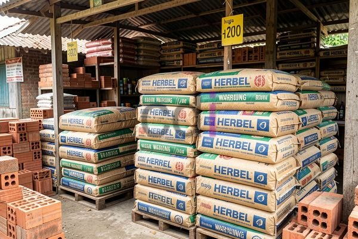

**Harga Semen Herbal Terbaru: Panduan Lengkap untuk Proyek Konstruksi Anda** - Hai Mitra CDI! Mencari tahu harga semen herbal terkini penting banget, kan, untuk perencanaan proyek konstruksi? Artikel ini hadir untuk memberikan panduan lengkap soal faktor yang memengaruhi harga, berbagai jenis semen herbal yang tersedia, dan perkiraan biaya yang perlu Anda siapkan. Yuk, simak selengkapnya!

## Mengapa Semen Herbal Jadi Pilihan Utama?

Semen herbal, atau semen dengan tambahan formula khusus untuk performa yang lebih baik, semakin banyak dipilih oleh para profesional konstruksi dan pemilik rumah. Kelebihannya? Proses pengerasan yang lebih cepat, kekuatan beton meningkat, dan potensi retak berkurang. Ini semua krusial untuk memastikan bangunan Anda kokoh dan awet. Beberapa jenis bahkan menawarkan ketahanan ekstra terhadap korosi dan serangan sulfat, ideal untuk kondisi tanah yang kurang bersahabat.

Mungkin Anda bertanya, kenapa harus semen herbal dibanding semen Portland biasa? Sederhana saja: jika proyek Anda butuh kekuatan beton yang lebih tinggi, waktu pengerjaan yang lebih efisien, atau perlindungan khusus terhadap lingkungan tertentu, semen herbal adalah solusinya.

## Apa Saja yang Mempengaruhi Harga Semen Herbal?

Harga semen herbal itu dinamis, tidak tetap. Ada beberapa faktor yang bikin harganya bisa naik turun. Pertama, jenis semen herbalnya. Formula khusus untuk aplikasi tertentu – misalnya semen *waterproofing* atau *self-leveling* – umumnya lebih mahal daripada jenis standar.

Kedua, merek semen. Merek yang sudah mapan di pasaran biasanya menawarkan kualitas yang lebih terjamin, namun seringkali dengan harga yang sedikit lebih tinggi. Ketiga, lokasi. Biaya transportasi dan ketersediaan bahan baku di daerah Anda bisa berpengaruh signifikan. Keempat, hukum pasar – permintaan dan penawaran. Saat permintaan konstruksi tinggi, harga semen cenderung ikut naik.

Sebagai patokan, harga semen herbal saat ini (Oktober) berkisar antara Rp 55.000 hingga Rp 75.000 per zak 50 kg, tergantung merek dan lokasi pembelian. Ini hanyalah angka estimasi ya, bisa berubah sewaktu-waktu. Untuk penawaran harga paling akurat dan sesuai dengan proyek Anda, silakan hubungi Kami. 

## Bedah Harga dan Keunggulan Setiap Jenis Semen Herbal

Berikut ini perbandingan beberapa jenis semen herbal yang populer di Indonesia:

*   **Semen Portland Komposit (PCC):** Harganya relatif terjangkau, sekitar Rp 55.000 - Rp 65.000 per zak. Keunggulannya? Lebih ramah lingkungan karena menggunakan *fly ash* atau *slag* sebagai pengganti sebagian semen Portland.
*   **Semen *Waterproofing*:** Harganya sedikit lebih tinggi, sekitar Rp 60.000 - Rp 70.000 per zak. Pilihan tepat untuk area yang sering terkena air, seperti kamar mandi, dapur, atau bagian fondasi.
*   **Semen *Self-Leveling*:** Harganya paling mahal, sekitar Rp 70.000 - Rp 80.000 per zak. Cocok banget buat bikin lantai yang rata sempurna tanpa perlu banyak proses perataan manual.
*   **Semen *High Early Strength*:** Harganya menengah, sekitar Rp 65.000 - Rp 75.000 per zak. Ingin pekerjaan konstruksi lebih cepat? Semen ini punya kemampuan pengerasan yang super cepat.

Memilih jenis semen herbal yang paling sesuai dengan kebutuhan proyek Anda itu penting. Pertimbangkan baik-baik anggaran yang tersedia dan kualitas yang Anda butuhkan sebelum memutuskan. Jangan ragu untuk berkonsultasi dengan ahli!

## Perkiraan Biaya Proyek dengan Semen Herbal

Ambil contoh, kita mau menghitung perkiraan biaya untuk membangun pondasi rumah tipe 45. Kita asumsikan Anda membutuhkan 20 zak semen herbal, dengan harga rata-rata Rp 65.000 per zak. Jadi, total biaya untuk semen adalah 20 zak x Rp 65.000 = Rp 1.300.000.

Perlu diingat, angka ini belum termasuk biaya transportasi, upah tukang, dan material lain seperti pasir, kerikil, serta besi beton. Secara keseluruhan, biaya pembangunan pondasi rumah tipe 45 dengan menggunakan semen herbal bisa mencapai Rp 5.000.000 hingga Rp 10.000.000, tergantung desain dan harga material di (not detected).

Angka ini hanyalah estimasi kasar. Untuk perhitungan yang lebih akurat, sebaiknya berkonsultasi dengan profesional konstruksi. Atau, Anda bisa langsung menghubungi Kami untuk mendapatkan penawaran harga yang disesuaikan dengan kebutuhan spesifik proyek Anda di (not detected).

Ada pertanyaan lebih lanjut? Jangan sungkan! Hubungi Kami melalui tombol **WhatsApp** atau **Telepon** yang ada di halaman ini. Kami siap membantu Anda!  [Adhimix Precast Cikarang: Solusi Konstruksi Cepat dan Efisien untuk Proyek Anda](/blog/adhimix-precast-cikarang/)