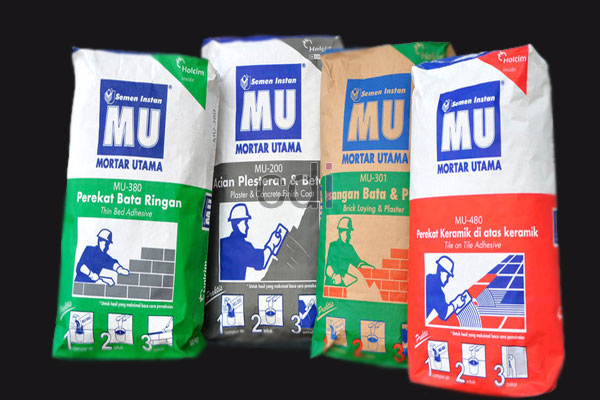
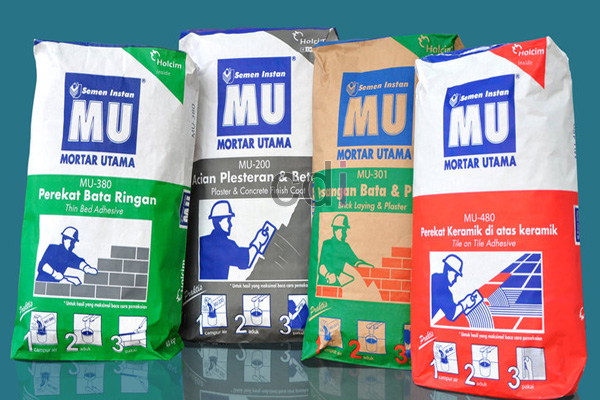

**Harga Semen Perekat Hebel** - Hai Mitra CDI! Sedang merencanakan pembangunan atau renovasi rumah di (not detected)? Penggunaan hebel atau bata ringan semakin populer, lho! Selain efisien biaya, hebel menawarkan keunggulan lain seperti presisi tinggi, kemampuan meredam panas, dan juga suara. Tentunya, ada banyak keuntungan lainnya, termasuk efisiensi dalam pengerjaan karena tidak memerlukan adukan pasir sebagai perekat. Nah, proses pemasangan hebel ini sedikit berbeda dengan pemasangan batu bata, terutama pada material adukan atau plester yang digunakan.

*Pilihan Merk Semen Perekat Hebel Terbaik*

## Berapa Sih Harga Semen Perekat Hebel?

Berbeda dengan pemasangan batu bata yang membutuhkan campuran semen dan pasir, pemasangan hebel cukup menggunakan semen khusus – yaitu semen instan atau mortar. Solusi ini sangat praktis dan mempercepat proses pemasangan karena tidak memerlukan tambahan pasir atau material lainnya. 

Cukup tambahkan air secukupnya hingga adonan tercampur rata dan siap digunakan untuk memasang hebel. Salah satu merek semen instan yang paling dikenal adalah Mortar Utama atau MU. Namun, perlu diingat, semen instan MU memiliki berbagai jenis dengan harga yang bervariasi, tergantung pada fungsinya. Ada yang dirancang khusus untuk dinding, lantai, bahkan pemasangan keramik. Jadi, pastikan Anda memilih jenis yang tepat sesuai kebutuhan proyek Anda di (not detected).

Untuk keperluan dinding, ada beberapa pilihan semen MU yang tersedia, seperti semen untuk pemasangan batu bata, semen khusus untuk bata ringan atau hebel, dan juga semen untuk plesteran. Berikut adalah detail daftar harganya:

<table style="text-align: center; height: 736px;" border="1" width="100%" cellspacing="0" cellpadding="3"><tbody><tr><td>
<strong>Produk</strong>
</td><td>
<strong>Fungsi</strong>
</td><td>
<strong>Harga /sak</strong>
</td></tr><tr><td><em>MU-300</em></td><td><em>digunakan untuk pasangan bata</em></td><td><em>Rp 51.500,- /40kg</em></td></tr><tr><td><em>MU-380</em></td><td><em>digunakan untuk perekat bata ringan</em></td><td><em>Rp 160.000,- /40kg</em></td></tr><tr><td><em>MU-301</em></td><td><em>digunakan untuk pasangan bata dan plesteran</em></td><td><em>Rp 58.500,- /40kg</em></td></tr><tr><td><em>MU-100</em></td><td><em>digunakan untuk plester premium</em></td><td><em>Rp 62.500,- /40kg</em></td></tr><tr><td><em>MU-200</em></td><td><em>digunakan untuk acian plester dan beton</em></td><td><em>Rp 160.000,- /40kg</em></td></tr><tr><td><em>MU-260</em></td><td><em>digunakan untuk acian profil</em></td><td><em>Rp 200.000,- /40kg</em></td></tr><tr><td><em>MU-270</em></td><td><em>digunakan untuk acian putih</em></td><td><em>Rp 157.000,- /25kg</em></td></tr></tbody></table>

Daftar harga di atas merupakan referensi harga semen perekat hebel atau semen instan dari merek Mortar Utama. Harga dapat bervariasi tergantung lokasi dan toko material di (not detected). Untuk kebutuhan lantai dan keramik, tersedia produk MU lain dengan harga yang berbeda. Kami sarankan untuk selalu mengecek harga terkini di toko material terdekat. Untuk info lebih detail mengenai harga dan ketersediaan produk, Anda juga bisa langsung menghubungi tim kami, ya! [Hubungi Kami](URL_KONTAK) – dengan senang hati kami akan membantu Anda. [Jual Hebel Bata Ringan di Ancol Jakarta Gratis Ongkir](/hebel/jual-hebel-bata-ringan-di-ancol-jakarta-gratis-ongkir/) bisa jadi referensi tambahan, lho!