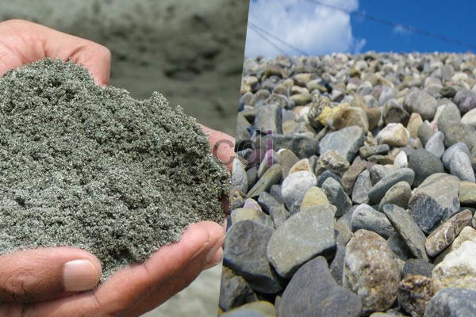

**Inilah Contoh Bahan Bangunan Struktural** - Hai Mitra CDI! Pernahkah Anda bertanya-tanya, apa saja sih komponen penting yang membuat sebuah bangunan kokoh dan aman? Nah, artikel ini akan membahas tuntas mengenai elemen-elemen struktural bangunan dan material yang paling sering digunakan. Memahami ini penting banget, lho, terutama kalau Anda sedang merencanakan pembangunan di (not detected). Yuk, simak selengkapnya!

*Memahami Material Penting untuk Fondasi Bangunan Anda*

## Bahan Bangunan untuk Elemen Struktural Gedung

Berikut adalah daftar bahan bangunan penting yang perlu Anda pertimbangkan untuk konstruksi struktural:

- 1\. ### Batu Kali

Pondasi adalah kunci utama kekuatan sebuah bangunan. Untuk rumah satu lantai, pondasi jalur biasanya sudah memadai. Tapi, untuk rumah bertingkat di (not detected), pondasi cakar ayam menjadi pilihan yang lebih tepat. Batu kali sering dipilih karena kekuatannya yang teruji, dan umumnya disusun dengan campuran pasir serta semen. Material alternatif untuk pondasi antara lain batu bata, batu gunung, dan batu putih.
- 2\. ### Semen

Semen itu seperti "perekat" universal dalam konstruksi. Fungsinya krusial dalam pembuatan pondasi, plesteran dinding, dan berbagai pekerjaan bangunan lainnya. Pemilihan semen yang tepat akan sangat berpengaruh pada kualitas bangunan Anda di (not detected).
- 3\. ### Pasir

Pasir adalah komponen penting dalam campuran semen.  Penting untuk memilih pasir dengan kandungan lumpur yang minim, karena lumpur dapat menghambat proses pengikatan antara pasir dan semen. Kualitas pasir berpengaruh langsung pada kekuatan struktur bangunan Anda.
- 4\. ### Batu Gamping Bakar

Batu gamping yang sudah dibakar dan dihaluskan bisa menjadi campuran semen dan pasir.  Bahkan, penggunaannya bisa membantu menghemat jumlah semen yang diperlukan.  Ini berguna untuk proyek-proyek pembangunan di (not detected) yang membutuhkan efisiensi biaya.
- 5\. ### Besi Baja

Besi baja adalah tulang punggung penguat bangunan.  Komponen-komponen seperti sloof (di atas pondasi), ring balok (untuk mengunci kolom dan memperkuat dinding), dan kolom (penyangga vertikal) wajib menggunakan besi baja berkualitas tinggi.  Penting untuk memastikan besi baja yang digunakan telah memenuhi standar keamanan dan konstruksi yang berlaku di (not detected).
- 6\. ### Kerikil / Batu Split

Kerikil atau batu split berperan sebagai pengisi dalam adonan beton, bersama dengan semen dan pasir.  Pilihlah kerikil yang berat dan memiliki sudut tajam. Hindari menggunakan batu apung yang ringan dan berongga, karena dapat mengurangi kekuatan beton. Krikil andesit dari gunung atau kali adalah pilihan yang bagus.

> 
- 7\. ### Batu Bata Merah

Batu bata merah berfungsi membentuk dinding bangunan. Perhatikan ciri-ciri batu bata yang baik: keras, tidak mudah pecah, dan ukuran yang seragam antar bata.  Beberapa produsen terkadang menambahkan garam dalam proses pembuatan untuk mempercepat pengeringan. Meski begitu, perlu diingat bahwa bata yang terlalu banyak terpapar garam cenderung lebih rapuh.

> 

Nah, itulah tadi pembahasan lengkap mengenai contoh bahan bangunan struktural. Semoga informasi ini bermanfaat dan menambah wawasan Anda, terutama jika Anda berencana membangun di (not detected). Jangan ragu untuk berkonsultasi dengan tim ahli kami untuk mendapatkan rekomendasi material terbaik sesuai dengan kebutuhan proyek Anda. [Hubungi kami](URL) untuk informasi lebih lanjut! Jangan lupa untuk melihat juga  untuk mengetahui pilihan harga material bangunan terbaik.