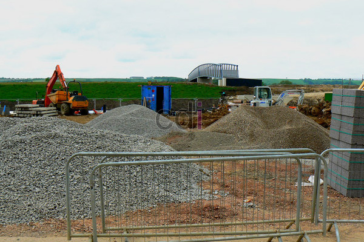

**Inilah Jenis Bahan Bangunan Yang Wajib Dibeli** - Hai Mitra CDI! Punya rencana membangun atau merenovasi? Memilih bahan bangunan yang tepat itu krusial, lho. Kualitas bahan langsung berdampak pada kekuatan dan ketahanan bangunan kita. Banyak perusahaan konstruksi melakukan riset mendalam, termasuk uji lab, untuk memastikan mutu bahan yang digunakan. Nah, biar proyek Anda lancar, yuk simak daftar bahan bangunan yang wajib dibeli ini! Dengan mengetahui material apa saja yang perlu disiapkan, Anda bisa membuat perhitungan RAB yang lebih akurat. Simak ulasannya di bawah ini:

*jenis bahan bangunan yang wajib dibeli*

## Daftar jenis bahan bangunan yang **wajib dibeli** untuk proyek Anda

Berikut ini adalah daftar lengkap bahan-bahan bangunan yang sebaiknya Anda siapkan saat memulai proyek pembangunan – baik itu rumah, kantor, mall, apartemen, atau jenis bangunan lainnya.

- 1\. ### Beton Cor

Material ini dibuat dari campuran batu, semen, pasir, dan bahan lainnya, lalu dituangkan ke dalam cetakan. Tingkat kekuatannya biasanya ditandai dengan kode seperti K-250, yang berarti mampu menahan tekanan 250 kg/m².

> **_Butuh detail lebih lanjut? Cek_** : [Daftar Jenis Mutu & Harga Beton Cor Readymix](/page/daftar-harga-rental-pompa-beton-dan-readymix-cor)
- 2\. ### Semen

Semen adalah perekat utama dalam konstruksi. Tanpa semen, bangunan tidak akan menyatu dengan kuat. Semen berfungsi mengikat agregat sehingga membentuk beton yang kokoh. Tersedia dalam kemasan satuan kilogram atau zak (40 kg atau 50 kg per zak).

> **_Mau tahu harga semen terbaru? Klik di sini_** : [Harga Semua Merk Semen Terkini](/blog/perbandingan-harga-semen-tiga-roda-holcim-gresik-padang)
- 3\. ### Besi Beton

Besi beton berfungsi menahan gaya tarik pada konstruksi beton. Material ini berbentuk batangan dengan penampang lingkaran sebagai penghubung.  Anda bisa menggunakan tabel berat besi untuk menghitung berat besi per meter.

> **_Cek referensi harga besi bangunan di sini_** : [DISINI](/blog/harga-besi-cor-beton-terbaru)

- 4\. ### Bekisting /Cetakan Beton

Bekisting adalah cetakan untuk membentuk beton. Biasanya dibuat dari papan kayu yang mudah dibentuk sesuai kebutuhan bangunan. Untuk pengecoran dak, penggunaan bondek bisa menjadi solusi hemat biaya dan waktu.
- 5\. ### Pasir Pasang, Cor & Plester

Sama pentingnya dengan semen, pasir merupakan material utama dalam bangunan. Pasir berfungsi mengikat bahan-bahan lain dan membentuk beton. Kualitas pasir dapat diuji melalui tes kadar lumpur, ukuran butiran, dan kandungan organik. Pasir yang umum digunakan adalah Pasir Pasang, Cor, dan Plester.

> **Lebih lengkap lihat** : [Daftar Harga Semua Jenis Pasir](/blog/daftar-harga-material-pasir-dan-batu-terlengkap)
- 6\. ### Batako, Bata Merah & Hebel

Ketiga material ini memiliki fungsi yang serupa, meskipun berbeda dalam bahan dasar dan proses pembuatan. Batako dan hebel memiliki keunggulan dalam kecepatan pemasangan dan presisi, cocok untuk pembuatan dinding, taman, lantai, dan aplikasi lainnya. Hebel atau bata ringan juga semakin populer belakangan ini sebagai pilihan bahan bangunan yang menarik.
- 7\. ### Kayu Balok, Kaso & Papan

Meskipun banyak material alternatif, kayu tetap menjadi pilihan utama dalam konstruksi. Minimal tiga jenis kayu – balok, kaso, dan papan – wajib Anda sediakan saat memulai pembangunan.

Selain bahan-bahan di atas, Anda juga memerlukan material lain seperti cat, keramik, pintu, jendela, dan sebagainya. Semoga informasi ini bermanfaat untuk proyek Anda! Jangan ragu menghubungi kami untuk konsultasi atau pemesanan bahan bangunan berkualitas di (not detected). Kami siap membantu Anda mewujudkan bangunan impian Anda.  [Inilah Bahan Bangunan Yang Paling Sering Dipakai](/blog/bahan-bangunan-paling-sering-dipakai/) — Artikel ini akan membantu Anda memahami pilihan bahan bangunan yang paling umum digunakan di Indonesia.