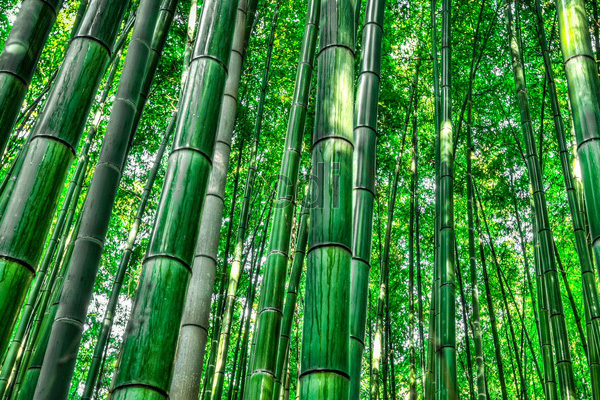

**Inilah Kelebihan Material Bambu yang Jarang Diketahui** - Hai Mitra CDI! Gimana kabarnya? Indonesia, dengan kekayaan alamnya yang luar biasa, punya segudang tumbuhan bermanfaat. Salah satunya adalah material bambu. Bambu itu sendiri adalah tanaman liar dengan batang berongga dan beruas. Uniknya, bambu dikenal sebagai tanaman dengan pertumbuhan paling cepat di dunia – bisa tumbuh lebih dari 65 cm per hari! Sejak lama, bambu menjadi material favorit di Indonesia, bahkan seringkali jadi alternatif utama setelah kayu.

*Material Bambu*

## Fungsi Material Bambu Secara Umum

Material bambu punya segudang fungsi yang sangat membantu, terutama dalam dunia konstruksi. Biasanya, bambu digunakan sebagai perancah atau *steiger* saat pembangunan, juga sebagai penopang bekisting dak, dan masih banyak lagi. Nah, bambu juga bisa jadi material utama untuk membangun rumah atau gazebo, nih. Untuk ini, bambu hitam sering jadi pilihan karena kesan artistik dan klasiknya yang khas. Bahkan, masyarakat sering memanfaatkan bambu untuk membangun jembatan karena harganya terjangkau, kuat, dan mudah didapatkan. Selain itu, bambu juga sering digunakan sebagai *tower* atau penopang baliho dan spanduk di pinggir jalan – terutama saat musim pemilu atau pilkada, lho.

Tapi, kegunaan bambu nggak cuma sampai di situ, Mitra. Para pengrajin handal bisa mengubah bambu menjadi berbagai produk bermanfaat. Kita sering jumpai peralatan rumah tangga yang terbuat dari bambu, misalnya. Intinya, bambu itu serbaguna banget buat kebutuhan sehari-hari.

## Kelebihan Material Bambu Sebagai Bahan Bangunan

Perkembangan arsitektur di Indonesia nggak lepas dari penggunaan bambu sebagai bahan bangunan. Nggak cuma untuk alat dan perabotan, bambu juga sering digunakan untuk konstruksi bangunan itu sendiri. Bahkan, bambu diklaim punya kekuatan setara dengan besi dan baja, asal diolah dengan benar terlebih dahulu. Tapi, karena merupakan produk alami, karakteristik bambu tidak selalu seragam. Jadi, diperlukan keahlian khusus dalam pemasangannya.

Berikut ini beberapa kelebihan material bambu jika digunakan sebagai bahan bangunan:

### Material bambu tampilannya sangat klasik
    
Kalau Mitra suka desain natural, bаmbu adalah pilihan tepat. Kesan alami yang ditimbulkan dari material ini sangat kuat. Untuk dekorasi, bambu biasanya hadir dalam bentuk perabotan, hiasan dinding, aksesoris, dan lantai.

### Material bambu rаmаh lingkungan
    
Salah satu alasan bambu termasuk bahan ramah lingkungan adalah karena bambu mudah tumbuh di berbagai tempat. Pertumbuhannya juga sangat cepat dan nggak butuh perawatan khusus. Bambu biasanya baru layak digunakan saat berusia antara 2-4 tahun.

### Harga material bambu lebih murаh
    
Bambu adalah material yang harganya relatif terjangkau. Rata-rata harga bambu saat ini berkisar antara Rp 7.500 sampai dengan Rp 15.000 per batang, tergantung kualitas. Coba bandingkan dengan harga kayu ukuran reng dan usuk saja, selisihnya lumayan signifikan! Jadi, bambu bisa jadi solusi untuk menghemat budget pembangunan. Untuk informasi harga terkini, silakan lihat tabel .

### Bambu lebih elastis dan lentur
    
Bambu adalah bahan bangunan yang punya tingkat elastisitas tinggi. Material ini bisa mempertahankan bentuknya dengan baik, lentur, dan tidak mudah patah. Kondisi ini yang menjadikan bambu pilihan terbaik untuk bangunan yang dibangun di daerah rawan gempa. Kalaupun bangunan rubuh, bobot bambu yang ringan tidak terlalu membahayakan penghuni bangunan tersebut.

### Bambu memiliki bоbоt yg ringan
    
Dengan bentuk fisiknya yang tidak padat (berongga di dalam), bambu memiliki berat yang lebih ringan dibandingkan material lainnya. Hal ini memudahkan distribusi, begitu juga dengan pemasangannya. Bambu juga relatif mudah dibentuk sesuai keinginan pengguna.

### Kualitas bambu setara dengan baja
    
Bambu memiliki tingkat kuat tarik yang sebanding dengan baja berkualitas sedang pada berat jenis yang sama. Bahkan, bambu yang sudah diawetkan sebelumnya diklaim sangat kokoh untuk dijadikan kolom bangunan bertingkat. Kabar baiknya, penggunaan bambu sebagai penopang bangunan sudah lama dikenal di masyarakat Indonesia. Kita bisa lihat dari banyaknya bangunan-bangunan kuno yang menggunakan bambu sebagai penyangganya.

## Kekurangan Pada Material Bambu
    
Meski punya banyak kelebihan, material bambu juga memiliki beberapa kekurangan. Ini wajar saja, karena bambu bukan produk pabrik dengan kontrol kualitas yang ketat. Bambu tumbuh liar di alam tanpa perawatan dan cetakan khusus. Beberapa kekurangan material bambu antara lain:

### Material bambu sulit di sambung dengan rapih
    
Meskipun bahan yang kuat, bambu punya kelemahan dalam detail sambungannya. Menyambung bambu untuk membentuk struktur memerlukan keterampilan khusus. Jadi, dibutuhkan penguasaan bambu yang mendalam.

### Karakteristik fisik bambu tіdаk seragam
    
Karena langsung dari alam, karakteristik bambu tidak pernah sama. Diameter yang berbeda-beda memerlukan ketelitian dalam proses seleksi bambu tahap awal. Jarak ruas dalam bambu juga pasti tidak sama dari ujung sampai pangkal. Hal ini bisa menimbulkan kesulitan dalam memadukan bambu secara harmonis dalam desain.

### Bambu mudah dimakan rayap
    
Rayap juga suka banget menggerogoti bambu, terutama bambu muda. Kalau sudah diserang rayap, kualitas bambu bisa cepat menurun dan rusak. Solusinya, oleskan cairan anti-rayap secara berkala dan pilih bambu tua yang sudah kering agar lebih awet.

Itulah, Mitra, beberapa hal yang perlu Anda ketahui tentang kelebihan dan kekurangan material bambu. Semoga informasi ini bermanfaat dan menambah wawasan Anda. Jika Anda tertarik menggunakan material bambu dalam proyek Anda di (not detected), jangan ragu untuk menghubungi tim kami untuk konsultasi lebih lanjut. Kami akan bantu mewujudkan desain impian Anda!  [Inilah Bahan Bangunan Yang Paling Sering Dipakai](/blog/bahan-bangunan-paling-sering-dipakai/)