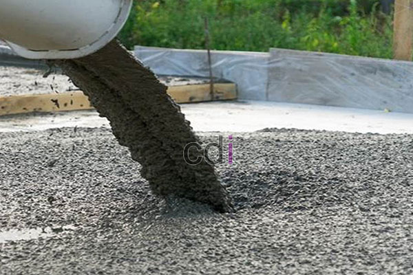

**Inilah Penyebab Beton Cor Lambat Mengering** - Hai Mitra CDI! Membangun struktur yang kokoh dan tahan lama adalah impian semua orang. Kualitas beton menjadi kunci utama pencapaiannya. Nah, memahami faktor-faktor yang memengaruhi waktu pengeringan beton itu penting banget, lho. Proses perencanaan campuran yang tepat – mulai dari perbandingan material, proses pencampuran, pengecoran, pemadatan, hingga perawatan setelah pengecoran – sangat krusial. Beton sendiri merupakan hasil perpaduan semen, agregat, air, dan mungkin tambahan zat aditif untuk memenuhi kebutuhan spesifik. Karena itu, proporsi material harus diperhatikan secara cermat.

*Solusi Tepat untuk Beton yang Lambat Kering*

## Mengapa Beton Terkadang Lambat Mengering?

Membuat formulasi beton yang ideal memang membutuhkan keahlian khusus, terutama pemahaman tentang teknik sipil dan teknologi bahan konstruksi. Idealnya, analisis material di laboratorium diperlukan untuk memastikan formulasi beton yang direncanakan benar-benar optimal. 

Penyebab utama beton lambat mengering seringkali ada pada komposisi semen yang tidak ideal – entah terlalu sedikit semen, atau kelebihan air dalam campuran. Kualitas material yang tidak memenuhi standar juga bisa menjadi faktor pemicu. 

Menurut para ahli, perbandingan campuran yang terbaik sebaiknya didasarkan pada berat, bukan volume seperti penggunaan ember. Dengan menimbang material secara akurat, kita bisa memastikan proporsi yang tepat untuk bangunan besar seperti gedung bertingkat atau apartemen. Meskipun begitu, untuk proyek skala kecil seperti rumah minimalis, metode konvensional dengan takaran ember masih bisa diterapkan asalkan dilakukan oleh tenaga ahli yang berpengalaman di (not detected).

## Tips Mencampur Beton Agar Cepat Kering & Kuat

Lalu, bagaimana cara mencampur beton agar lebih cepat mengering dan hasilnya lebih kuat? Berikut beberapa poin penting yang perlu diperhatikan:

- 1. **Peran Semen:** Semakin banyak semen yang digunakan, semakin kokoh beton yang dihasilkan. Jumlah semen berbanding lurus dengan kekuatan beton.
- 2. **Kontrol Air:** Gunakan air sesedikit mungkin. Air berfungsi untuk mempermudah proses pengerjaan seperti pengangkutan, pemadatan, dan finishing. Walaupun jumlah air yang banyak membuat pekerjaan lebih ringan, kelebihan air justru menurunkan kualitas beton dan memperlambat proses pengeringan. Pengerjaan di musim hujan juga bisa memengaruhi kecepatan pengeringan, nih.
- 3. **Faktor Air Semen (FAS):** Idealnya, campuran beton memiliki FAS yang rendah, yaitu lebih banyak semen daripada air. Untuk mencapai ini, kurangi perbandingan air dan semen. Hal ini akan meningkatkan kualitas dan mempercepat proses pengeringan.

Semoga informasi ini bermanfaat, ya! Dengan memahami faktor-faktor di atas, Anda bisa mendapatkan hasil cor beton yang optimal di (not detected). Kalau Anda ingin lebih praktis, pertimbangkan untuk menggunakan *beton curah /cair* atau *readymix* yang sudah siap pakai. Untuk informasi lebih lanjut dan pemesanan, silahkan hubungi tim CDI melalui tombol Telepon/WhatsApp yang tersedia. Kami siap membantu Anda mewujudkan bangunan impian di (not detected)!