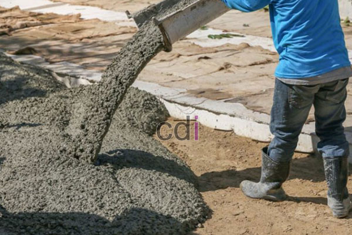

**Inilah Penyebab Cor Beton Bisa Retak** - Hai Mitra CDI! Pernahkah Anda bertanya-tanya, kenapa cor beton bisa retak meski sudah dibangun dengan hati-hati? Nah, ada banyak faktor yang bisa jadi penyebabnya, lho. Beberapa di antaranya bahkan sering luput dari perhatian. Kondisi ini bisa terjadi karena keterbatasan anggaran yang memaksa penggunaan material di bawah standar, atau mungkin karena kurangnya konsultasi dengan ahli sebelum memulai proyek. Padahal, memastikan kualitas cor beton itu butuh pengetahuan dan pengalaman yang mumpuni. Artikel ini akan membahas beberapa penyebab umum retaknya cor beton yang perlu Anda antisipasi, khususnya untuk proyek di (not detected). Yuk, simak selengkapnya!

## Penyebab Cor Beton Bisa Retak: Apa Saja?

Retakan pada cor beton bisa menandakan masalah serius pada struktur bangunan. Berikut beberapa penyebab utama yang perlu Anda perhatikan:

- 1. **Bekisting Tidak Memadai:** Cetakan beton (bekisting) yang kurang kuat atau tidak stabil saat proses pengecoran bisa memicu retak. Bekisting harus mampu menahan berat beban bangunan selama beton mengeras.
- 2. **Pencampuran Material Tidak Sesuai:** Proporsi campuran semen, split, pasir, dan air yang tidak tepat bisa menurunkan kualitas cor. Penggunaan semen terlalu sedikit atau split berlebihan adalah contohnya.
- 3. **Kurangnya Perawatan Pasca-Pengecoran:** Setelah pengecoran, cor beton perlu dijaga kelembapannya dengan penyiraman air secara berkala. Jika tidak, bisa terjadi retak akibat pengeringan terlalu cepat.
- 4. **Pembongkaran Bekisting Terlalu Dini:** Beton membutuhkan waktu minimal 28 hari untuk mencapai kekuatan maksimal. Membongkar bekisting sebelum waktu yang ditentukan bisa mengakibatkan keretakan.
- 5. **Beban Melebihi Kapasitas:** Jika beban bangunan melebihi kemampuan struktur beton, tentu saja akan terjadi tekanan berlebih yang berujung pada retak.
- 6. **Usia Cor Terlalu Tua:** Beton yang sudah terlalu lama juga bisa rentan retak, terutama jika tidak ada perawatan berkala.
- 7. **Bencana Alam:** Bencana alam seperti banjir, gempa bumi, dan kebakaran dapat menyebabkan kerusakan dan retak pada struktur cor beton.
- 8. **Perencanaan Struktur yang Kurang Tepat:** Kesalahan dalam perhitungan struktur atau penggunaan mutu cor di bawah standar kebutuhan akan melemahkan kekuatan cor beton.
- 9. **Karat Tulangan atau Ukuran Besi Kurang:** Karat pada besi tulangan atau penggunaan besi dengan ukuran yang tidak sesuai dapat mengurangi kekuatan dan menyebabkan retak.
- 10. **Material Campuran Kotor:** Penggunaan material yang mengandung bahan organik, lumpur, atau bahan kimia tertentu dapat melemahkan struktur cor beton.
- 11. **Kerusakan Akibat Tindakan Manusia:** Pemukulan atau perusakan beton secara sengaja tentu saja bisa memicu retak dan merusak struktur.

Itulah beberapa penyebab umum cor beton bisa retak yang perlu Anda waspadai. Memastikan kualitas bahan bangunan dan proses pengecoran dengan cermat adalah kunci untuk menghindari masalah ini. Dengan begitu, bangunan Anda di (not detected) akan lebih kokoh dan tahan lama.

Untuk solusi yang lebih tepat dan terpercaya, jangan ragu untuk berkonsultasi dengan ahlinya. **CDI** siap membantu Anda menangani segala permasalahan terkait pengecoran dan konstruksi bangunan. Tim kami akan melakukan survei dan memberikan saran terbaik sesuai dengan kebutuhan proyek Anda di (not detected). [Inilah Penyebab Beton Cor Lambat Mengering](/blog/inilah-penyebab-beton-cor-lambat-mengering/) bisa jadi bacaan tambahan yang bermanfaat. Hubungi kami sekarang juga untuk mendapatkan penawaran terbaik! Jangan tunda, kualitas bangunan Anda adalah prioritas kami!