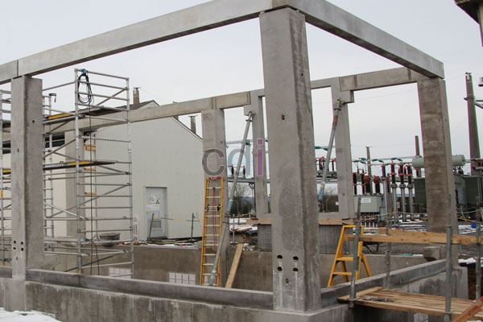

**Inilah Ukuran Balok Beton Sesuai SNI** - Hai Mitra CDI! Tahukah Anda, balok beton adalah elemen krusial dalam struktur bangunan? Ia berfungsi sebagai pengikat kolom dan lantai, menopang beban secara horizontal, dan memastikan kekuatan bangunan secara keseluruhan. Nah, memahami ukuran balok beton yang sesuai standar sangat penting, lho! Artikel ini akan membahasnya secara detail untuk Anda. Mari kita simak bersama!

*Ukuran Balok Beton*

## Memastikan Stabilitas Balok Beton

Stabilitas balok beton sangat penting, terutama karena komponen ini bekerja dengan menahan lenturan. Saat balok menerima beban, akan timbul momen lentur dan deformasi. Ini menciptakan tegangan tarik di bagian bawah dan tegangan tekan di bagian atas balok. Untuk mengatasi ini, baja tulangan dipasang di area tegangan tarik – itulah mengapa sering disebut balok bertulangan baja tarik. 

Agar gaya terdistribusi dengan baik, jarak antar batang tulangan utama sebaiknya tidak lebih dari 150 mm di area momen maksimum. Jika momennya berkurang, jarak ini bisa dinaikkan hingga 300 mm. Idealnya, penampang balok persegi memiliki minimal 4 batang tulangan di setiap sudut, yang kemudian dikelilingi oleh sengkang untuk menambah kekakuan. Diameter sengkang minimal adalah 6 mm.

## Persyaratan Ukuran Balok Beton Menurut SNI

Berdasarkan PBBI 1971.N.I – 2 hal 91, ada beberapa persyaratan ukuran balok beton yang perlu diperhatikan:

- 1\. Lebar badan balok minimal harus 1/50 dari bentang bersih. Tinggi balok perlu dipilih secara cermat, idealnya sesuai dengan lebar badan yang telah ditentukan.
- 2\. Diameter tulangan minimum adalah 12 mm untuk semua jenis baja tulangan. Hindari pemasangan tulangan dalam lebih dari 2 lapis, kecuali dalam kondisi khusus.
- 3\. Tulangan tarik harus menyebar merata pada daerah tarik maksimum penampang.
- 4\. Untuk balok dengan tinggi lebih dari 90 cm, pasang tulangan samping dengan luas minimal 10% dari luas tulangan tarik utama. Diameter batang tulangan samping minimal 8 mm untuk baja lunak dan 6 mm untuk baja keras.
- 5\. Sengkang harus selalu dipasang pada balok beton dengan jarak tidak lebih dari 30 cm. Sengkang berfungsi sebagai tulangan geser dan jaraknya tidak boleh lebih dari 2.3 kali tinggi balok. Diameter sengkang minimal 6 mm untuk baja lunak dan 5 mm untuk baja keras.

<table class="table">
  <caption>Ukuran Balok Beton Umum</caption>
  <thead>
    <tr><th>Lebar (b)</th><th>Tinggi (h)</th><th>Diameter Tulangan Utama</th></tr>
  </thead>
  <tbody>
    <tr><td>30 cm</td><td>40 cm</td><td>12 mm - 16 mm</td></tr>
    <tr><td>40 cm</td><td>50 cm</td><td>16 mm - 20 mm</td></tr>
  </tbody>
</table>

Nah, itulah detail penting mengenai ukuran balok beton sesuai SNI. Semoga informasi ini bermanfaat bagi Mitra CDI dalam merencanakan proyek konstruksi di (not detected)! Kami mengerti bahwa mungkin ada pertanyaan atau kebutuhan konsultasi lebih lanjut. Jangan ragu untuk menghubungi kami untuk mendapatkan informasi harga atau bantuan lebih detail. Kami siap membantu Anda mewujudkan bangunan yang kuat dan berkualitas di (not detected). [Anda dapat menghubungi tim ahli kami disini](URL). [Atau cek juga artikel kami tentang uji slump beton](/blog/cara-uji-slump-beton-sesuai-dengan-sni/) untuk informasi tambahan yang relevan.