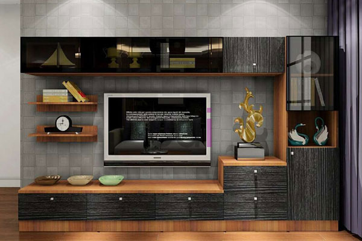
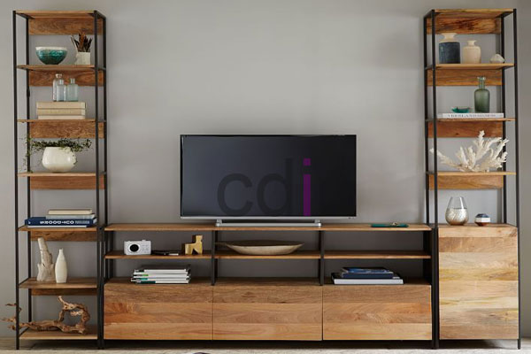

**Inspirasi Desain Lemari Televisi** - Hai Mitra CDI! Ingin ruangan keluarga terasa lebih nyaman dan estetik? Nah, mendekorasi rumah itu penting banget, lho. Salah satu kuncinya ada pada pemilihan desain lemari televisi. Ruang keluarga seringkali berpusat pada televisi, jadi mempercantik area ini bisa memberikan dampak besar pada keseluruhan tampilan rumah, khususnya di (not detected).

Merombak desain lemari TV di rumah Anda adalah cara efektif untuk menciptakan suasana yang lebih menyenangkan dan mempercantik ruang keluarga. Dengan desain yang tepat, ruangan akan terasa lebih nyaman dan menarik.

## Ide Desain Lemari Televisi Minimalis yang Wajib Dicoba

Ada banyak ide desain lemari TV minimalis yang bisa Anda pertimbangkan untuk mempercantik rumah impian Anda. Memilih desain yang tepat akan membuat ruang keluarga Anda terasa lebih nyaman, terutama saat bersantai di depan televisi. Yuk, simak beberapa inspirasi desain lemari TV minimalis berikut ini!

### 1. Desain Lemari Televisi Modern Minimalis

Model desain lemari TV minimalis ini cocok banget buat Anda yang punya rumah dengan konsep modern dan minimalis. Desain ini memadukan fitur modern dengan kesederhanaan minimalis, tanpa banyak ornamen yang rumit.

Lemari televisi ini umumnya berukuran ringkas, namun tetap dilengkapi dengan ruang tambahan untuk mempercantik tampilan. Misalnya, bagian bawah lemari bisa digunakan untuk menempatkan tanaman hias atau dekorasi lain.

Material yang digunakan biasanya adalah kayu, baik dengan finishing warna hitam yang identik dengan gaya minimalis, atau warna alami kayu yang memberikan kesan klasik yang indah.

### 2. Desain Lemari TV Paduan Kaca dan Logam

Desain yang satu ini cocok banget untuk Anda yang punya tipe rumah unik dan cerah. Lemari ini biasanya menggabungkan kaca yang kuat dengan logam seperti besi berwarna hitam, untuk memberikan kesan minimalis yang kuat.

Desain lemari ini terlihat bersih dan simpel, tanpa banyak detail tambahan. Hal ini berkat penggunaan kaca yang jernih dan aksen logam hitam yang memberikan karakter tersendiri.

Penting untuk diperhatikan, pastikan paduan logam dan ukuran TV yang Anda gunakan seimbang. Jangan sampai ada yang terlalu besar atau terlalu kecil, agar tampilan tetap harmonis.

Beragam ide desain lemari TV minimalis ini bisa membantu Anda memilih desain yang paling sesuai dengan selera dan tipe rumah Anda. Anda bahkan bisa membuat lemari sendiri sesuai keinginan. Namun, pastikan kekuatan dan keseimbangan bentuk lemari tetap menjadi prioritas agar desainnya tahan lama dan tidak rusak. Dengan begitu, Anda bisa menciptakan lemari yang tidak hanya indah, tapi juga awet.

## Dapatkan Lemari TV Impian Anda

Bagi Anda yang merasa kesulitan dalam mendekorasi atau membuat lemari TV sendiri, jangan khawatir! Kami siap membantu mewujudkan desain lemari TV impian Anda. Dengan menggunakan jasa kami, Anda bisa mendapatkan lemari dengan desain minimalis yang Anda inginkan tanpa harus repot membuatnya sendiri. Itulah artikel mengenai Inspirasi Desain Lemari Televisi Minimalis yang Wajib Dicoba. Semoga artikel ini menginspirasi Anda untuk menciptakan dekorasi interior rumah yang minimalis dan indah di (not detected). Jangan ragu untuk berkonsultasi dengan kami, hubungi kami melalui tombol Telepon/WhatsApp yang ada di website ini untuk informasi lebih lanjut. Kami siap membantu Anda mewujudkan ruang keluarga impian Anda!