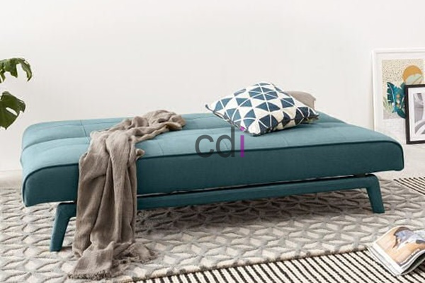
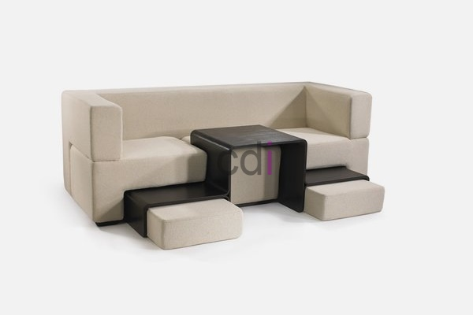
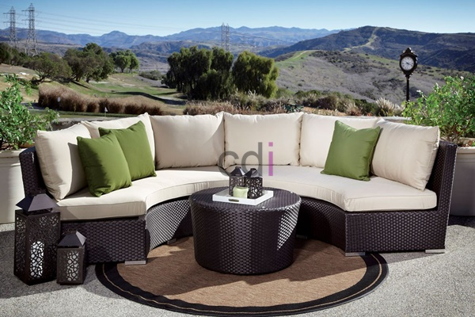

**Inspirasi Desain Sofa Untuk Rumah Masa Kini** - Hai Mitra CDI! Sedang memikirkan cara menyegarkan tampilan ruang keluarga di (not detected)? Atau justru ingin merombak total dengan konsep minimalis yang sedang populer? Kami punya beberapa inspirasi desain sofa yang bisa jadi solusi tepat untuk rumah impian Anda. Yuk, simak ulasan berikut!

Rumah minimalis memang jadi favorit banyak orang. Kesederhanaan desainnya menawarkan kesan luas, rapi, dan modern. Tapi, memilih perabot yang tepat, termasuk sofa, adalah kunci agar konsep minimalis ini benar-benar tercapai. 

Memilih sofa yang sesuai dengan desain rumah minimalis membutuhkan perhatian khusus. Bukan hanya soal model, tapi juga warna, material, dan ukuran. Dengan begitu, sofa justru akan mempercantik tampilan rumah Anda.

## Beberapa Inspirasi Desain Sofa Minimalis yang Wajib Anda Miliki

Sudah banyak sekali pilihan model sofa minimalis yang tersedia. Dari yang simpel hingga yang unik, semuanya bisa Anda temukan. Berikut adalah beberapa di antaranya:

### 1. Model Sofa Oriental

Pernah melihat sofa di bank atau ruang tunggu yang terlihat elegan dan sederhana? Nah, itulah yang disebut sofa oriental. Sofa ini biasanya memiliki desain datar tanpa sandaran punggung yang terlalu tinggi, namun tetap nyaman karena adanya jahitan atau detail tekstur.

Untuk memberikan kesan minimalis pada sofa oriental, pilihlah warna-warna netral seperti abu-abu, krem, atau putih. Warna monokrom ini akan menyatu harmonis dengan konsep rumah minimalis Anda.

### 2. Model Sofa Sambung Meja

Ingin sofa yang multifungsi sekaligus mempercantik ruang keluarga? Model sofa sambung meja bisa jadi pilihan yang tepat. Sofa ini didesain dengan meja kecil yang terintegrasi di antara dua bagian sofa.

Keunikan desain ini tidak hanya memberikan tampilan yang menarik, tapi juga kepraktisan. Anda bisa menempatkan minuman, camilan, atau buku di atas meja tersebut tanpa perlu menambahkan perabot tambahan.

### 3. Model Sofa Setengah Lingkar

Sofa setengah lingkar adalah pilihan yang menarik untuk mengisi sudut-sudut ruangan di rumah minimalis Anda. Bentuknya yang unik dan melengkung memberikan sentuhan berbeda pada interior rumah.

Sofa ini biasanya memiliki sandaran tangan dan punggung yang melengkung lembut, memberikan kenyamanan maksimal saat bersantai. Pastikan memilih warna yang serasi dengan tema rumah Anda agar tampilan tetap harmonis dan tidak menghilangkan kesan minimalis.

Sofa minimalis memang menjadi incaran banyak orang, terutama mereka yang menyukai desain interior yang simpel dan modern. Permintaan yang tinggi ini mendorong banyak produsen untuk menciptakan berbagai model sofa minimalis yang menarik. 

Tertarik memiliki salah satu model sofa minimalis di atas? Jangan ragu untuk menghubungi kami! Kami siap membantu Anda menemukan sofa yang paling sesuai dengan kebutuhan dan selera Anda di (not detected). Dapatkan penawaran menarik dan pelayanan terbaik hanya dari CDI. [Apakah Anda ingin tahu lebih banyak tentang bata merah expose yang bisa melengkapi desain ruang keluarga Anda?](https://www.creative-design-interior.com/blog/bata-merah-expose-dinding-rumah-modern/) Gimana, sudah punya gambaran sofa impian untuk rumah Anda? Ayo wujudkan bersama CDI! 