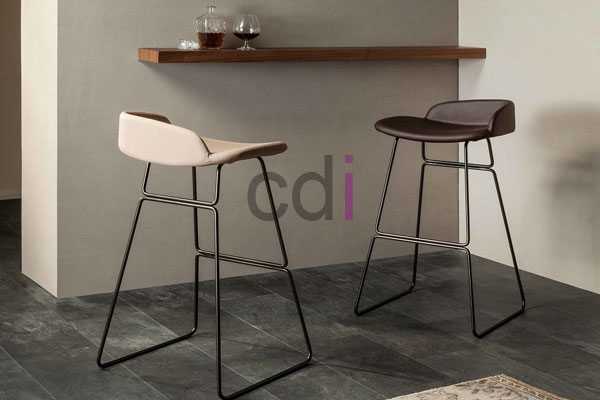
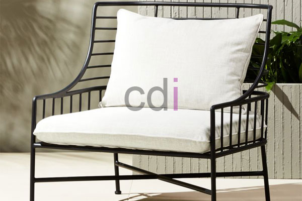
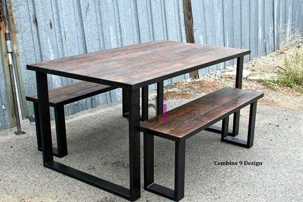

**Inspirasi Terbaru Desain Kursi Besi Minimalis** - Hai Mitra CDI! Bayangkan sebuah rumah yang nyaman dan estetik… pasti ada kursi yang menjadi bagian pentingnya, kan? Mulai dari rumah sederhana hingga mewah, kursi adalah perabot wajib. Karenanya, memilih kursi yang tepat adalah investasi penting bagi hunian Anda—terlebih jika Anda sering menerima tamu. Nah, di era modern ini, keinginan untuk memiliki perabot yang stylish juga semakin meningkat. Kursi besi minimalis hadir sebagai solusi yang tepat untuk mewujudkan gaya hidup modern di rumah Anda.

Kursi memiliki peran multifungsi: tempat bersantai, tempat beristirahat, atau sekadar tempat duduk yang nyaman untuk tamu. Gaya hidup masyarakat Indonesia yang semakin modern turut mendorong permintaan akan furnitur yang unik dan berkualitas. Banyak sekali desain kursi yang bisa Anda temukan, mulai dari kursi kayu, busa, hingga besi. 

## Beberapa Desain Kursi Besi Minimalis yang Sedang Tren

Kalau Anda mencari kursi yang kuat, kokoh, dan tahan lama, kursi besi adalah pilihan yang sangat direkomendasikan. Kualitasnya terjamin dan akan menjadi investasi jangka panjang untuk rumah Anda. Ingin tahu modelnya? Yuk, simak ulasan berikut ini!

### 1. Desain Kursi Besi Ala Café

*Kursi Besi Minimalis untuk Suasana Santai*

Desain kursi besi bergaya café sedang populer banget, lho! Banyak orang tertarik menciptakan suasana café modern di dalam rumah mereka. Kursi besi jenis ini sangat cocok untuk teras rumah, ruang bersantai, atau ruang keluarga. Desainnya yang minimalis dan elegan akan memberikan sentuhan modern pada ruangan Anda. Bayangkan memadukannya dengan desain dinding yang terinspirasi dari café-café kekinian. Dijamin, anak-anak remaja Anda akan betah menghabiskan waktu di rumah daripada harus nongkrong di luar! Nah, untuk inspirasi lainnya, Anda bisa cek [Harga Kursi Besi Minimalis Terbaru](/blog/harga-kursi-besi-minimalis-terbaru/) untuk melihat pilihan model dan harga.

### 2. Desain Kursi Besi Kombinasi Busa

Ingin kursi yang nyaman sekaligus stylish? Kombinasi besi dan busa adalah jawabannya! Kursi besi dengan bantalan busa memberikan kenyamanan ekstra tanpa mengorbankan kekuatan dan ketahanan. Desain kursi ini cocok untuk berbagai ruangan, mulai dari ruang tamu hingga ruang keluarga. Tampilannya yang mewah akan meningkatkan estetika interior rumah Anda. Pilihan ideal untuk menciptakan suasana yang hangat dan mengundang.

### 3. Desain Kursi Besi Kombinasi Kayu

Selain busa, kayu juga menjadi kombinasi yang menarik untuk kursi besi. Gunakan kayu berkualitas tinggi, seperti kayu jati, untuk menciptakan kursi yang elegan dan tahan lama. Kursi besi kombinasi kayu sangat cocok untuk ruang makan, memberikan sentuhan alami dan sederhana pada ruangan Anda. Desainnya yang minimalis akan menciptakan suasana yang nyaman dan harmonis saat Anda menikmati hidangan bersama keluarga. Kalau Anda ingin tahu lebih banyak tentang bahan-bahan konstruksi, artikel [Berapa Besi yang Dibutuhkan untuk Membangun Rumah? Panduan Lengkap & Perhitungan](/blog/berapa-besi-yang-dibutuhkan-untuk-membangun-rumah/) mungkin bisa menjadi referensi tambahan.

Demikian mitra, ulasan kami mengenai inspirasi desain kursi besi minimalis. Semoga artikel ini memberi Anda ide-ide segar untuk mempercantik rumah Anda! Untuk desain yang unik dan sesuai dengan keinginan Anda, jangan ragu menggunakan jasa kami. Kami siap membantu mewujudkan kursi besi minimalis impian Anda. Jangan sungkan untuk menghubungi kami atau mengunjungi [[[PLACEHOLDER_N]]] untuk konsultasi lebih lanjut. Kami tunggu kabar baiknya!