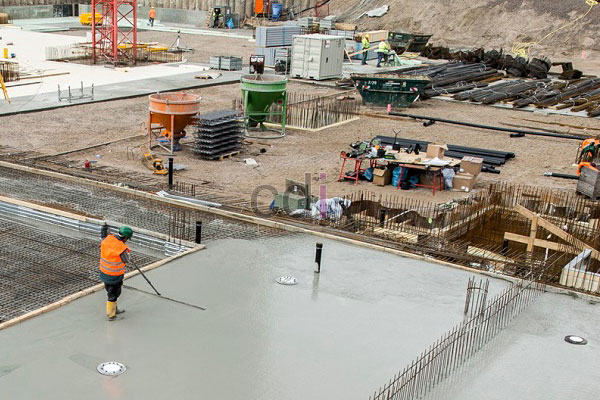

**Mengenal Istilah Istilah Pada Konstruksi Beton** - Hai Mitra CDI! Saat merencanakan pembangunan atau renovasi, struktur beton jadi fondasi penting. Banyak istilah teknis yang sering terdengar, namun mungkin belum sepenuhnya dipahami. Artikel ini hadir untuk membekali Anda dengan pengetahuan dasar tentang istilah-istilah kunci dalam konstruksi beton di (not detected). Yuk, simak ulasannya!

*Memahami Dasar Konstruksi Beton*

## Daftar Istilah Istilah Pada Struktur Beton

- 1\. **Acuan** – Lebih dikenal sebagai bekisting, yaitu alat yang digunakan untuk membentuk beton sesuai dengan dimensi, bentuk, dan posisi yang diinginkan.
- 2\. **Agregat** – Material granular seperti kerikil, batu pecah, pasir, atau kerak tungku besi yang dicampurkan dengan pengikat untuk menciptakan adukan atau beton.
- 3\. **Adukan** – Campuran semen Portland, agregat halus, dan air—fondasi utama sebelum menjadi beton.
- 4\. **Angker** – Digunakan untuk mengikat sambungan pada beton pracetak, memastikan kekuatan dan stabilitas.
- 5\. **Bahan tambahan** – Bahan pencampur adukan beton berbentuk cairan atau bubuk, ditambahkan untuk memodifikasi sifat-sifat beton.
- 6\. **Beton** – Hasil perpaduan semen hidraulik (seperti semen Portland), agregat halus dan kasar, serta air—dengan atau tanpa tambahan bahan lain—yang mengeras dan memadat.
- 7\. **Berat jenis** – Perbandingan antara berat dan volume suatu bahan, misalnya beton, yang penting dalam perhitungan massa.
- 8\. **CGS** – Sistem satuan internasional terkecil yang menggunakan sentimeter sebagai satuan utama (metric).
- 9\. **Dowel** – Material penghubung antara dua komponen struktur beton, memastikan transfer beban yang efektif.
- 10\. **Dekking** – Beton penutup yang berfungsi sebagai patokan ketebalan pelindung beton terhadap korosi tulangan.
- 11\. **Faktor air semen (FAS)** – Rasio antara jumlah air dan semen dalam campuran beton, yang memengaruhi kuat tekan dan durabilitas beton.
- 12\. **Konstruksi batu** – Pasangan batu yang berfungsi sebagai elemen konstruksi, mampu menahan beban tekanan lebih dari 100 kg/cm2.
- 13\. **Konstruksi beton** – Beton yang berperan sebagai elemen struktural utama dalam bangunan.
- 14\. **Kabel** – Juga disebut tendon, merupakan susunan material yang digunakan untuk memberikan gaya tarik pada beton prategang.
- 15\. **Mks** – Sistem satuan internasional terbesar yang menggunakan meter sebagai satuan utama (metric).
- 16\. **Perancah** – Kerangka atau struktur sementara yang digunakan sebagai tempat kerja pada ketinggian dan penyangga acuan beton, menjaga posisinya stabil.
- 17\. **Sengkang** – Tulangan berbentuk cincin atau spiral yang berfungsi menahan tegangan geser dan torsi pada struktur beton. Terbuat dari kawat baja, jaring kawat baja las, atau batang tulangan.
- 18\. **Segregasi** – Pemisahan agregat yang sejenis dalam adukan beton, mengakibatkan perbedaan komposisi dan potensi penurunan kualitas.
- 19\. **Tulangan** – Batang baja polos atau berdeformasi (atau pipa) yang berfungsi menahan gaya tarik pada struktur beton.

## Mengapa Penting Memahami Istilah dalam Konstruksi Beton?

Seringkali, orang yang berencana membangun rumah atau bangunan lainnya kurang memperhatikan atau merasa tidak perlu mempelajari istilah-istilah penting dalam konstruksi. Mungkin karena dianggap sebagai ranah arsitek atau karena ketersediaan bangunan siap pakai. Padahal, memahami dasar-dasar konstruksi beton—walaupun hanya istilah umum—dapat memberikan manfaat signifikan. Nah, dengan berkelatan pengetahuan tentang konstruksi beton, Anda bisa melakukan pemilihan material yang lebih cerdas. Ini akan berdampak langsung pada penghematan biaya pembangunan atau renovasi. Dengan memahami istilah dan standar kualitas, Anda dapat berdiskusi lebih efektif dengan kontraktor atau developer, serta menghindari potensi masalah di kemudian hari.  Sangat disarankan bagi Anda untuk meluangkan waktu mempelajari ilmu teknik sipil, setidaknya memahami istilah-istilah umum pada struktur beton.

Dengan begitu, Anda akan lebih percaya diri dan terhindar dari kesalahan yang merugikan.

Nah, itulah dia pembahasan mengenai daftar Istilah Istilah Umum Pada Struktur Beton yang sering dijumpai dalam pekerjaan konstruksi rumah, ruko, jalan, dan bangunan lainnya di (not detected). Bagaimana, sudah lebih paham kan, Mitra? Pastikan Anda selalu menggunakan material dan jasa konstruksi berkualitas dari CDI untuk hasil yang optimal. Untuk informasi lebih lanjut mengenai layanan dan produk kami, silakan hubungi tim kami. [Lihat Layanan Desain Interior](URL_DESAIN_INTERIOR) dan [Cek Harga Material Bangunan](URL_DAFTAR_HARGA) untuk penawaran terbaik! Jangan ragu untuk menghubungi kami untuk konsultasi gratis. [Hubungi Kami Sekarang](URL_KONTAK) untuk mewujudkan proyek impian Anda!