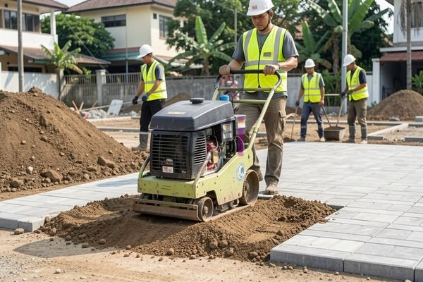

**Jasa Stamper Tanah: Solusi Pemadatan Efisien untuk Proyek Konstruksi Anda** - Hai Mitra CDI! Pernahkah Anda membayangkan fondasi bangunan yang kokoh dan tahan lama? Kuncinya ada pada pemadatan tanah yang tepat. Di Creative Design Interior, kami paham betul betapa pentingnya proses ini.

Pemadatan tanah yang kurang baik bisa berakibat fatal: bangunan ambles, retakan menganga, bahkan kegagalan struktur. Bayangkan kerugian waktu dan biaya yang harus ditanggung! Itulah kenapa memilih jasa stamper tanah profesional adalah investasi cerdas untuk keamanan dan keberhasilan proyek Anda di (not detected). Kami hadir dengan tenaga terampil dan peralatan canggih untuk memastikan fondasi bangunan Anda kuat dan awet.

## Mengapa Investasi pada Jasa Stamper Tanah Profesional Itu Penting?

Pemadatan tanah bukan sekadar memadatkan tanah begitu saja. Ada ilmu dan teknik khusus di baliknya untuk mencapai kepadatan optimal yang sesuai standar. Stamper tanah, atau *jumping jack*, adalah alat berat yang bekerja dengan getaran dan tekanan untuk mencapai kepadatan yang dibutuhkan.

Mengapa memilih profesional? Tentu saja, penggunaan alat yang tepat adalah kunci. Setiap jenis tanah membutuhkan pendekatan berbeda. Operator berpengalaman kami mampu membaca kondisi tanah dan menentukan metode pemadatan yang paling efektif. Selain itu, hasil pemadatan akan terukur dan sesuai standar kualitas, memberikan ketenangan pikiran bagi Mitra CDI.

## Beragam Jenis Stamper Tanah dan Penerapannya

Tersedia beragam jenis stamper tanah, masing-masing dirancang untuk kebutuhan spesifik. Memilih jenis yang tepat akan mempercepat pekerjaan dan meningkatkan kualitas hasil. Mari kita lihat beberapa jenis umum beserta aplikasinya:

*   **Stamper Tanah Manual (Hand Rammer):** Pilihan tepat untuk area sempit dan pekerjaan kecil yang membutuhkan presisi, seperti di sekitar utilitas atau galian sempit.
*   **Stamper Tanah Mekanik (Jumping Jack):** Ideal untuk pemadatan tanah urug, base course, dan lapisan aspal tipis pada area yang lebih luas.
*   **Vibratory Plate Compactor:** Sering digunakan untuk pemadatan aspal, paving block, dan tanah granular pada lahan yang luas.

Mempertimbangkan jenis tanah juga krusial. Tanah berpasir memerlukan vibrasi lebih tinggi dibandingkan tanah lempung. Jangan ragu berkonsultasi dengan Jasa Pemadatan dengan Stamper kami untuk mendapatkan solusi terbaik bagi proyek Anda.

## Mempertimbangkan Biaya Jasa Stamper Tanah di (not detected): Apa yang Mempengaruhi?

Biaya jasa stamper tanah di wilayah (not detected) dan sekitarnya bervariasi, bergantung pada beberapa faktor. Luas area adalah penentu utama – semakin besar area, semakin kompleks pekerjaan dan semakin tinggi biayanya. Jenis tanah juga berpengaruh; tanah yang sulit dipadatkan memerlukan usaha dan waktu ekstra.

Untuk gambaran, estimasi biaya jasa stamper tanah berkisar antara Rp 35.000 hingga Rp 75.000 per meter persegi. Perlu diingat, angka ini hanyalah perkiraan. Untuk mendapatkan penawaran harga yang akurat dan sesuai dengan kebutuhan proyek Mitra CDI, silakan hubungi Kami.

Faktor-faktor lain yang perlu diperhatikan:

*   **Jarak Lokasi Proyek:** Mempengaruhi biaya transportasi alat dan tenaga kerja.
*   **Aksesibilitas Lokasi:** Lokasi yang sulit dijangkau dapat menaikkan biaya operasional.
*   **Kondisi Tanah:** Tanah dengan kandungan organik tinggi atau material besar memerlukan waktu pemadatan lebih lama.

## Persiapan Lahan: Kunci Keberhasilan Jasa Stamper Tanah

Persiapan lahan yang matang akan mempercepat proses pemadatan dan menghasilkan kualitas yang maksimal. Berikut beberapa tips yang bisa Anda terapkan:

*   **Lahan Bersih:** Singkirkan material organik, sampah, dan benda-benda lain yang dapat mengganggu pemadatan.
*   **Permukaan Rata:** Ratakan permukaan tanah secara kasar agar pemadatan lebih efektif.
*   **Kadar Air Ideal:** Pastikan kandungan air dalam tanah optimal. Tanah terlalu kering atau terlalu basah akan menghambat proses pemadatan. Kandungan air ideal berkisar 10-20%.
*   **Bagi Area:** Bagi lahan menjadi beberapa bagian kecil untuk memudahkan dan memastikan hasil pemadatan merata.

Butuh panduan lebih lanjut? Konsultasikan dengan ahli konstruksi Kami. Jangan lupa untuk selalu memeriksa kualitas tanah sebelum memulai. Jika tanah kurang baik, pertimbangkan perbaikan tanah terlebih dahulu. Pelajari lebih lanjut tentang pentingnya kualitas tanah dalam Tanah Merah Cikarang: Panduan Lengkap Penggunaan untuk Fondasi dan Struktur Bangunan.

Siap memulai proyek Anda dengan fondasi yang kuat? Jangan ragu! Hubungi Kami sekarang melalui tombol **WhatsApp** atau **Telepon** di bawah ini untuk konsultasi gratis. Kami siap membantu Mitra CDI di (not detected) mewujudkan proyek impian Anda. Kami juga melayani jasa lainnya, seperti [Concrete Pump Kodok: Solusi Pengecoran Efisien untuk Proyek Jabodetabek](/blog/concrete-pump-kodok/) yang bisa meringankan pekerjaan Anda.