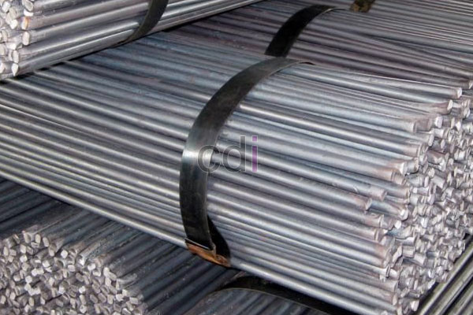

**Jenis Besi Beton untuk Cor Rumah dan Jalan** - Hai Mitra CDI! Apakah Anda sedang merencanakan proyek cor untuk rumah atau jalan? Memilih jenis besi beton yang tepat adalah kunci utama keberhasilan konstruksi. Yuk, kita bahas tuntas mengenai berbagai jenis besi beton yang tersedia dan bagaimana cara memilihnya sesuai kebutuhan Anda di (not detected).

Sebelum kita masuk ke detail jenis-jenis besi beton, penting untuk memahami beberapa faktor yang memengaruhi pemilihan besi beton yang sesuai.

## Faktor Penentu Pemilihan Besi Beton

Pemilihan besi beton yang tepat tidak bisa sembarangan, lho. Ada beberapa hal penting yang perlu Anda pertimbangkan, di antaranya:

## Kondisi Lokasi Pembangunan di (not detected)

Lokasi proyek pembangunan sangat berperan dalam menentukan jenis besi beton yang dibutuhkan. Jika Anda membangun di lahan yang kurang stabil, seperti lahan gambut atau bekas sawah, maka penggunaan besi beton dengan diameter lebih besar sangat disarankan. Hal ini penting untuk memastikan kekuatan dan daya tahan bangunan. Sebaliknya, untuk tanah yang padat, besi beton dengan diameter standar mungkin sudah cukup memadai. Selain itu, jika proyek Anda berada di dekat jalan raya yang ramai, pertimbangkan penggunaan besi beton yang lebih kuat untuk mengurangi dampak getaran.

## Jenis dan Skala Bangunan atau Jalan

Jenis dan skala bangunan atau jalan juga menjadi faktor penentu. Apakah Anda membangun rumah tinggal sederhana, rumah bertingkat, atau jalan raya? Setiap jenis bangunan memiliki kebutuhan kekuatan dan daya tahan yang berbeda. Rumah bertingkat tentu membutuhkan besi beton yang lebih besar dan kuat dibandingkan rumah satu lantai. Demikian pula, jalan kelas satu membutuhkan besi beton dengan mutu yang lebih tinggi dibandingkan jalan kelas dua atau tiga di (not detected).

*Memilih Besi Beton yang Tepat untuk Keamanan dan Kekuatan Struktur*

Dengan mempertimbangkan lokasi dan jenis bangunan atau jalan, Anda akan lebih mudah menentukan jenis besi beton yang paling sesuai untuk proyek Anda di (not detected).

## Jenis-Jenis Besi Beton untuk Cor Rumah dan Jalan

Berikut ini adalah daftar jenis-jenis besi beton yang umum digunakan dan telah tersertifikasi oleh Badan Standarisasi Nasional (BSN):

### Ukuran Besi Beton Polos

| Jenis Besi | Diameter (mm) | Luas Penampang (m²) | Berat /m (kg) |
|---|---|---|---|
| P.6 | 6 | 0,2827 | 0,222 |
| P.8 | 8 | 0,5027 | 0,395 |
| P.10 | 10 | 0,7854 | 0,617 |
| P.12 | 12 | 1,131 | 0,888 |
| P.14 | 14 | 1,539 | 1,12 |
| P.16 | 16 | 2,011 | 1,58 |
| P.19 | 19 | 2,835 | 2,23 |
| P.22 | 22 | 3,801 | 2,98 |
| P.25 | 25 | 4,909 | 3,85 |
| P.28 | 28 | 6,158 | 4,83 |
| P.32 | 32 | 8,042 | 6,31 |

### Ukuran Besi Beton Sirip

| Jenis Besi | Diameter (mm) | Luas Penampang (m²) | Berat /m (kg) |
|---|---|---|---|
| P.6 | 6 | 0,2827 | 0,222 |
| P.8 | 8 | 0,5027 | 0,395 |
| P.10 | 10 | 0,7854 | 0,617 |
| P.13 | 13 | 1,327 | 1,04 |
| P.16 | 16 | 2,011 | 4,58 |
| P.19 | 19 | 2,835 | 2,23 |
| P.22 | 22 | 3,801 | 2,98 |
| P.25 | 25 | 4,909 | 3,85 |
| P.29 | 29 | 6,625 | 5,18 |
| P.32 | 32 | 8,042 | 6,31 |
| P.36 | 36 | 10,18 | 7,99 |
| P.40 | 40 | 12,57 | 9,88 |
| P.50 | 50 | 19,64 | 17,4 |

Daftar di atas memberikan gambaran lengkap mengenai berbagai ukuran besi beton yang tersedia. Untuk informasi lebih lanjut mengenai harga besi beton, silakan kunjungi halaman [Daftar Harga Besi Beton](/blog/harga-besi-cor-beton-terbaru). Jangan ragu untuk menghubungi tim kami jika Anda membutuhkan konsultasi lebih lanjut untuk proyek Anda di (not detected). Kami siap membantu Anda memilih besi beton yang paling tepat untuk kebutuhan Anda! [Jasa Cor Jalan di Ancol Jakarta](/cor/jasa-cor-jalan-di-ancol-jakarta/) bisa menjadi solusi tepat untuk proyek jalan Anda.