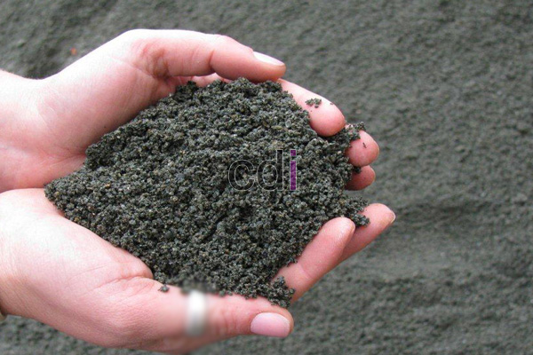

**Macam macam Pasir Hitam dan Lokasi Penambangannya** - Hai Mitra CDI! Pernahkah Anda bertanya-tanya, pasir jenis apa yang ideal untuk proyek bangunan Anda? Banyak yang menghubungi kami menanyakan hal serupa. Nah, kali ini kami akan membahas tuntas berbagai jenis pasir hitam dan dari mana saja sumber penambangannya. Semoga ulasan ini membantu Anda menemukan pilihan terbaik, terutama jika Anda berada di wilayah Jakarta, Bogor, Depok, Tangerang, Bekasi, Cikarang, Cibitung, atau sekitarnya di Jawa Barat.

*Pasir Hitam*

## Memahami Pasir Hitam: Lebih dari Sekadar Warna

Sebagian besar lokasi penambangan pasir di Jawa Barat dan Banten menghasilkan pasir berwarna hitam. Namun, tahukah Anda bahwa warna hitam ini bervariasi? Ada hitam pekat, hitam kemerahan, hitam kecoklatan, bahkan hitam keabuan. Supplier pasir, termasuk kami, secara tradisional menyebutnya semua sebagai "pasir hitam". Perlu diingat, meskipun warnanya serupa, kualitas pasir dari lokasi penambangan yang berbeda bisa sangat bervariasi. Inilah mengapa harga pasir hitam seringkali berbeda-beda antar penjual.

## Ragam Jenis Pasir Hitam dan Asalnya

Bagi Anda yang sedang mencari pasir hitam berkualitas baik dengan lokasi terdekat dari proyek Anda, simak penjelasan kami mengenai jenis-jenis pasir hitam dan lokasi penambangannya berikut ini:

- 1\. [**Pasir Hitam Jebrod**](/product/pasir-cor-jebrot). Pasir kelas satu asal penambangan di Kp. Jebrod, Cianjur, Jawa Barat. Pasir ini sangat direkomendasikan untuk pekerjaan cor karena irit semen dan memiliki kandungan lumpur yang sangat rendah (di bawah 8%). Warnanya bervariasi, mulai dari hitam abu-abu tua hingga hitam kecoklatan, bahkan terkadang merah pucat.
- 2\. [**Pasir Hitam Cimangkok**](/product/jual-pasir-cimangkok). Pasir dari daerah Cimangkok, Sukabumi, Jawa Barat, yang juga termasuk golongan pasir hitam kelas satu. Warna hitam kecoklatan membuatnya cocok untuk pekerjaan cor, pondasi, dan pemasangan bata.
- 3\. [**Pasir Hitam Cimalaka Subang /Bandung**](/product/pasir-cimalaka). Pasir kelas satu dengan warna hitam keabuan (ada juga yang abu-abu tua) yang banyak digunakan untuk cor, pasang, dan berbagai kebutuhan konstruksi lainnya. Ditambang di daerah Cimalaka.
- 4\. [**Pasir hitam mundu**](/blog/jual-pasir-cor-lampung-dan-mundu). Pasir kelas dua asal Cirebon, Jawa Barat. Dulu sangat terkenal dengan kualitasnya, namun kini agak sulit menemukan yang asli. Warna aslinya hitam kecoklatan.
- 5\. [**Pasir Hitam Jonggol Bogor**](/product/pasir-cor-hitam). Pasir rendah lumpur kelas dua yang ditambang dengan metode sedot dan cuci. Warnanya hitam pekat dan sangat ideal untuk cor, pondasi, dan pemasangan bata.
- 6\. **Pasir Hitam Cicangkal Bogor**. Berasal dari daerah Bogor, pasir ini berwarna hitam muda dan sangat baik untuk pekerjaan pasang batu, bata, plester, dan cor.
- 7\. [**Pasir Hitam Rangkas**](/product/jual-pasir-rangkas). Pasir kelas tiga yang berasal dari penambangan di wilayah Rangkas Bitung, Banten. Pasir ini populer di Jakarta karena harganya yang terjangkau dan kualitasnya yang cukup baik. Warnanya hitam keabuan dan bisa digunakan untuk plester, pasang batu, dll.
- 8\. [**Pasir Hitam Serang**](/blog/alternatif-pasir-cor-yang-bagus-dan-murah). Selain Rangkasbitung, Banten juga memiliki lokasi penambangan di Serang. Meskipun masuk kategori pasir kelas tiga, pasir Serang termasuk yang terbaik di Propinsi Banten. Warnanya hitam pekat, ditambang dengan metode sedot, dan cocok untuk cor, pasang, dan plester.
- 9\. [**Pasir Hitam Ayak Cilegon**](/product/pasir-pasang-cilegon). Masih dari wilayah Banten, pasir kelas tiga ini banyak dipakai di proyek perumahan dan cluster karena harganya murah dan kualitasnya baik. Warnanya hitam kecoklatan dan keabuan, sangat direkomendasikan untuk pasang pondasi, bata, dll selain cor.
- 10\. **Pasir Hitam Bohlam Sukabumi**. Pasir dari Kp. Bohlam, Sukabumi, berwarna hitam kecoklatan, sangat baik untuk pasang bata, pondasi, dll sebagai alternatif pasir berkualitas bagus dan murah.

## Tips Pintar Memilih Pasir Hitam

Setelah membaca ulasan jenis-jenis pasir hitam dan lokasi penambangannya, mungkin Anda merasa sedikit bingung. Pasir hitam mana yang paling cocok untuk proyek Anda? Berikut adalah panduan cerdas untuk membantu Anda memilih:

- 1\. Pertimbangkan kegunaan pasir tersebut. Jika untuk cor, pilih pasir spesialis cor. Jika kebutuhan Anda beragam, pasir serbaguna bisa menjadi pilihan.
- 2\. Bandingkan harga dan sesuaikan dengan anggaran proyek Anda – apakah untuk perumahan umum atau hunian pribadi.
- 3\. Pilih lokasi penambangan terdekat untuk menekan biaya pengiriman.
- 4\. Cari supplier yang memberikan bebas biaya pengiriman dan penurunan harga untuk mendapatkan penawaran terbaik.
- 5\. Pastikan volume pasir yang Anda beli dapat diukur ulang di lokasi atau menggunakan harga per meter kubik (m3) daripada per truk untuk transparansi.
- 6\. Pastikan penjual mendukung sistem pembayaran di lokasi (COD) jika Anda membeli secara online atau via telepon untuk keamanan transaksi.

> Kami juga menyediakan semua jenis pasir hitam yang telah disebutkan. Untuk informasi lebih lanjut dan  detail harga, silakan hubungi kami melalui tombol Telepon/WhatsApp yang tersedia di halaman ini. Atau kunjungi [**Daftar Harga Material Alam**](/blog/daftar-harga-material-pasir-dan-batu-terlengkap).

Demikian penjelasan dari kami mengenai Jenis Jenis Pasir Hitam dan Lokasi Penambangannya. Semoga ini menjadi panduan yang bermanfaat, khususnya bagi Anda yang mencari pasir hitam di Jabodetabek dan Jawa Barat. Terima kasih! [Jual Pasir Hitam Kasar di Bondongan Bogor Gratis Ongkir](/pasir/jual-pasir-hitam-kasar-di-bondongan-bogor-gratis-ongkir/) bisa menjadi referensi tambahan untuk pilihan pasir ideal Anda.