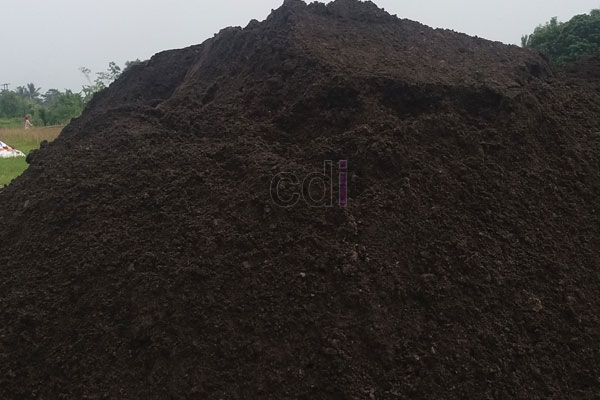
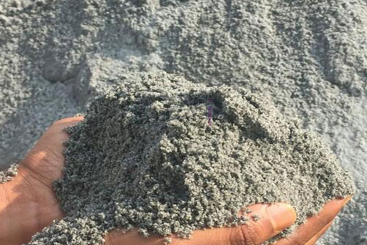
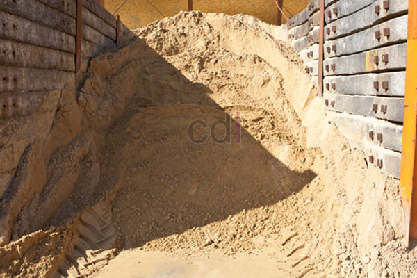
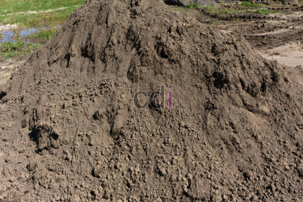

**Beberapa Jenis Pasir untuk Bahan Bangunan** | Mitra CDI! Pernahkah Anda bertanya-tanya, sebenarnya ada berapa jenis pasir yang digunakan dalam konstruksi? Nah, artikel ini hadir untuk menjawab rasa penasaran Anda. Pasir, material alam berbentuk butiran halus, memang krusial dalam berbagai tahap pembangunan. Ukurannya sendiri berkisar antara 0,50 mm hingga 2 mm. Asal-usulnya beragam; di pegunungan berasal dari letusan gunung berapi, sementara di wilayah pesisir tropis, batu kapur menjadi sumber utamanya. Keberadaannya memang kurang ideal untuk pertumbuhan tanaman karena kandungan mineralnya yang minim. Tapi justru inilah yang membuatnya sangat berguna sebagai campuran semen untuk menciptakan bangunan yang kokoh.

## Mengapa Pasir Begitu Penting dalam Konstruksi?

Dalam dunia pembangunan, pasir bukan sekadar komponen tambahan. Ia adalah salah satu bahan utama yang tak tergantikan. Biasanya, pasir dicampur dengan semen untuk menghasilkan adukan yang kuat. Fungsinya pun beragam, mulai dari urugan di bawah pondasi, fondasi lantai, plester dinding, hingga pemasangan *paving*. Tak hanya itu, pasir juga menjadi komponen penting dalam pembuatan mortar – adukan yang digunakan untuk lantai, pondasi batu kali, perekat dinding bata, lantai keramik, dan material cetak lainnya. Singkatnya, tanpa pasir, bangunan yang utuh dan berkualitas akan sulit terwujud.

## Mengenal Berbagai Jenis Pasir untuk Kebutuhan Bangunan Anda

Memilih jenis pasir yang tepat sangat penting. Tidak semua pasir cocok untuk semua jenis konstruksi. Kebutuhan dan kondisi bangunan akan menentukan jenis material yang paling ideal. 

Berikut adalah beberapa jenis pasir yang umum digunakan dalam pembangunan:

### Pasir Beton (Pasir Cor)

Sering disebut Pasir Cor, jenis pasir ini memiliki ciri-ciri butiran yang lebih kasar dan terasa keras saat digenggam, serta tidak menggumpal. Ukuran butirannya biasanya berkisar antara 1 mm hingga 3 mm. Pasir Beton yang berkualitas memiliki kandungan lumpur di bawah 5%, baik itu jenis pasir putih maupun pasir hitam. Material ini sangat ideal untuk pengecoran, pemasangan pondasi, dan sebagai perekat dinding (misalnya saat memasang bata dan plester). Secara umum, Pasir Cor dari sumber kali lebih direkomendasikan karena kandungan lumpurnya cenderung lebih rendah dibandingkan pasir dari sumber gunung.

*Pasir Beton*

### Pasir Pasang

Jenis pasir ini memiliki tekstur yang lebih halus dibandingkan Pasir Beton. Saat digenggam, pasir ini cenderung menggumpal dan tidak mudah kembali ke bentuk semula. Harganya relatif lebih terjangkau. Pasir Pasang umumnya digunakan sebagai campuran untuk perekat dinding, bata, pemasangan keramik, marmer, dan lain sebagainya. Perlu diingat, pasir ini seringkali mengandung kerikil, sehingga perlu dilakukan pengayakan terlebih dahulu sebelum digunakan.

*Pasir pasang*

### Pasir Plester

Pasir Plester merupakan jenis pasir terhalus di antara jenis pasir lainnya. Berbeda dengan pasir untuk memasang bata atau batu, pasir plester harus benar-benar halus dan bebas dari bebatuan serta kotoran. Mengayak pasir sebelum dicampurkan ke plester adalah langkah yang wajib dilakukan agar permukaan dinding bisa benar-benar halus dan rata. Pengecualian berlaku untuk pasir putih Bangka dan Lampung yang secara alami bebas dari lumpur dan bebatuan.

*Pasir plester*

### Pasir Urug

Jenis pasir ini memiliki tekstur yang lebih kasar dan seringkali tercampur dengan bebatuan. Ia memang lebih cocok digunakan sebagai bahan urugan. Meskipun bisa digunakan sebagai campuran cor, hasilnya cenderung lebih kasar dan kurang optimal. Pasir urugan biasanya ditambang dari sungai atau diambil dari sisa hasil pengayakan pasir lainnya. Karena peruntukannya hanya untuk urukan, kualitasnya pun tidak terlalu diutamakan.

*Pasir urug*

> Tertarik dengan salah satu jenis pasir di atas, Mitra? Yuk, segera hubungi tim kami untuk informasi lebih lanjut! Temukan pilihan terbaik untuk proyek Anda. Jangan ragu untuk bertanya — kami siap membantu!

Saat ini, sumber pasir utama ada dua: gunung dan sungai/laut. Pasir dari gunung cenderung memiliki kandungan lumpur lebih tinggi karena hanya melalui proses pengayakan. Sementara itu, pasir dari sungai memiliki kandungan lumpur yang sangat rendah karena melalui proses penyedotan dan pencucian. Ada juga pasir fabrikasi yang dihasilkan dari penggilingan bebatuan. Penting untuk diingat, penggunaan material ini haruslah bijaksana dan legal. Hindari penambangan liar yang merusak alam. Mari bersama-sama menjaga kelestarian lingkungan agar generasi mendatang tetap dapat menikmati sumber daya alam ini.

[Jual Pasir Bangka di Babakan Pasar Bogor Gratis Ongkir](/pasir/jual-pasir-bangka-di-babakan-pasar-bogor-gratis-ongkir/) — Jika Anda mencari suplai Pasir Bangka berkualitas, kunjungi halaman ini untuk penawaran menarik di Bogor!