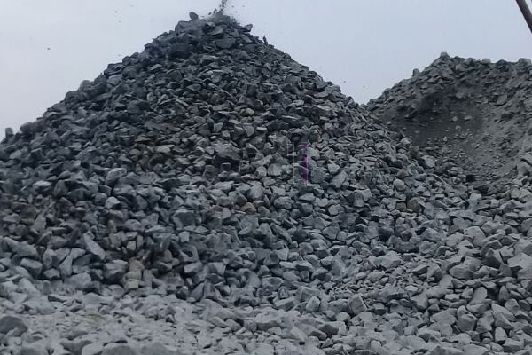

**Inilah Jenis Material Untuk Pengurugan** - Hai Mitra CDI! Apakah Anda sedang merencanakan proyek konstruksi atau renovasi di (not detected)? Pengurugan adalah tahapan penting yang seringkali dibutuhkan. Banyak yang bertanya-tanya, material apa saja yang cocok untuk pengurugan? Nah, di artikel ini, kami akan membahas tuntas jenis-jenis material pengurugan dan cara penerapannya agar proyek Anda berjalan lancar dan efisien. Yuk, simak selengkapnya!

*Batu Makdam 5/7*

## Memahami Hal Penting Dalam Proses Pengurugan

Sebelum memilih material, ada beberapa hal krusial yang perlu Anda perhatikan dalam proses pengurugan. Memahami hal-hal ini akan membantu Anda menentukan jenis material yang paling tepat untuk kebutuhan proyek Anda di (not detected). Berikut poin-poin pentingnya:

- 1\. **Lokasi Lahan:** Apakah lahan yang akan diurug berada di area perkotaan yang padat penduduk, dekat sungai, atau di daerah rawan longsor dan gempa?
- 2\. **Kedalaman Pengurugan:** Jika kedalaman area yang akan diurug lebih dari 50 cm, pertimbangkan penggunaan beberapa lapisan material pengurugan yang berbeda untuk mendapatkan hasil yang optimal.
- 3\. **Beban yang Akan Diterima:** Pertimbangkan beban yang akan berada di atas area pengurugan nantinya. Hal ini akan mempengaruhi pilihan jenis material yang paling sesuai untuk menopang beban tersebut.

## Persiapan Matang Sebelum Pengurugan Dimulai

Persiapan yang baik adalah kunci keberhasilan setiap proyek, termasuk pengurugan. Dengan persiapan yang matang, Anda dapat menghemat waktu dan biaya. Berikut beberapa hal yang perlu Anda lakukan sebelum memulai proses pengurugan di (not detected):

- 1\. Pastikan tenaga tukang yang Anda gunakan sudah siap dan jumlahnya mencukupi.
- 2\. Periksa kondisi alat pemadat dan pastikan berfungsi dengan baik.
- 3\. Prioritaskan pemesanan material yang akan digunakan sebagai lapisan paling dasar.
- 4\. Lakukan pengawasan stok material secara berkala agar pekerjaan tidak terhambat.

## Jenis Material Untuk Pengurugan dan Aplikasinya

Setelah memahami struktur tanah dan kebutuhan proyek Anda, Anda akan lebih mudah memilih material pengurugan yang tepat. Berikut adalah beberapa jenis material pengurugan yang umum digunakan beserta saran penggunaannya:

- 1\. **Batu Makadam**. Material alam hasil pecahan batu pondasi dengan ukuran umumnya di bawah 7 cm. Sangat ideal untuk lapisan pertama pada jalan atau area lain sebelum dilapisi basecourse atau sirdam. Ingin tahu lebih lanjut tentang batu makadam? Klik [**DISINI**](/product/batu-makadam).
- 2\. **Batu Lime Stone /Batu Kapur Mentah**. Batu berwarna putih kekuningan dengan tekstur lebih lunak dibandingkan batu makadam. Penggunaannya hampir sama dengan makadam, namun dengan harga yang lebih terjangkau dan memiliki kemampuan menyerap air. Ini menjadi pilihan hemat biaya yang baik untuk pengurugan dasar lahan berlubang atau pembuatan jalan baru. _Baca lebih lanjut tentang material limestone di_ [**Material Limestone**](/product/jual-batu-limestone-kapur).
- 3\. **Sirtu /Sirdam /Base Course**. Campuran batu pecah (ukuran < 5cm), abu batu, dan pasir hitam. Digunakan sebagai lapisan kedua setelah makadam atau lime stone untuk mengisi celah-celah pemadatan pada infrastruktur jalan atau area lainnya. _Untuk info harga Sirtu /Sirdam, silakan klik_ [**Material Sirtu dan Sirdam**](/product/sirtu-dan-sirdam).
- 4\. **Brangkal**. Material hasil saringan penambangan pasir, sering digunakan untuk pengurugan yang tidak memerlukan spesifikasi khusus karena harganya yang relatif murah. Brangkal banyak dicari oleh penyedia jasa pengurugan bangunan.
- 5\. **Pasir Urug**. Pasir kualitas rendah yang tidak cocok untuk campuran semen, hanya digunakan sebagai material pengurugan. Sangat ideal untuk diaplikasikan pada lantai sebelum pemasangan keramik, marmer, atau pengecoran.
- 6\. **Kulit Aspal**. Hasil kupasan aspal lama saat renovasi jalan. Material ini dimanfaatkan sebagai urugan karena ketahanannya yang kuat dan harga yang sangat terjangkau. Namun, ketersediaan kulit aspal cukup terbatas karena hanya ada saat proyek pengelupasan aspal sedang berlangsung.
- 7\. **Puing puing bangunan**. Sisa-sisa bongkaran bangunan yang dapat dimanfaatkan sebagai material pengurugan. Kekuatan dan kemampuannya menyerap air menjadikan puing bangunan rekomendasi untuk pengurugan lahan yang akan dibangun rumah atau gedung. Tidak disarankan untuk urugan jalan.
- 8\. **Limbah Beton**. Stoknya terbatas dan hanya tersedia saat terjadi kegagalan produksi atau kelebihan produksi di batching plant. Untuk mendapatkannya, Anda perlu menjalin koneksi dengan pemilik usaha pabrik beton.

Itulah penjelasan singkat mengenai "_Jenis Material Untuk Pengurugan_". Semoga informasi ini bermanfaat bagi Anda yang berencana melakukan pengurugan di (not detected). Jika Anda memiliki pertanyaan lebih lanjut atau membutuhkan bantuan dalam memilih material yang tepat, jangan ragu untuk menghubungi kami melalui tombol Telepon/WhatsApp di website ini. Kami siap membantu Anda!