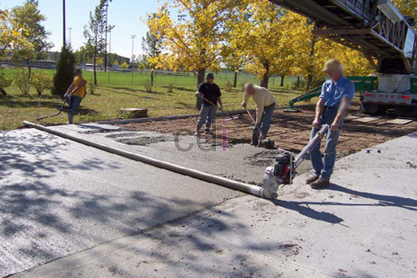

**Mengenal Mutu Beton Ready Mix Pratekan** - Hai Mitra CDI! Pernahkah Anda bertanya-tanya, bagaimana beton bisa lebih kuat dan tahan lama? Nah, dalam dunia konstruksi, ada teknik khusus yang membuat beton bekerja lebih optimal. Teknik itu adalah pratekan! Artikel ini akan mengulas tuntas tentang beton ready mix pratekan, mulai dari pengertian, jenis, hingga keunggulannya. Yuk, kita simak bersama!

## Beton Ready Mix Prategang dan Pratekan: Apa Bedanya?

Beton ready mix, secara umum, adalah beton yang diproduksi di pabrik *batching plant* lalu dikirim dalam kondisi segar sesuai permintaan pelanggan. Tapi, ada jenis beton khusus yang punya keunggulan lebih: beton prategang dan pratekan. Kedua jenis ini dirancang untuk mengatasi kelemahan beton biasa—yaitu kurang tahan terhadap gaya tarik.

Kita tahu kalau beton kuat menahan tekanan, sementara baja kuat menahan tarikan. Kombinasi keduanya menghasilkan beton bertulang yang efektif. Tapi, ada bagian beton yang kurang termanfaatkan karena hanya menahan tekanan. Nah, di sinilah beton prategang dan pratekan berperan.

*Beton ready mix pratekan* (atau *prestressed concrete*) dibuat dengan memberikan tekanan awal pada beton sebelum mendapat beban. Dengan begitu, seluruh penampang beton berada dalam kondisi tertekan—bahkan sebelum digunakan. Ini meningkatkan efisiensi dan daya tahan struktur.

Sementara, *beton prategang* adalah beton bertulang yang diberi tegangan internal sedemikian rupa sehingga tegangan tarik potensial akibat beban dapat dinetralkan. Tujuannya? Mengurangi risiko retak dan meningkatkan kekuatan konstruksi.

## Jenis Mutu Beton Pratekan & Prategang: Pilihan Terbaik untuk Proyek Anda

Ada dua cara utama dalam pembuatan beton ready mix pratekan dan prategang, yang menentukan jenis mutu beton yang digunakan:

### _Prestress Pretension Concrete_ (Pratekan Pra-Tegangan)

Metode ini menerapkan gaya prategang *sebelum* beton dicor. Prosesnya begini: baja tensioning ditarik terlebih dahulu, membentuk lekukan pada balok beton. Setelah itu, beton dicor di sekeliling baja tersebut. Setelah mengeras, baja dilepaskan, memindahkan tegangan ke beton dan menghasilkan struktur yang sangat kuat.

### _Prestress Post Tension Concrete_ (Prategang Pasca-Tegangan)

Berbeda dengan metode sebelumnya, beton dicor terlebih dahulu. Kemudian, saluran khusus (duct) dibuat di dalam beton untuk memasukkan kabel baja (tendon). Setelah beton mengeras, kabel baja ditarik dan dikencangkan, memberikan tekanan internal pada beton. Metode ini sering digunakan untuk proyek-proyek dengan bentang panjang, karena memungkinkan pemasangan kabel baja secara segmental (per bagian 1–1,5 meter).

<table class="table">
  <caption>Contoh Mutu Beton Pratekan</caption>
  <thead>
    <tr><th>Jenis Beton</th><th>Mutu (K)</th></tr>
  </thead>
  <tbody>
    <tr><td>Beton Struktur</td><td>K-300, K-275, K-250, K-225</td></tr>
    <tr><td>Beton Konstruksi Khusus</td><td>K-500, K-450, K-400, K-375, K-325, K-350</td></tr>
  </tbody>
</table>

Nah, mitra, itulah penjelasan lengkap tentang beton ready mix pratekan dan prategang. Semoga ulasan ini bermanfaat dan membantu Anda memahami lebih dalam tentang teknologi beton modern ini! Jika Anda masih memiliki pertanyaan atau ingin konsultasi lebih lanjut, jangan ragu untuk menghubungi kami. Kami siap membantu Anda menemukan solusi beton yang tepat untuk setiap proyek di (not detected). Atau, jika Anda ingin langsung memesan beton cor dengan spek standar uji SNI, silakan hubungi tim kami! [Daftar Harga Beton Ready Mix](/blog/daftar-harga-beton-cor-ready-mix-non-fly-ash-dan-fly-ash/) juga tersedia untuk referensi Anda. Jangan lupa lihat juga bagaimana [Cara Kerja Pompa Beton Ready Mix](/blog/cara-kerja-pompa-beton-ready-mix/) agar pekerjaan pengecoran Anda semakin efisien. Dengan beton berkualitas dan layanan terbaik dari CDI, proyek Anda pasti lebih kokoh dan tahan lama!