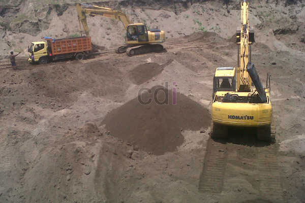
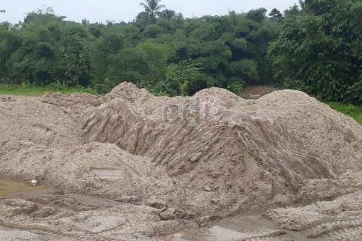

**Macam macam Pasir Gunung dan Sungai** - Hai Mitra CDI! Sedang mencari informasi lengkap tentang perbedaan pasir gunung dan sungai? Tenang, Anda berada di tempat yang tepat! Kami memahami bahwa memilih jenis pasir yang tepat untuk proyek Anda bisa jadi membingungkan. Nah, untuk mempermudah, mari kita bedah perbedaan utama antara Pasir Gunung dan Pasir Sungai. Dengan memahami karakteristik masing-masing, Anda bisa membuat keputusan terbaik untuk kebutuhan konstruksi Anda di (not detected).

*pemandangan tambang pasir gunung*

## Mengenal Lebih Dekat Pasir Gunung

Pasir Gunung, seperti namanya, umumnya berasal dari material vulkanik seperti sisa letusan gunung merapi atau endapan debu vulkanik. Jenis pasir ini banyak ditemukan di wilayah Indonesia, khususnya Pulau Jawa dan Sumatera. Ciri khasnya? Warnanya cenderung hitam pekat, teksturnya kasar dan keras, serta kandungan lumpurnya relatif minim – menjadikannya pilihan ideal untuk pengecoran dan pemasangan batu pondasi. Perlu diingat, beberapa sumber pasir gunung mungkin memiliki kadar lumpur lebih tinggi, sehingga memerlukan proses pencucian sebelum digunakan. 

Beberapa lokasi penambangan pasir gunung yang kami ketahui termasuk Tasikmalaya (Pasir Galunggung), Sukabumi (Pasir Cimangkok), Cianjur (Pasir Jebrod), Subang (Pasir Cimalaka), Bogor (Pasir Cicangkal), Jonggol (Pasir Hitam), Rangkasbitung (Pasir Rangkas), Cilegon (Pasir Cilegon), Yogyakarta (Pasir Merapi), Kediri (Pasir Gunung Kelud), Paring Sewu Lampung (Pasir Gunung Sugih), dan masih banyak lagi lokasi lain di (not detected) yang juga menghasilkan pasir gunung berkualitas.

## Mengenal Lebih Dekat Pasir Sungai

Selain dari gunung, sumber pasir yang melimpah di Indonesia juga berasal dari sungai-sungai yang mengalir di berbagai pulau, mulai dari Jawa, Sumatera, Kalimantan, hingga lainnya. Secara umum, kualitas Pasir Sungai dianggap lebih baik dibandingkan Pasir Gunung. Alasannya? Pasir yang diambil dari dasar sungai sudah melalui proses pencucian alami, sehingga terbebas dari lumpur dan kotoran. Hasilnya, pasir sungai cenderung lebih bersih dan halus. Beberapa lokasi penambangan pasir sungai yang kami ketahui antara lain Sungai Musi (Sumatra), Sungai Pontianak (Kalimantan Barat), Pasir Pulang Pisau, Sungai Kahayan (Kalimantan Tengah), Sungai Cimanuk (Jawa Barat), Sungai Serayu Banyu Mas (Jawa Tengah), dan Sungai Brantas (Jawa Timur). Tentu, suplai pasir sungai di (not detected) juga tersedia.

*pekerjaan di area tambang pasir sungai*

## Perbandingan: Kelebihan dan Kekurangan Pasir Gunung vs. Pasir Sungai

Supaya Anda lebih mudah membandingkan dan menentukan pilihan terbaik, berikut adalah rangkuman kelebihan dan kekurangan masing-masing jenis pasir:

### Keunggulan Pasir Gunung Dibandingkan Pasir Sungai

- 1\. Proses penambangannya relatif lebih mudah dan tidak memerlukan mesin sedot.
- 2\. Ketersediaannya luas dan mudah ditemukan di berbagai toko material.
- 3\. Harganya cenderung lebih terjangkau, cocok untuk berbagai aplikasi seperti pemasangan, pengecoran, dan plesteran.

### Kekurangan Pasir Gunung Dibandingkan Pasir Sungai

- 1\. Kadar lumpurnya lebih tinggi, sehingga memerlukan proses pencucian untuk meminimalkan kandungan lumpur.
- 2\. Membutuhkan proses pengayakan berulang kali untuk mendapatkan ukuran yang sesuai.
- 3\. Penggunaan semen yang lebih banyak (terutama jika pasir belum dicuci).

### Keunggulan Pasir Sungai Dibandingkan Pasir Gunung

- 1\. Teksturnya lebih halus dan bersih, biasanya hanya memerlukan satu kali pengayakan.
- 2\. Kandungan lumpurnya lebih rendah karena proses pembersihan alami oleh aliran sungai.
- 3\. Lebih hemat dalam penggunaan semen.

### Kekurangan Pasir Sungai Dibandingkan Pasir Gunung

- 1\. Proses penambangannya lebih rumit, membutuhkan mesin sedot dan berpotensi menimbulkan masalah banjir.
- 2\. Ketersediaannya terkadang terbatas, terutama di daerah yang jauh dari sumber sungai.
- 3\. Harganya lebih mahal karena kualitasnya yang lebih unggul.

Sebagai penutup, Mitra, baik Pasir Gunung maupun Pasir Sungai memiliki kelebihan dan kekurangan masing-masing. Pemilihan terbaik tergantung pada kondisi dan lokasi proyek Anda di (not detected). Jika lokasi proyek Anda dekat dengan sumber pasir gunung, memilih pasir gunung tentu lebih ekonomis karena menghemat biaya transportasi. Begitu pula sebaliknya, jika sumber pasir sungai lebih dekat, pasir sungai akan menjadi pilihan yang lebih efisien.

Butuh bantuan lebih lanjut untuk menentukan jenis pasir yang tepat untuk proyek Anda? Jangan ragu untuk [hubungi kami](URL_KONTAK) dan dapatkan konsultasi gratis dari tim ahli kami! Kami siap membantu Anda menemukan solusi terbaik untuk kebutuhan konstruksi Anda di (not detected). Kami juga menyediakan berbagai jenis material bangunan lainnya, lho! [Yuk, lihat katalog lengkap kami](URL_KATALOG)!