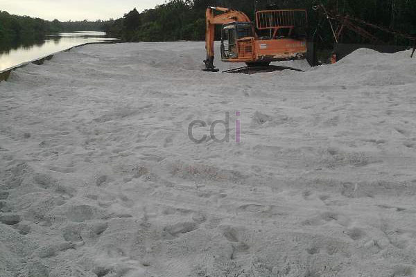

**Jenis Pasir Untuk Hamparan Taman Bermain** - Hai Mitra CDI! Ada banyak pertanyaan menarik yang datang dari para pengelola taman bermain anak seputar pemilihan jenis pasir yang tepat untuk hamparan bermain. Walaupun kami lebih dikenal sebagai penyedia material bangunan, kami punya pengalaman menyediakan pasir untuk beberapa proyek taman bermain lho. Nah, berdasarkan pengalaman itu, yuk kita bahas bersama jenis pasir apa saja yang paling ideal untuk menciptakan area bermain yang aman dan menyenangkan bagi anak-anak di (not detected).

*Pilihan Pasir Terbaik untuk Taman Bermain*

## Mengenal Karakteristik Pasir yang Ideal

Memilih pasir yang tepat untuk hamparan taman bermain itu penting banget. Dengan begitu banyaknya pilihan yang ada, mari kita fokus pada karakteristik utama yang harus diperhatikan. Pasir laut putih atau pasir sedot sering menjadi favorit karena kualitasnya yang prima. Warnanya yang cerah, seperti kristal atau silika, serta proses penambangan yang bersih (disedot dan dicuci) menjadikannya pilihan menarik. Jadi, intinya, pasir yang cocok untuk hamparan taman bermain adalah yang halus teksturnya, berwarna cerah, bersih, dan bebas debu.

## Rekomendasi Jenis Pasir untuk Taman Bermain

Setelah kita tahu karakteristik pasir yang dibutuhkan, sekarang mari kita lihat jenis-jenis pasir (yang tersedia di CDI) yang memenuhi kriteria tersebut. Berikut adalah pilihan yang kami rekomendasikan:

- 1. **Pasir Silika Bangka**. Pasir ini punya warna putih bersih yang memukau, mirip garam dapur. Butirannya berkilau seperti kaca atau silika, dengan variasi ukuran mulai dari halus hingga kasar.
- 2. **Pasir Lampung Cuci**.  Pasir ini juga sangat baik, meskipun warnanya cenderung krem atau kecoklatan. Ketersediaan ukurannya hanya yang lembut saja.
- 3. **Pasir Coklat Belitung**. Sesuai namanya, pasir ini berwarna coklat alami. Teksturnya agak kasar dan cocok digunakan sebagai campuran untuk dekorasi pot bunga atau sebagai elemen hias di area bermain.

## Jangkauan Pengiriman Pasir di (not detected) dan Sekitarnya

Tertarik untuk membeli pasir-pasir berkualitas ini? Kami siap melayani Anda! Jangan ragu untuk menghubungi tim kami untuk berdiskusi mengenai harga dan ketersediaan. Kami melayani pengiriman ke berbagai lokasi, termasuk:

- 1. Seluruh wilayah Jakarta.
- 2. Kabupaten Bogor.
- 3. Kota Depok.
- 4. Kota Tangerang.
- 5. Kota Bekasi.
- 6. Karawang.
- 7. Cikampek.
- 8. Purwakarta.

## Transaksi Aman dan Terpercaya

Kami mengutamakan keamanan dan kenyamanan Anda dalam bertransaksi. Sistem pembayaran yang kami terapkan adalah *cash on delivery* – Anda membayar di lokasi setelah material pasir diterima. Dengan sistem ini, Anda tidak perlu khawatir tentang penipuan karena Anda tidak perlu membayar di muka. Kami mengirimkan barang terlebih dahulu, sehingga Anda bisa memastikan kualitasnya sebelum melakukan pembayaran. Dijamin aman 100%! Untuk informasi lebih lanjut, atau konsultasi gratis mengenai kebutuhan pasir taman bermain Anda di (not detected), segera hubungi kami melalui tombol telepon/WhatsApp di halaman ini. [Jual Pasir Bangka di Babelan Bekasi Gratis Ongkir](/pasir/jual-pasir-bangka-di-babelan-bekasi-gratis-ongkir/) adalah salah satu lokasi yang sering kami kirimkan materialnya juga!