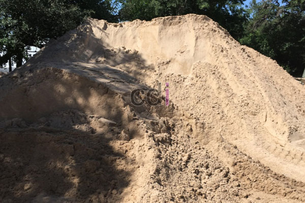

**Jenis Pasir untuk Produksi Batching Plant** - Hai Mitra CDI! Sudah lebih dari satu dekade, tepatnya 12 tahun, CDI fokus melayani kebutuhan beton curah siap pakai (ready mix concrete). Pengalaman panjang ini telah mengasah pemahaman kami tentang seluk-beluk konstruksi beton. Nah, dari pengalaman itulah kami ingin berbagi pengetahuan tentang "Jenis Pasir untuk Produksi Batching Plant" – topik yang sangat krusial dalam operasional pabrik beton. Artikel ini adalah rangkuman dari apa yang kami ketahui, semoga bermanfaat bagi Anda! Mari kita bahas lebih lanjut jenis-jenis pasir dan lokasi penambangannya.

*Pasir Bangka, Pilihan Utama untuk Batching Plant*

## Karakteristik Pasir yang Ideal untuk Batching Plant

Sebelum menyelami jenis-jenis pasir yang cocok untuk produksi batching plant, penting untuk memahami karakteristik fisik yang menjadi standar kualitas di pabrik olahan beton. Berikut adalah poin-poin pentingnya:

- 1\. Jenis Pasir Cor: Karena batching plant mengkhususkan diri pada produksi beton cor siap pakai, jenis pasir yang dibutuhkan adalah pasir cor khusus.
- 2\. Tekstur Kasar dan Kuat: Pasir yang baik memiliki butiran kasar (berukuran antara 1 s/d 4 mm) dan terasa keras saat digenggam. Hindari pasir yang lembek atau empuk seperti pasir plester.
- 3\. Kadar Lumpur Rendah: Kandungan lumpur sebaiknya tidak melebihi 5%. Kadar lumpur yang tinggi dapat menyebabkan pemborosan semen dan meningkatkan risiko retak pada hasil cor.
- 4\. Sumber dari Sungai atau Pasir Cuci: Pasir sungai umumnya memiliki kandungan lumpur lebih rendah dibandingkan pasir gunung. Pasir sungai diperoleh melalui proses penyedotan dan pencucian, sehingga lebih bersih. Pasir gunung perlu dicuci terlebih dahulu untuk mengurangi kadar lumpurnya.
- 5\. Supplier Terpercaya dengan Kapasitas Besar: Batching plant membutuhkan pasokan pasir yang stabil, minimal 10.000 m³ per hari. Memilih supplier yang mampu memenuhi kebutuhan ini sangat penting untuk kelancaran produksi.

## Pilihan Terbaik Jenis Pasir untuk Batching Plant

Berdasarkan pengalaman kami, ada banyak jenis pasir yang memenuhi standar untuk produksi batching plant. Indonesia kaya akan sumber daya pasir yang bisa dimanfaatkan. Beberapa jenis yang paling umum digunakan di pabrik olahan beton antara lain: Pasir Bangka kasar, Pasir Jebrod, Pasir Cimalaka, Pasir Cimangkok, Pasir Belitung, Pasir Silika, Pasir Merapi, Pasir Pulang Pisau dan Pasir Galunggung.

## Lokasi Penambangan Pasir Cor Terbesar di Indonesia

Setelah mengetahui karakteristik pasir yang ideal, penting juga untuk mengetahui lokasi penambangan atau supplier terbesarnya di Indonesia. Berikut adalah data yang kami kumpulkan, semoga menjadi referensi bagi Anda yang berencana mendirikan pabrik olahan beton atau batching plant:

- 1\. Tambang Pasir Pulau Bangka: Terletak di provinsi Bangka Belitung, khususnya di wilayah Belitung Timur (untuk informasi lebih detail, silakan hubungi kami).
- 2\. Tambang Pasir Tulang Bawang Lampung: Berlokasi di Kabupaten Tulang Bawang, Lampung.
- 3\. Tambang Pasir Sungai Musi: Berada di sepanjang pinggiran sungai Musi, Sumatera Selatan.
- 4\. Tambang Pasir Pontianak: Terletak di sungai Kapuas, Kalimantan Barat.
- 5\. Tambang Pasir Palangkaraya: Berlokasi di Palangka Raya, Kalimantan Tengah.
- 6\. Tambang Pasir Pulang Pisau: Terletak di kabupaten Pulang Pisau, Kalimantan Tengah.
- 7\. Tambang Pasir Jebrod: Terletak di desa Jebrod, Cianjur, Jawa Barat.
- 8\. Tambang Pasir Cimangkok: Berada di desa Cimangkok, Sukabumi.
- 9\. Tambang Pasir Cimalaka: Berlokasi di kp. Cimalaka, Subang, Jawa Barat.
- 10\. Tambang Pasir Sungai Progo: Berada di Magelang, Jawa Tengah.
- 11\. Tambang Pasir Merapi: Terletak di lereng gunung Merapi, Yogyakarta.
- 12\. Tambang Pasir Galunggung: Berada di Tasikmalaya, Jawa Barat.

## Sistem Pembayaran yang Aman dan Efisien

Pembelian pasir dalam jumlah besar tentu membutuhkan anggaran yang signifikan. Oleh karena itu, penting untuk memahami sistem pembayaran yang baik dan aman. Berikut adalah beberapa metode pembayaran yang umumnya disetujui oleh supplier pasir terkemuka:

- 1\. Sistem Pembayaran SKBDN: Janji tertulis dari pemohon yang mengikat bank untuk melakukan pembayaran kepada penerima atau order.
- 2\. Sistem Pembayaran FOB: Pembayaran dilakukan secara tunai setelah material diterima oleh pemesan.

Itulah penjelasan kami mengenai Jenis Pasir untuk Produksi Batching Plant. Semoga artikel ini bermanfaat bagi Anda. Kami, dari CDI, siap menyediakan berbagai jenis pasir dengan kualitas terjamin dan kuantitas yang tak terbatas, sesuai dengan lokasi batching plant Anda di (not detected). Jangan ragu untuk menghubungi kami melalui email atau telepon. [Hubungi kami sekarang juga!](URL) untuk mendapatkan penawaran terbaik dan solusi kebutuhan pasir Anda. Kami berkomitmen untuk menjadi mitra terpercaya dalam kesuksesan proyek konstruksi Anda di (not detected).  Kami juga bisa membantu Anda dalam [pemilihan material bangunan lainnya](URL).