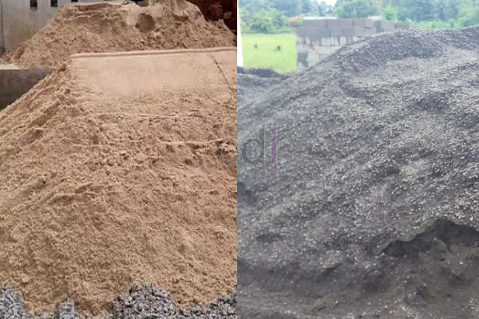
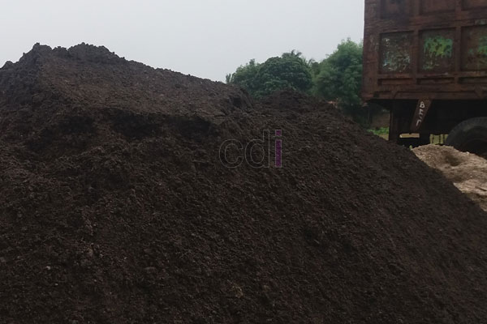

**Jenis Pasir yang Baik Untuk Pengecoran** - Hai Mitra CDI! Sedang mencari informasi tentang pasir yang tepat untuk pengecoran? Artikel ini hadir untuk membantu Anda memahami berbagai jenis pasir yang unggul untuk menghasilkan coran beton yang kokoh dan tahan lama. Yuk, kita bahas satu per satu! 

*Memilih Pasir yang Tepat untuk Pengecoran Berkualitas*

## Sifat dan Karakteristik Pasir yang Ideal untuk Pengecoran

Sebenarnya, hampir semua jenis pasir bisa dipakai untuk pengecoran, karena campuran semen, split, dan air akan mengerasnya. Tapi, mutu dan kekuatan cor beton sangat dipengaruhi oleh kandungan dalam pasir itu sendiri. Kandungan lumpur dan garam yang berlebihan bisa menyebabkan coran cepat melepuh dan rapuh. Jadi, memilih Jenis Pasir yang Baik Untuk Pengecoran adalah kunci utama! Secara umum, pasir yang baik memiliki warna yang pekat (hitam, kemerahan, atau putih), tekstur kasar, dan terasa keras saat diremas.

Berikut adalah hasil rekomendasi dari pengalaman kami sebagai pemasok pasir, informasi ini akan membantu Anda memilih jenis pasir yang sesuai dengan kebutuhan proyek Anda.

## Pasir Cor Putih Bangka Kasar: Pilihan Premium untuk Kualitas Tertinggi

Pasir Cor Putih Bangka adalah jenis pasir terbaik dan paling mahal yang tersedia. Kualitasnya sangat unggul, menghasilkan coran yang sangat keras hingga sulit dipaku bahkan dengan paku beton. Jenis pasir ini biasanya dipilih untuk pengecoran struktur bangunan yang membutuhkan kualitas prima.

> _Untuk informasi selengkapnya, kunjungi [**DISINI**](/product/pasir-putih-bangka)_

## Pasir Cor Galunggung Tasikmalaya: Bebas Pengotor, Ideal untuk Proyek Besar

Jenis Pasir Cor Galunggung ini terkenal karena bebas dari unsur lumpur dan garam. Warnanya hitam kemerahan dengan tekstur yang keras dan kasar, menjadikannya pilihan utama untuk pengecoran tiang pancang, bendungan, dan proyek besar lainnya. Namun, ketersediaannya terbatas dan ongkos kirimnya relatif mahal.

## Pasir Cor Pontianak: Pilihan Efisien untuk Plant Ready Mix

Jenis Pasir Pontianak hadir dalam dua warna: hitam dan putih kemerahan. Kandungan lumpur dan garam yang rendah membuat jenis pasir ini populer di plant-plant Ready Mix.

## Pasir Cor Hitam Beton (Pasir Sedot): Solusi Ekonomis dengan Kualitas Terjamin

Jika Anda mencari pasir cor yang bagus namun terjangkau, Pasir Cor Hitam Beton (pasir sedot) adalah pilihan yang tepat. Proses penambangan dan pencuciannya memastikan pasir ini bebas lumpur dan garam. Kami merupakan supplier utama untuk wilayah jabodetabek (jakarta, bogor, depok, tangerang dan bekasi) dan siap melayani kebutuhan Anda.

> _Untuk melihat Daftar Harganya, silahkan klik **[DISINI](/blog/daftar-harga-material-pasir-dan-batu-terlengkap)**_

## Pasir Cor Cimangkok Sukabumi: Irit Semen, Cocok untuk Beragam Aplikasi

Pasir Cor Cimangkok Sukabumi memiliki karakter fisik yang kasar, basah, dan keras saat digenggam. Sangat cocok untuk berbagai kebutuhan pengecoran. Selain itu, kandungan lumpurnya yang rendah (di bawah 7%) membuat campuran semen menjadi lebih hemat. Baik yang sudah dicuci maupun belum, pasir ini sangat bagus untuk digunakan di plant ready mix.

> _Dapatkan detail lengkapnya di **[DISINI](/product/jual-pasir-cimangkok)**_

## Pasir Cor Jebrod Cianjur: Hemat Semen dengan Kandungan Mangan

Pasir Cor Jebrod Cianjur sudah terkenal kualitasnya di Cianjur, Bogor, dan Bekasi. Kandungan mangan dan hemat semennnya menjadi keunggulan utama. Warnanya mirip dengan Cimangkok (hitam kemerahan), meskipun kandungan krikilnya sedikit lebih banyak (sekitar 10%).

> _Untuk spesifikasi lengkap Pasir Cor Jebrod Cianjur, kunjungi **[DISINI](/product/pasir-cor-jebrot)**_

## Pasir Cor Jawilan: Alternatif Berkualitas dengan Harga Terjangkau

Pasir Jawilan bisa menjadi alternatif menarik dari Jenis Pasir yang Baik Untuk Pengecoran. Warnanya krem kemerah-merahan dan teksturnya kasar, menyerupai pasir putih Bangka. Kualitasnya terbukti baik dan harganya relatif sama dengan Pasir Hitam Sedot.

## Pasir Cor Hitam Rumpin

Pilihan terakhir yang kami rekomendasikan adalah Pasir Cor Hitam dari daerah Rumpin Tangerang. Jenis pasir ini menawarkan kualitas baik dengan harga yang lebih bersahabat.

Itulah beberapa Jenis Pasir yang Baik Untuk Pengecoran yang sering kami rekomendasikan. Untuk pemesanan atau konsultasi lebih lanjut, jangan ragu untuk menghubungi tim kami. Kami siap membantu Anda menemukan solusi terbaik untuk proyek Anda di (not detected) dan sekitarnya!

Untuk informasi lebih lanjut dan penawaran terbaik, silahkan hubungi kami. Kami siap melayani kebutuhan material bangunan Anda di (not detected) dan wilayah lainnya. Jangan tunda lagi, segera hubungi kami untuk mendapatkan solusi terbaik!