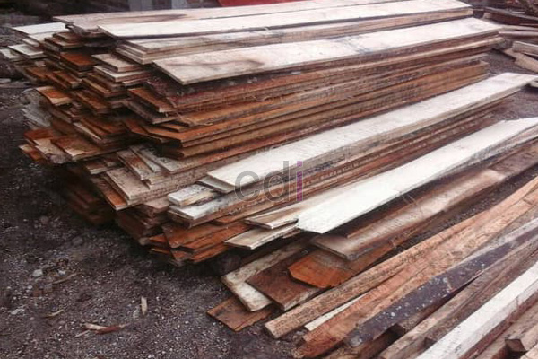

**Kayu untuk Cor: Panduan Lengkap Pemilihan, Fungsi, dan Biaya** - Hai Mitra CDI! Pernahkah Anda bertanya-tanya, kayu seperti apa yang paling pas untuk pekerjaan cor beton? Pilihan kayu yang tepat sangat krusial, lho. Karena, kayu yang kurang ideal bisa bikin struktur jadi bermasalah, mudah membengkak, bahkan mengancam keberhasilan proyek Anda di (not detected). Jadi, yuk kita bahas tuntas!

Kayu dalam pengecoran beton seringkali menjadi fondasi utama saat membuat bekisting. Bekisting ini penting banget karena bertugas menahan bentuk beton cair sampai benar-benar mengeras. Selain itu, kayu juga bisa dimanfaatkan untuk perancah pendukung dan elemen struktural sementara lainnya selama proses konstruksi. Memilih kayu yang ideal adalah kunci utama untuk memastikan hasil pengecoran yang berkualitas.

## Memilih Kayu yang Tepat untuk Pengecoran Beton

Memilih kayu untuk cor itu nggak bisa sembarangan. Ada beberapa hal penting yang harus diperhatikan, seperti kekuatan kayu, ketahanannya terhadap air, dan seberapa mudah kayu tersebut dikerjakan. Di Indonesia, ada beberapa jenis kayu yang umum digunakan, seperti kayu kamper, kayu borneo, dan kayu meranti. Mana yang terbaik?

Kayu kamper sering jadi favorit karena kekuatannya yang lumayan dan mudah dicari. Tapi, perlu diingat kalau kayu ini kurang tahan terhadap serangan rayap kalau nggak diberi pengawet yang memadai. Sedangkan kayu borneo punya kekuatan setara kamper dan sedikit lebih unggul dalam menahan kelembapan. Kalau budget terbatas, kayu meranti bisa jadi pilihan ekonomis, terutama untuk bekisting yang nggak butuh kekuatan ekstra.

Selain jenis kayu, perhatikan juga kadar airnya. Kayu yang masih basah mengandung air tinggi, yang bisa mempengaruhi kekuatan beton dan bikin bekisting menyusut. Sebaiknya, gunakan kayu yang sudah dikeringkan dengan kadar air di bawah 20%.

## Fungsi Utama Kayu dalam Proses Pengecoran

Kayu untuk cor punya peran penting di berbagai tahapan pengecoran beton, dari awal persiapan sampai akhir penyelesaian.

Bekisting kayu berfungsi untuk membentuk dan menahan beton cair sesuai desain. Bekisting harus kuat menahan berat beton saat mengeras, rapat, dan presisi agar permukaan beton halus dan akurat.

Selain membuat bekisting, kayu juga digunakan untuk perancah pendukung. Perancah ini penting untuk menopang bekisting dan memberi akses aman bagi pekerja selama pengecoran. Perancah kayu harus dirancang dengan cermat agar stabil dan aman. Kayu juga bisa jadi elemen struktural sementara untuk memperkuat bagian konstruksi tertentu selama proses pengecoran.

## Estimasi Biaya Kayu untuk Cor dan Faktor yang Mempengaruhi

Biaya kayu untuk cor berbeda-beda, tergantung jenis kayu, ukuran, dan tempat Anda membeli. Sebagai gambaran, harga kayu kamper kering untuk bekisting di (not detected) biasanya berkisar antara Rp 3.000.000 hingga Rp 5.000.000 per kubik. Kayu borneo sedikit lebih mahal, sekitar Rp 4.000.000 hingga Rp 6.000.000 per kubik. Nah, kalau ingin lebih hemat, kayu meranti bisa jadi pilihan, sekitar Rp 2.500.000 hingga Rp 4.000.000 per kubik.

Ingat ya, harga ini cuma estimasi dan bisa berubah sewaktu-waktu. Untuk penawaran yang paling akurat sesuai kebutuhan proyek Anda di (not detected), silakan hubungi Kami.

Selain harga kayu, ada biaya lain yang perlu dihitung, seperti biaya pengiriman, biaya pengerjaan (memotong dan memasang), serta biaya perawatan (misalnya, pengawet). Sebagai contoh, untuk proyek sederhana seperti cor pondasi rumah dengan volume beton 5 meter kubik, perkiraan biaya kayu bekisting (menggunakan kayu meranti) bisa mencapai Rp 7.500.000 hingga Rp 15.000.000, termasuk ongkos kerja dan pengiriman.

## Tips Mengoptimalkan Penggunaan Kayu untuk Cor

Mau hemat biaya dan mengurangi limbah kayu? Ini beberapa tips yang bisa Anda terapkan:

*   **Rencanakan:** Rencanakan penggunaan kayu dengan cermat untuk meminimalkan sisa potongan.
*   **Kayu Bekas:** Manfaatkan kayu bekas yang masih layak pakai untuk bagian-bagian yang nggak butuh kekuatan ekstra.
*   **Perawatan:** Rawat kayu dengan baik agar awet dan bisa dipakai lagi di masa depan.
*   **Paku & Sekrup:** Gunakan paku dan sekrup berkualitas baik yang sesuai dengan jenis kayu. Pasang dengan benar untuk meningkatkan kekuatan dan stabilitas bekisting.
*   **Bersihkan:** Pastikan bekisting bersih dari sisa beton setelah proses pengerasan, sehingga kayu bisa digunakan lagi.

Butuh bantuan atau konsultasi lebih lanjut? Jangan ragu menghubungi Kami! Tombol **Telepon** dan **WhatsApp** di bawah ini bisa langsung Anda gunakan. [Besi Rangka Bangunan: Panduan Lengkap Pemilihan, Fungsi, dan Estimasi Biaya 2026](/blog/besi-rangka-bangunan/) — dengan struktur yang kokoh, proyek Anda jadi lebih aman dan tahan lama. Kami siap membantu mewujudkan bangunan impian Anda di (not detected)!