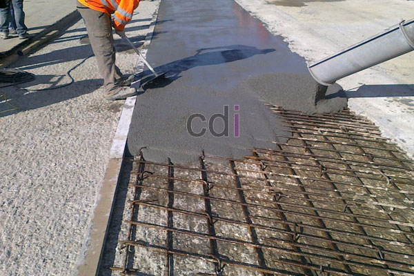

**Fungsi Beton Screening Pada Konstruksi** - Hai Mitra CDI! Pernahkah Anda bertanya-tanya, bagaimana sebuah bangunan bisa berdiri kokoh dan tahan lama? Salah satu jawabannya terletak pada pemilihan material yang tepat. Nah, kali ini kita akan membahas fungsi beton *screening* dalam konstruksi, sebuah material yang mungkin belum terlalu familiar, tapi punya peran penting, lho! Secara umum, beton adalah hasil campuran agregat kasar (seperti batu split atau batu *screening*), agregat halus (pasir), semen, dan air. Selama proses pengerasan, campuran ini membentuk massa padat yang menjadi fondasi kuat bagi berbagai struktur. Untungnya, di era modern ini, Anda tidak perlu lagi repot mencampur bahan-bahan tersebut sendiri. Tersedia beton *ready mix* dan *minimix* yang sudah terstandarisasi untuk proyek pembangunan skala besar maupun kecil.

*Mari kita telusuri lebih lanjut aplikasi fungsi beton screening*

## Pembuatan Adonan Beton Screening: Proses di Balik Layar

Dalam produksi beton skala besar, alat yang digunakan adalah *batching plant*. Fasilitas ini menjamin konsistensi produk beton, sesuai standar yang ditetapkan – termasuk hasil uji slump dan kekuatan beton. *Batching plant* dilengkapi dengan alat penimbang material (*dry mixed*) dan pengaduk (*concrete mixer truck*). 

Komponen utama *batching plant* meliputi: 1. Silo semen untuk penyimpanan semen. 2. *Belt conveyor* untuk mengangkut agregat halus dan kasar dari lokasi *bin* ke area penyimpanan. *Bin* digunakan untuk mengumpulkan material dengan *wheel loader* dari base camp, yang kemudian ditarik ke atas. *Storage bin* berfungsi memisahkan agregat berdasarkan kategori: split, *screening*, pasir, dan *fly ash*. 3. Timbangan untuk mengukur semen, air, dan material. 4. *Dosage pump* untuk menambahkan *admixture* seperti *retarder*. Dan terakhir, tempat penampungan air.

## Manfaat dari Beton Screening: Lebih dari Sekadar Campuran

Apa sebenarnya yang dimaksud dengan *screening*? Ini adalah material kerikil berukuran 0,5 – 1 cm yang populer digunakan dalam pengaspalan jalan, mulai dari jalan ringan hingga kelas 1. Sementara beton *screening* adalah beton siap curah yang terdiri dari pasir beton, batu *screening*, semen (dan bahan aditif), serta air.

Umumnya, beton *screening* digunakan pada elemen struktur bangunan yang tidak menanggung beban struktural utama. Aplikasi umumnya meliputi lapisan bawah untuk lantai dasar dan jalan, lapisan kedua pada lantai dak, serta konstruksi sejenis. Selain itu, beton campuran *screening* banyak dipakai di pabrik beton pracetak untuk memproduksi panel pagar beton, *paving block*, kotak saluran air (U Ditch), batas trotoar jalan, dan *buis* beton. 

Jadi, itulah penjelasan mengenai fungsi dan manfaat beton *screening* dalam konstruksi. Semoga bermanfaat untuk Mitra CDI! Nah, untuk memastikan kualitas dan kekuatan beton yang tahan lama (*durability*), sebaiknya gunakan komposisi beton yang terukur dan berkualitas tinggi – seperti beton *ready mix* yang diangkut dengan truk molen. Jangan ragu untuk menghubungi kami jika Anda membutuhkan informasi lebih lanjut atau pemesanan produk!

Berikut ini informasi tambahan mengenai material bangunan yang mungkin dibutuhkan untuk proyek Anda: [Alas Cor Beton: Panduan Lengkap Jenis, Fungsi, dan Pemasangannya](/blog/alas-cor-beton/).