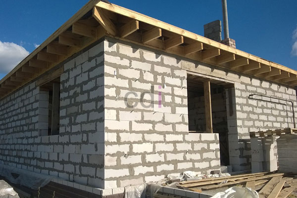

**Jenis Kelas Beton Cor Yang Cocok Untuk Rumah Tinggal** - Hai Mitra CDI! Gimana kabarnya? Membangun rumah impian tentu butuh perencanaan matang, termasuk memilih kelas beton cor yang tepat. Mutu beton sangat memengaruhi kekuatan dan ketahanan bangunan lho. Yuk, simak panduan ini supaya Anda tidak salah pilih dan bisa membangun rumah yang kokoh di (not detected)! Kami akan membahas berbagai kelas beton dan komposisi adukan yang ideal, entah Anda memilih pengecoran manual atau menggunakan layanan *ready mix* dari pabrik.

*Kelas Beton Cor Yang Cocok Untuk Rumah Tinggal*

## Pentingnya Memilih Mutu Beton yang Tepat

Seringkali, kami melihat konsumen kurang memahami jenis kelas beton yang sesuai untuk proyek mereka. Padahal, pemilihan yang keliru bisa berakibat fatal—kekuatan bangunan berkurang, biaya membengkak, dan waktu terbuang percuma. Bayangkan saja, jika Anda membangun rumah dua lantai, tentu membutuhkan mutu beton yang berbeda dengan bangunan satu lantai. Dengan memilih kelas beton yang tepat, Anda memastikan bangunan kuat, awet, dan efisien biaya. Untuk rumah tinggal 2 lantai atau lebih, kami menyarankan penggunaan: **K-225 untuk lantai dak, K-250 untuk selup dan tiang, serta K-300 untuk pondasi / cakar ayam.**

## Komposisi Adukan: Kunci Utama Pengecoran Manual

Kalau Anda memilih untuk mengecor secara manual, pemahaman komposisi adukan yang tepat sangatlah vital. Beruntungnya, jika Anda memesan beton *ready mix* dari pabrik seperti Jayamix, Pioner, atau Holcim, Anda tak perlu khawatir. Mereka sudah menyediakan berbagai kelas beton yang siap pakai. 

Salah satu faktor kunci dalam pembuatan beton berkualitas adalah jenis semen dan perbandingan yang benar. Di pasaran, ada berbagai jenis semen yang dirancang khusus untuk kebutuhan yang berbeda. Misalnya, untuk bangunan di daerah rawa, Anda memerlukan semen dengan kadar keasaman dan sulfat yang lebih tinggi, seperti Semen Portland Jenis V. Penggunaan semen biasa dalam kondisi ini bisa menyebabkan beton tergerus asam dan sulfat seiring waktu. Memilih semen yang tepat, justru bisa menghemat biaya perawatan di masa depan.

Untuk standar di Indonesia, perbandingan ideal adukan adalah 1:2:3 (semen : pasir : split). Artinya, untuk setiap 1 kg semen, gunakan 2 kg pasir dan 3 kg split. Namun, dalam prakteknya, banyak tukang yang mengukur berdasarkan volume. Perbandingan yang umum digunakan adalah 1 m³ semen : 2 m³ pasir : 3 m³ split. Mereka juga memanfaatkan alat ukur seperti ember, pengki, sekop, atau dolak. Contohnya, 1 ember semen : 2 ember pasir : 3 ember batu split.

Berikut adalah panduan perbandingan yang lebih rinci:
- 1 zak semen = 5 sekop pengki
- 1 zak semen = 1 dolak
- 1 zak semen 50 kg = 0.024 m³

Dengan pemahaman ini, Anda bisa menentukan perbandingan semen, split, dan pasir yang tepat untuk mencapai kualitas beton yang diinginkan. Misalnya, untuk mutu beton 1:2:3, gunakan 1 sekop semen : 2 sekop pasir : 3 sekop batu split. Untuk kualitas beton SNI, biasanya dimulai dengan kode 'K', seperti K-100 yang memerlukan komposisi semen 247 : pasir 869 : batu split 999 : air 215 liter. Semoga informasi ini bermanfaat!

Kami di CDI (not detected) siap membantu Anda memilih kelas beton yang sesuai dengan kebutuhan proyek Anda. Jangan ragu untuk menghubungi kami untuk konsultasi gratis dan mendapatkan penawaran terbaik! [Hubungi Kami](URL) Jangan lupa juga untuk melihat artikel kami tentang [Analisa Cor Beton K 225: Panduan Lengkap untuk Fondasi Kuat dan Tahan Lama](/blog/analisa-cor-beton-k-225/) untuk informasi lebih mendalam. Yuk, wujudkan rumah impian Anda bersama CDI!