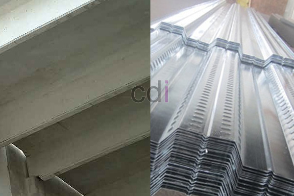

**Kelebihan Dak Bondek Vs Konvensional** - Hai Mitra CDI! Mencari tahu opsi terbaik untuk atap atau lantai bangunan Anda di (not detected)? Kami akan membahas perbandingan antara dak bondek dan dak konvensional. Kedua jenis dak ini punya karakteristik unik, namun banyak proyek modern beralih ke bondek karena keunggulannya. Yuk, kita bedah lebih dalam!

*Mengupas Tuntas Keunggulan Dak Bondek*

## Apa yang Membedakan Dak Bondek dan Dak Konvensional?

Perbedaan mendasar terletak pada material yang digunakan. Untuk dak bondek, Anda memerlukan bondek itu sendiri, wiremesh, beton (campuran semen, pasir, dan kerikil), serta penyangga. Sementara dak konvensional membutuhkan besi beton yang ditata dua arah, beton, penyangga, bekisting (terdiri dari usuk, triplek, dan papan cor), serta perancah.

### Kenapa Dak Bondek Semakin Populer?

Ada beberapa alasan kuat kenapa dak bondek menjadi pilihan utama:

- **Efisiensi Biaya** – Penggunaan dak bondek cenderung lebih hemat material. Minimnya sisa bahan setelah pengerjaan bisa sangat membantu mengendalikan anggaran proyek Anda di (not detected).

- **Praktis dan Ekonomis** – Proses pemasangan dak bondek relatif lebih mudah dan cepat, yang berimbas pada penghematan biaya tenaga kerja jika dibandingkan dengan metode konvensional.

- **Kualitas Terjamin** – Bondek menawarkan kekuatan dan konsistensi yang baik, memastikan bangunan Anda kokoh dan tahan lama.

- **Mengurangi Kebutuhan Besi Tulangan** – Bondek berfungsi ganda sebagai elemen struktural, mengurangi atau bahkan menghilangkan kebutuhan akan besi tulangan konvensional.

- **Hasil Lebih Rapi** – Sistem ini menghasilkan permukaan bawah lantai yang lebih rapi, berbeda dengan metode konvensional yang rentan terhadap masalah bekisting plywood seperti keropos, *ngepling*, atau retak yang memerlukan pekerjaan tambahan.

- **Keamanan Ekstra** – Bondek memberikan tingkat keamanan yang lebih tinggi, terutama jika terjadi kebakaran dibandingkan dak konvensional.

- **Tahan Korosi** – Penggunaan plat baja komposit pada bondek memastikan perlindungan terhadap karat, meningkatkan umur panjang struktur bangunan Anda.

Kelebihan-kelebihan ini menjadikan dak bondek solusi ideal untuk berbagai proyek, mulai dari bangunan bertingkat hingga rumah tinggal di (not detected). Meskipun begitu, perlu diingat ada beberapa hal yang perlu diperhatikan, seperti ketidakcocokan pada plat *cantilever* atau tepi gedung, pentingnya perencanaan yang matang untuk meminimalkan sisa material, dan pertimbangan efisiensi biaya dibandingkan bekisting plywood, terutama mengingat fluktuasi harga besi baja.

## Proses Pemasangan Dak Bondek: Langkah Demi Langkah

Berikut adalah tahapan pelaksanaan pemasangan dak bondek yang umumnya dilakukan:

1. Pemasangan bekisting kolom dan pengecoran kolom.
2. Pembongkaran bekisting kolom setelah beton mengeras.
3. Pemasangan perancah lantai dan bekisting balok.
4. Pemasangan plat lantai bondek.
5. Pemasangan besi tulangan bagian atas.
6. Pengecoran lantai dan balok.
7. Pembongkaran bekisting balok dan plat lantai.

Nah, itulah tadi perbandingan lengkap antara dak bondek dan dak konvensional. Semoga ulasan ini bermanfaat bagi Anda dalam menentukan pilihan yang tepat untuk proyek konstruksi di (not detected)! [Baca juga tentang biaya cor dak bondek per m2 di artikel kami](https://blog/biaya-cor-dak-bondek-per-m2/) untuk estimasi anggaran yang lebih akurat. Jika Anda membutuhkan material bondek berkualitas dengan harga kompetitif, jangan ragu untuk menghubungi kami. Kami siap membantu mewujudkan proyek impian Anda! Silakan hubungi tim kami untuk informasi lebih lanjut. 