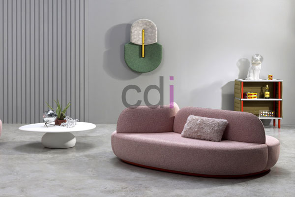

**Kelebihan dan Kekurangan Membeli Furniture Online** - Hai Mitra CDI! Pernah gak sih membayangkan betapa praktisnya mendapatkan furniture impian tanpa harus berkeliling toko? Di era digital ini, belanja online semakin populer, termasuk untuk urusan perabot rumah. Nah, kami dari Creative Design Interior (CDI) ingin membahas tuntas plus minusnya membeli furniture secara online, khususnya buat Mitra yang ada di (not detected). Mari kita bedah bersama!

*Koleksi sofa modern dari CDI*

## Kelebihan Membeli Furniture Secara Online

### 1. Efisiensi Waktu: Proses Lebih Cepat

Bayangkan betapa berharganya waktu Anda, Mitra. Dengan belanja online, Anda tidak perlu lagi meluangkan waktu berjam-jam untuk mengunjungi toko furniture satu per satu. Cukup pilih, pesan, dan barang akan dikirimkan langsung ke depan pintu Anda. Prosesnya jauh lebih ringkas, bahkan jika Anda berbelanja dari toko yang lokasinya jauh dari (not detected). Ini solusi tepat bagi Anda yang super sibuk!

### 2. Kebebasan Memilih: Banyak Pilihan Desain

Pilihan desain di toko fisik seringkali terbatas. Berbeda dengan belanja online, Anda akan menemukan lautan opsi! Hampir semua model dan gaya furniture yang Anda cari bisa ditemukan di berbagai toko online. Dengan begitu, Anda bisa lebih mudah menemukan furniture yang benar-benar sesuai dengan selera dan konsep interior rumah Anda di (not detected).

### 3. Kemudahan Perbandingan: Hemat Waktu & Biaya

Kebayang gak, Mitra, kalau harus mencatat harga dan spesifikasi setiap furniture yang Anda lihat di toko? Ribet! Nah, dengan belanja online, Anda bisa membandingkan harga, kualitas, dan fitur furniture dari berbagai toko dengan sangat mudah. Tinggal buka beberapa tab browser, dan Anda bisa menemukan penawaran terbaik tanpa harus repot keluar rumah. Ini juga berarti penghematan biaya transportasi ke toko-toko furniture di (not detected).

## Kekurangan Membeli Furniture Secara Online

Tentu saja, ada beberapa hal yang perlu dipertimbangkan sebelum Anda memutuskan untuk membeli furniture secara online. Yuk, kita bahas kekurangannya agar Anda bisa membuat keputusan yang tepat.

### 1. Realita vs. Ekspektasi: Potensi Perbedaan Barang

Ini sering jadi kekhawatiran utama, Mitra. Barang yang Anda lihat di gambar mungkin terlihat sempurna, tapi saat sampai di rumah, kondisinya bisa jadi sedikit berbeda. Perbedaan warna, tekstur, atau bahkan ukuran bisa saja terjadi. Untuk meminimalkan risiko ini, pastikan Anda membaca deskripsi produk dengan teliti, perhatikan foto dari berbagai sudut, dan cari testimoni dari pembeli lain. Jangan ragu untuk bertanya pada penjual jika ada yang kurang jelas!

### 2. Biaya Tambahan: Ongkos Kirim yang Perlu Diperhitungkan

Furniture biasanya berukuran besar dan berat, sehingga biaya pengiriman bisa cukup signifikan. Pastikan Anda menghitung total biaya, termasuk ongkos kirim, sebelum Anda membuat keputusan. Bandingkan harga dari beberapa toko untuk mendapatkan penawaran terbaik. Kalau Anda berada di (not detected), pertimbangkan juga apakah ada toko online yang menawarkan free ongkir untuk area tersebut.

### 3. Risiko Pembayaran: Membayar di Awal Tanpa Melihat Langsung

Membayar sebelum menerima barang memang bisa terasa kurang nyaman, apalagi jika Anda belum pernah berbelanja di toko tersebut. Pastikan Anda berbelanja di toko online yang terpercaya dan memiliki sistem pembayaran yang aman. Baca kebijakan pengembalian barang dengan cermat sebelum Anda melakukan pembayaran.

Jadi, bagaimana Mitra? Apakah Anda sudah mempertimbangkan semua kelebihan dan kekurangan ini? Jangan lupa, jika Anda sedang mencari furniture custom berkualitas tinggi di (not detected), jangan ragu untuk menghubungi kami. Kami akan dengan senang hati membantu Anda mewujudkan interior impian Anda. Untuk konsultasi lebih lanjut dan info harga terbaik, hubungi tim kami sekarang juga! [Telepon/WhatsApp]

[Begini Cara Merawat Furniture Yang Benar](/blog/begini-cara-merawat-furniture-yang-benar/) — Pelajari tips jitu untuk menjaga furniture kesayangan Anda tetap awet dan tahan lama. Jangan biarkan investasi Anda sia-sia!

<table class="table">
  <caption>Perbandingan Estimasi Biaya Pengecoran</caption>
  <thead>
    <tr><th>Jenis Pekerjaan</th><th>Harga Per Meter Persegi (Estimasi)</th><th>Catatan</th></tr>
  </thead>
  <tbody>
    <tr><td>Pengecoran Lantai Rumah</td><td>Rp 150.000 - Rp 300.000</td><td>Tergantung ketebalan dan kualitas material</td></tr>
    <tr><td>Pengecoran Kolom</td><td>Rp 300.000 - Rp 500.000</td><td>Termasuk besi dan biaya tenaga kerja</td></tr>
    <tr><td>Pengecoran Balok</td><td>Rp 400.000 - Rp 600.000</td><td>Harga bervariasi tergantung spesifikasi</td></tr>
  </tbody>
</table>
