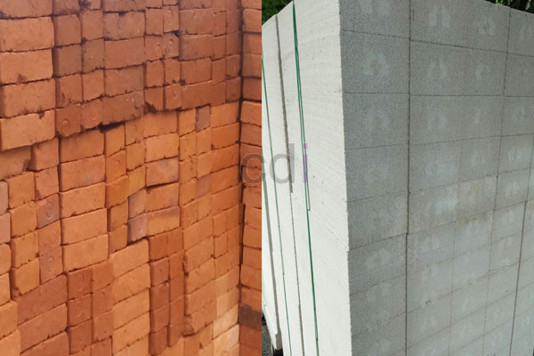

**Kelebihan dan Kelemahan Bata Merah dan Ringan** - Hai Mitra CDI! Pernahkah Anda mempertimbangkan perbandingan antara bata merah dan bata ringan untuk proyek konstruksi di (not detected)? Kedua material ini punya penggemar masing-masing, dan pemilihan yang tepat bisa sangat memengaruhi efisiensi biaya dan kualitas bangunan Anda. Nah, yuk kita bedah lebih dalam kelebihan dan kekurangannya supaya Anda makin mantap dalam menentukan pilihan.

## Membandingkan Bata Merah dan Ringan: Apa Bedanya?

Bata merah dan bata ringan adalah dua opsi paling umum yang sering kita temui di (not detected). Bata merah memang masih menjadi favorit karena sudah digunakan secara turun-temurun dan mudah ditemukan. Tapi, dengan perkembangan teknologi, bata ringan menawarkan alternatif menarik dengan keunggulannya tersendiri. Apa saja perbedaan mendasar antara keduanya? Mari kita bahas.

### Kelebihan Bata Merah yang Perlu Anda Tahu:

- **Pemasangan Mudah:** Tidak memerlukan keterampilan khusus untuk pemasangan, cocok untuk berbagai level tukang.
- **Transportasi Praktis:** Ukurannya yang relatif kecil memudahkan proses pengangkutan material ke lokasi proyek di (not detected).
- **Harga Terjangkau:** Biasanya lebih murah karena proses pembuatannya yang tradisional dan menggunakan bahan baku yang mudah didapat.
- **Tidak Butuh Perekat Khusus:** Dapat dipasang dengan semen biasa tanpa perlu campuran perekat tambahan.
- **Tahan Api:** Memiliki ketahanan yang baik terhadap panas dan api, meningkatkan keamanan bangunan.

### Kekurangan Bata Merah yang Perlu Dipertimbangkan:

- **Bobot Lebih Berat:** Beratnya yang lebih tinggi dapat meningkatkan biaya transportasi dan membutuhkan tenaga lebih besar saat pemasangan di (not detected).
- **Ukuran Kurang Presisi:** Ukuran yang bervariasi kadang menyulitkan pembuatan pasangan bata yang rapi dan presisi.
- **Kualitas Bervariasi:** Kualitas bergantung pada cara pembuatan dan pembakaran, yang seringkali masih manual.
- **Pemakaian Perekat Lebih Banyak:** Karena ukurannya tidak seragam, membutuhkan lebih banyak perekat untuk mengisi celah.
> _"Butuh suplai Bata Merah berkualitas SUPER untuk proyek Anda di (not detected)? Hubungi kami sekarang! Dapatkan info detail di halaman [BATA MERAH OVEN](/product/bata-merah-oven)."_

## Bata Ringan: Alternatif Modern untuk Konstruksi Anda!

Sebagai alternatif yang semakin populer, bata ringan menawarkan solusi konstruksi yang lebih efisien dan modern.  Bata ringan kini banyak dicari sebagai solusi praktis dan efisien untuk pembangunan di (not detected).  

### Keunggulan Bata Ringan yang Menarik:

- **Ukuran Presisi:** Diproduksi dengan mesin modern sehingga ukuran seragam, memudahkan pemasangan dan menghasilkan dinding yang lebih rapi.
- **Bobot Lebih Ringan:** Mengurangi beban struktur bangunan secara keseluruhan, menghemat biaya fondasi dan rangka.
- **Proses Pembangunan Lebih Cepat:** Ukuran yang presisi memungkinkan pemasangan lebih cepat dan efisien.
- **Kedap Air:** Struktur pori-pori yang rapat mengurangi risiko rembesan air, menjaga bangunan tetap kering.
- **Kedap Suara:** Menawarkan isolasi suara yang lebih baik, menciptakan lingkungan yang lebih tenang dan nyaman.
- **Ketahanan Terhadap Gempa:** Struktur ringan dan fleksibel membantu bangunan lebih tahan terhadap guncangan gempa bumi.

### Kekurangan Bata Ringan yang Perlu Anda Ketahui:

- **Membutuhkan Perekat Khusus:** Memerlukan perekat khusus yang dirancang untuk bata ringan agar daya rekatnya optimal.
- **Keahlian Pemasangan:** Membutuhkan tenaga tukang yang terampil dan berpengalaman dalam pemasangan bata ringan.
- **Harga Lebih Mahal:** Secara umum, harga bata ringan lebih tinggi dibandingkan bata merah.
- **Kurang Cocok untuk Dinding Luar:** Teksturnya yang relatif lembut membuatnya kurang ideal untuk dinding luar yang membutuhkan kekuatan ekstra.
- **Ketersediaan Terbatas:** Tidak selalu mudah ditemukan di toko material bangunan biasa, terutama di area (not detected).
> _"Ingin mempercepat proyek dengan **Bata Ringan** berkualitas? Kami jual langsung dari pabrik! Klik [Bata Ringan /Hebel](/product/jual-bata-ringan-hebel) untuk info lengkapnya."_

**Bata merah dan ringan** masing-masing punya karakteristik unik.  Penting untuk mempertimbangkan kebutuhan spesifik proyek Anda di (not detected), anggaran yang tersedia, dan ketersediaan material sebelum membuat keputusan.  Pastikan juga untuk memilih material pendukung yang sesuai dengan jenis bata yang Anda gunakan agar konstruksi bangunan lebih kuat dan tahan lama. Dengan perencanaan yang matang dan pemasangan yang tepat, Anda bisa menciptakan bangunan yang estetis dan fungsional. Jangan ragu untuk berkonsultasi dengan tim ahli kami untuk mendapatkan rekomendasi terbaik!