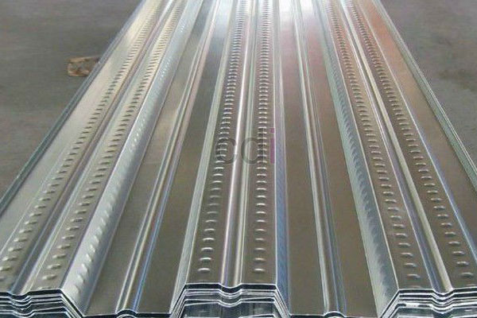

**Inilah Keunggulan Menggunakan Bondek** - Hai Mitra CDI! Pernahkah Anda bertanya-tanya, kenapa beberapa kontraktor selalu memilih bondek meskipun harganya terlihat sedikit lebih tinggi? Pengalaman mengajarkan mereka bahwa kualitas sebuah material adalah investasi jangka panjang. Terutama ketika bicara soal kekuatan dan ketahanan bangunan. Nah, bondek yang terbuat dari besi ini memang punya peran vital dalam memperkuat konstruksi, khususnya lantai. Yuk, kita kupas tuntas keunggulannya!

*Bondek untuk dak*

## Keunggulan Menggunakan Bondek

Memang betul, investasi awal untuk bondek mungkin terasa lebih besar. Tapi, jangan hanya lihat dari harga di awal saja, ya! Ada banyak keunggulan bondek yang membuatnya jadi pilihan cerdas dan hemat biaya dalam jangka panjang. Simak beberapa poin penting berikut ini:

### 1\. Struktur Bangunan Jadi Lebih Kokoh

Bayangkan sebuah lantai gudang yang harus menahan beban berat dari barang-barang, peralatan, bahkan kendaraan berat. Kalau lantainya tidak dilapisi bondek, kemungkinan besar akan cepat rusak, bahkan amblas. Bahaya, kan? Nah, dengan lapisan **bondek** yang tepat, lantai akan mampu menahan beban berat tersebut selama bertahun-tahun. Bondek memberikan kekuatan ekstra yang tak tertandingi. Ini penting banget untuk bangunan di (not detected) yang seringkali punya kebutuhan khusus terkait beban.

### 2\. Pengecoran Lantai Lebih Mudah dan Efisien

Lantai cor memang butuh ‘tulang’ agar kuat. Tapi, jenis ‘tulang’ yang digunakan sangat berpengaruh pada proses pengecoran. Kalau ‘tulangnya’ dibuat asal-asalan, pemasangannya tidak pas, atau kualitasnya kurang baik, proses pengecoran bisa jadi lama dan butuh banyak tenaga. Berbeda cerita kalau menggunakan bondek. Pengecoran jadi lebih cepat, lebih mudah, dan bahkan bisa menghemat jumlah pekerja. Jadi, efisien waktu dan biaya, deh!

### 3\. Proses Pembuatan Bondek yang Presisi

Kualitas bondek tidak lahir begitu saja. Proses pembuatannya sangat detail dan presisi. Karena kalau tidak, bondek tidak akan mampu memberikan kekuatan maksimal pada struktur bangunan. Artinya, bondek yang dibuat sembarangan bisa mengurangi ketahanannya, meskipun tetap lebih baik daripada metode konvensional. Untuk kualitas terbaik, pastikan Anda membeli bondek dari supplier terpercaya di (not detected).

Bisa disimpulkan, kalau Anda menginginkan struktur lantai yang kuat, kokoh, dan tahan lama, **bondek** adalah pilihan yang tepat sebagai ‘tulang’ utamanya. Lantai akan menjadi sangat kuat dan awet, bahkan mampu menahan beban berat sekalipun. Sangat direkomendasikan untuk penggunaan di rumah, gudang, atau bangunan komersial lainnya di (not detected).

Tertarik dengan keunggulan bondek? Jangan ragu untuk menghubungi kami dan dapatkan penawaran terbaik! [Tabel harga bondek dan spesifikasi lengkap]() sudah kami siapkan untuk Anda. Atau, hubungi tim kami melalui tombol Telepon/WhatsApp di halaman ini untuk konsultasi gratis. Kami siap membantu mewujudkan bangunan impian Anda! [Inilah Alasan Kenapa Bondek Jauh Lebih Murah](/blog/alasan-kenapa-bondek-jauh-lebih-murah/) bisa jadi bacaan menarik terkait perbandingan ekonominya.