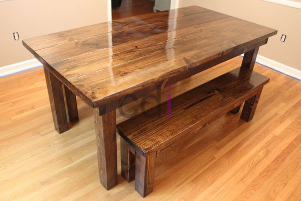

**Kualitas Meja Kayu Jati Belanda** - Hai Mitra CDI! Pernahkah Anda membayangkan betapa menyenangkannya memiliki rumah yang terasa nyaman dan menarik? Tentu saja! Salah satu kunci penting untuk mewujudkannya adalah pemilihan perabotan yang tepat. Nah, meja adalah salah satu elemen wajib yang ada di setiap rumah, bukan? 

Ada begitu banyak pilihan meja di pasaran. Bingung mau pilih yang mana? Kami punya rekomendasi menarik untuk Anda: meja kayu jati Belanda! Jenis meja ini bukan hanya akan mempercantik ruangan, tapi juga memberikan kesan hangat dan alami pada hunian Anda. Yuk, simak lebih lanjut apa saja keunggulan meja jati Belanda ini.

*Meja jati belanda*

## Mengapa Memilih Meja Jati Belanda?

Sebelum memutuskan untuk membeli, ada baiknya kita telaah dulu apa saja yang membuat meja jati Belanda ini begitu istimewa. Berikut ini beberapa kelebihan yang akan membuat Anda semakin yakin untuk memilihnya:

### 1. Reputasi yang Terpercaya

Nama “Jati Belanda” sudah cukup dikenal di kalangan pecinta perabotan. Asosiasi dengan kualitas dan keindahan kayu jati secara otomatis memberikan nilai tambah pada meja ini. Banyak orang mempercayai bahwa produk dengan merek yang sudah mapan biasanya lebih tahan lama. Lho, ternyata dinamakan Jati Belanda karena serat kayunya mirip kayu jati, namun dengan warna yang lebih cerah dan khas.

### 2. Kuat dan Awet Bertahun-tahun

Kekuatan dan daya tahan adalah hal yang paling dicari saat membeli perabotan, bukan? Meja jati Belanda hadir sebagai solusi tepat! Kayu jati belanda dikenal dengan kualitasnya yang unggul sehingga meja ini mampu menahan beban dan penggunaan sehari-hari dalam jangka waktu yang lama. Anda tidak perlu khawatir cepat mengganti meja karena rusak. Bahkan banyak kafe, warung makan, restoran, hingga ruang keluarga memilih furnitur dari jati belanda.

### 3. Jaminan Bebas Rayap

Masalah rayap memang momok menakutkan bagi pemilik rumah. Serangga kecil ini bisa merusak perabotan kayu kesayangan Anda. Tapi tenang saja! Kayu jati Belanda memiliki aroma alami yang tidak disukai rayap, sehingga meja ini lebih terlindungi dari serangan rayap. Ini adalah keuntungan tambahan yang patut dipertimbangkan, kan?

## Kisaran Harga Meja Jati Belanda di (not detected)

Meja Jati Belanda semakin populer karena desainnya yang simpel, elegan, dan mudah dipadukan dengan berbagai gaya interior. Kenyamanan yang ditawarkan pun tak kalah menarik. Lalu, bagaimana dengan harganya? Apakah sesuai dengan anggaran Anda? 

Kami memahami bahwa harga adalah faktor penting dalam setiap keputusan pembelian. Kabar baiknya, meja jati Belanda relatif terjangkau dan dapat disesuaikan dengan kebutuhan kantong Anda. Harga akan bervariasi tergantung pada model, ukuran, dan finishing yang dipilih. Untuk informasi lebih detail mengenai  yang tersedia, silakan lihat tabel harga di atas.

Bagi Anda yang berada di wilayah (not detected) dan sekitarnya, jangan ragu untuk menghubungi kami! Kami siap membantu Anda mendapatkan meja jati Belanda impian Anda. Kami melayani pembelian langsung, pemesanan online, dan juga menerima custom order sesuai dengan ukuran dan warna yang Anda inginkan. Dengan meja jati Belanda, Anda akan merasakan kenyamanan dan keindahan dalam setiap sudut ruangan. Dijamin, Anda tidak akan kecewa! Jangan tunda lagi, hubungi kami sekarang juga untuk penawaran terbaik! Kami dari CDI (not detected) siap melayani Anda.