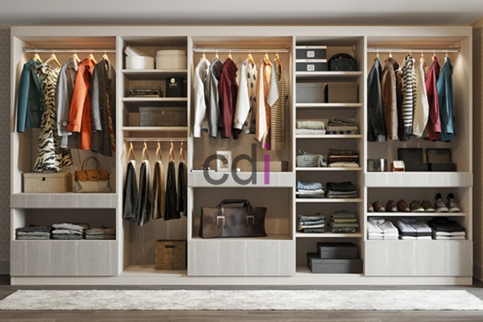

**Kenapa Lemari Gantung Baju Gamis Jadi Pilihan Cerdas?** - Hai Mitra CDI! Punya banyak gamis tapi bingung gimana supaya tetap rapi dan mudah diakses? Koleksi gamis yang indah dan beragam memang butuh perhatian khusus. Nah, kami punya solusinya! Kami akan membahas kenapa lemari gantung baju gamis bisa jadi jawaban tepat untuk masalah penyimpanan Mitra.

### Ruang Lebih Luas dengan Sentuhan Lemari Gantung

Lemari gantung baju gamis adalah solusi cerdas untuk memaksimalkan ruang, terutama di kamar tidur (not detected) yang tak terlalu besar. Bayangkan, alih-alih menumpuk gamis di lemari biasa yang memakan tempat, Anda bisa memanfaatkan ruang vertikal dengan lemari gantung. Desainnya yang menggantung memberikan kesan ruangan lebih lapang dan terbuka. Selain itu, lemari gantung memungkinkan Anda menata gamis berdasarkan warna, model, atau acara tertentu – jadi lebih mudah saat memilih outfit! Yuk, pertimbangkan juga manfaatnya dalam menjaga gamis dari debu dan kotoran agar tetap bersih lebih lama.

Memilih lemari gantung yang pas memang butuh sedikit pertimbangan. Material jadi hal penting. Kayu solid seperti jati atau mahoni menawarkan kesan mewah dan tahan lama, tapi tentu saja lebih mahal. Kalau budget terbatas, multipleks berkualitas baik atau *particle board* berlapis laminasi anti air bisa jadi pilihan menarik. Jangan lupa perhatikan ukuran dan kapasitas lemari, sesuaikan dengan jumlah gamis yang Anda miliki dan pastikan tingginya cukup untuk menampung gamis terpanjang tanpa tersangkut.

### Desain Lemari Gantung Gamis: Ekspresikan Gaya Anda

Lemari gantung bukan cuma soal fungsi, tapi juga estetika. Kami di Creative Design Interior memahami itu betul! Itulah kenapa kami menawarkan layanan desain *custom* yang memungkinkan Mitra CDI mewujudkan lemari gantung impian. Mitra bisa bebas memilih model pintu (sliding, swing, atau tanpa pintu), warna *finishing*, dan detail dekoratif sesuai selera.

Untuk inspirasi, berikut beberapa ide desain lemari gantung gamis yang bisa jadi pertimbangan:

*   **Minimalis Modern:** Desain simpel dengan garis lurus dan warna-warna netral seperti putih, abu-abu, atau cokelat muda. Cocok untuk kamar tidur bergaya minimalis atau Skandinavia.
*   **Klasik Elegan:** Desain dengan ukiran indah dan warna-warna mewah seperti cokelat tua, emas, atau krem. Ideal untuk kamar tidur bergaya klasik atau Victorian.
*   **Bohemian Chic:** Paduan warna cerah, motif etnik, dan sentuhan anyaman atau renda akan memberikan nuansa bohemian yang ceria pada kamar tidur Anda (not detected).
*   **Open Wardrobe:** Konsep lemari terbuka yang menampilkan seluruh koleksi gamis. Cocok untuk Mitra CDI yang suka menata pakaian seperti di toko *boutique*.

### Perkiraan Biaya Lemari Gantung Baju Gamis

Biaya pembuatan lemari gantung baju gamis akan bervariasi, tergantung pada material yang dipilih, ukuran, desain, dan kerumitan pengerjaan. Berikut ini tabel estimasi biaya yang bisa jadi acuan:

<table class="table">
  <caption>Estimasi Harga Lemari Gantung Baju Gamis</caption>
  <thead>
    <tr><th>Material</th><th>Ukuran (PxLxT)</th><th>Estimasi Harga</th></tr>
  </thead>
  <tbody>
    <tr><td>Multipleks dengan Laminasi</td><td>180 x 60 x 200 cm</td><td>2.500.000 – 4.000.000</td></tr>
    <tr><td>Kayu Solid (Mahoni)</td><td>180 x 60 x 200 cm</td><td>5.000.000 – 8.000.000</td></tr>
    <tr><td>Multipleks dengan Finishing Melamin</td><td>240 x 60 x 220 cm</td><td>3.000.000 – 5.000.000</td></tr>
    <tr><td>Kayu Solid (Jati)</td><td>240 x 60 x 220 cm</td><td>7.000.000 – 12.000.000</td></tr>
  </tbody>
</table>

Untuk informasi harga lebih detail dan penawaran khusus, silakan hubungi Kami. Kami akan dengan senang hati membantu Mitra mendesain dan mewujudkan lemari gantung gamis yang sempurna. [Gantungan Baju Lemari Tarik: Solusi Ruang Efisien untuk Pakaian Anda](/blog/gantungan-baju-lemari-tarik/) juga bisa jadi inspirasi tambahan untuk memaksimalkan ruang penyimpanan di lemari Mitra CDI.

Butuh konsultasi lebih lanjut? Jangan ragu untuk menghubungi Kami. Tombol **Telepon** dan **WhatsApp** siap membantu Mitra CDI! Kami siap menjawab semua pertanyaan dan memberikan solusi terbaik untuk kebutuhan interior Anda.