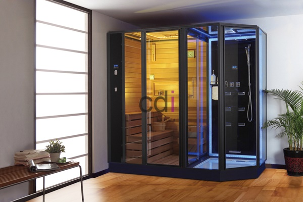

**Lemari Kaca 3 Pintu: Hindari 5 Kesalahan Umum Saat Memilih** - Hai Mitra CDI! Bingung memilih lemari kaca 3 pintu yang tepat untuk ruangan di (not detected)? Atau seringkali merasa setelah beli, lemari justru terasa kurang pas? Tenang, Anda tidak sendirian. Kali ini, Kami akan membahas 5 kesalahan paling sering dilakukan saat memilih lemari kaca 3 pintu—beserta solusinya. Yuk, simak hingga tuntas!

## Material Lemari: Jangan Hanya Lihat Penampilan!

Seringkali, Mitra memilih material lemari kaca 3 pintu berdasarkan tampilannya saja. Padahal, ada banyak faktor lain yang perlu dipertimbangkan, seperti kebutuhan fungsional dan gaya hidup Anda sehari-hari. Material populer seperti kayu solid, MDF, *particle board*, dan aluminium punya kelebihan dan kekurangannya masing-masing. 

Kayu solid menawarkan kesan mewah dan awet, tapi perawatannya butuh perhatian ekstra dan harganya relatif tinggi. MDF (*Medium Density Fiberboard*) dan *particle board* lebih terjangkau, namun kurang tahan terhadap kelembapan dan benturan. Sementara itu, aluminium tampil modern dan anti karat, meski mungkin terasa kurang hangat dibandingkan kayu.

Pikirkan juga siapa yang akan sering menggunakan lemari tersebut. Misalnya, jika ada anak kecil di rumah, material yang lebih kuat seperti MDF berlapis melamin bisa jadi pilihan lebih baik daripada kayu solid yang mudah tergores.

## Ukuran Lemari: Jangan Sampai Ruangan Jadi Sempit!

Lemari kaca 3 pintu memang menawarkan ruang penyimpanan yang lega. Tapi, jika ukurannya tidak sesuai dengan ruangan, justru bisa membuat ruangan di (not detected) terasa penuh dan sempit. Ukur area yang akan ditempati lemari dengan teliti sebelum membeli. Perhatikan juga tinggi langit-langit dan posisi furnitur lain.

Sebagai referensi, lemari kaca 3 pintu berukuran 180-240 cm biasanya cocok untuk ruangan berukuran sedang hingga besar. Untuk ruangan yang lebih kecil, pertimbangkan lemari dengan lebar yang lebih ramping atau model lemari kaca 2 pintu. Pastikan juga ada cukup ruang untuk membuka pintu lemari tanpa mengganggu aktivitas di ruangan.

## Kualitas Kaca & Keamanan: Jangan Diabaikan!

Kaca adalah elemen kunci pada lemari kaca 3 pintu. Pastikan kaca yang digunakan cukup tebal (minimal 5mm untuk lemari standar) dan memiliki sertifikasi keamanan seperti SNI. Kaca *tempered* adalah pilihan yang sangat direkomendasikan karena lebih kuat dan pecah menjadi serpihan kecil yang tidak tajam jika terkena benturan.

Perhatikan juga kualitas engsel dan sistem pengunci pintu lemari. Engsel dan kunci yang berkualitas baik akan mencegah pintu menutup mendadak atau menyebabkan barang terjatuh. Fitur *soft-closing* pada engsel juga sangat berguna untuk mengurangi risiko kerusakan dan suara berisik.

## Tata Letak & Pencahayaan: Maksimalkan Fungsionalitas & Estetika

Tata letak interior lemari kaca 3 pintu sangat memengaruhi bagaimana Anda memanfaatkan ruang yang ada. Susun barang-barang berdasarkan frekuensi penggunaan: barang yang sering dipakai sebaiknya diletakkan di area yang mudah dijangkau. Gunakan rak tambahan, laci, atau gantungan baju untuk mengoptimalkan ruang penyimpanan.

Pencahayaan juga sangat penting. Pencahayaan yang tepat akan mempercantik tampilan barang-barang di dalam lemari dan memudahkan Anda menemukan apa yang Anda cari. Memasang lampu LED di dalam lemari adalah solusi hemat energi dan memberikan pencahayaan yang optimal.

## Harga Murah: Jangan Korbankan Kualitas Jangka Panjang!

Mungkin tergoda dengan lemari kaca 3 pintu murah. Tapi ingat, harga murah seringkali berbanding lurus dengan kualitas yang rendah. Material yang digunakan mungkin tidak tahan lama, engsel mudah rusak, dan kaca rentan pecah.

Lebih baik berinvestasi pada lemari kaca 3 pintu berkualitas dari produsen terpercaya. Perhatikan material, konstruksi, dan fitur keamanannya. Ingat, lemari kaca 3 pintu adalah investasi jangka panjang yang akan Anda gunakan selama bertahun-tahun. Pertimbangkan opsi yang tersedia di (not detected) dan sesuaikan dengan anggaran Anda.

Sebagai gambaran, lemari kaca 3 pintu berkualitas standar (MDF dengan kaca 5mm) biasanya ada di kisaran harga tertentu. Sementara lemari dari kayu solid dengan kaca tempered seringkali memiliki penawaran yang berbeda. Informasi selengkapnya mengenai harga dan promo terbaru bisa Anda dapatkan melalui tabel harga di atas atau dengan menghubungi Kami langsung.

Jadi, tunggu apa lagi? Jangan ragu untuk menghubungi Kami melalui tombol **WhatsApp** atau **Telepon** yang ada di halaman ini untuk konsultasi gratis dan penawaran terbaik! [Contoh Lemari Buku Kaca: Desain Modern dan Hemat Ruang](/blog/contoh-lemari-buku-kaca/) bisa jadi inspirasi untuk desain interior ruangan Anda.