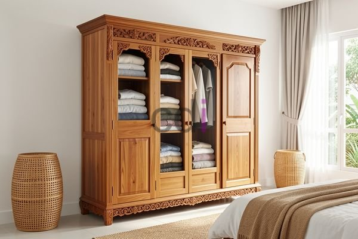

**Lemari Kayu 3 Pintu: Solusi Penyimpanan Optimal untuk Ruang Tidur Modern** - Hai Mitra CDI! Apakah Anda sedang mencari cara pintar untuk menata ruang tidur agar lebih rapi dan nyaman? Lemari kayu 3 pintu bisa jadi jawabannya. Furniture ini bukan cuma tempat menyimpan pakaian, tapi juga bisa jadi bagian yang mempercantik interior rumah Anda.

Ruang penyimpanan yang memadai di kamar tidur itu penting banget, lho. Semakin banyak barang yang kita punya, semakin perlu juga solusi penyimpanan yang optimal. Nah, lemari kayu 3 pintu ini menawarkan kapasitas lebih besar daripada lemari 2 pintu. Jadi, cocok banget buat Anda yang punya banyak koleksi pakaian, aksesoris, atau barang-barang pribadi lainnya. Selain itu, lemari ini juga bisa jadi elemen dekoratif yang bikin kamar tidur Anda terlihat lebih menarik.

## Mengapa Lemari Kayu 3 Pintu Jadi Pilihan Terbaik?

Investasi pada lemari kayu 3 pintu itu banyak keuntungannya, Mitra. Pertama, kapasitasnya yang luas bikin Anda bisa menata semua barang dengan lebih efisien. Bayangkan, nggak perlu lagi pakaian numpuk di lantai atau di kursi! Ini terutama bermanfaat buat keluarga atau mereka yang punya banyak koleksi pakaian.

Kedua, desainnya yang fleksibel bisa disesuaikan dengan berbagai gaya interior rumah Anda. Mau gaya minimalis, modern, klasik, atau industrial, Kami bisa bantu wujudkan lemari impian Anda. Pilihan material kayunya juga beragam, mulai dari kayu solid seperti jati dan mahoni, sampai kayu olahan seperti MDF dan multipleks. Masing-masing punya kelebihan dan kekurangan yang bisa Anda pertimbangkan.

Ketiga, lemari kayu 3 pintu terkenal kokoh dan awet kalau dirawat dengan benar. Kayu itu material alami yang kuat dan tahan lama. Dengan perawatan yang tepat, lemari ini bisa jadi furniture warisan yang bisa dinikmati anak cucu Anda.

## Hal-hal yang Perlu Dipertimbangkan Sebelum Membeli

Sebelum Anda memutuskan untuk membeli lemari kayu 3 pintu, ada beberapa hal penting yang perlu Anda perhatikan. Yang pertama adalah ukuran ruangan. Pastikan kamar tidur Anda punya cukup ruang untuk menempatkan lemari tanpa membuat ruangan terasa sempit dan penuh. Ukur area yang tersedia dan bandingkan dengan dimensi lemari yang Anda inginkan.

Kemudian, pikirkan juga jenis kayu yang paling cocok untuk Anda. Kayu jati memang terkenal kualitasnya, tapi harganya juga lumayan tinggi. Kayu mahoni bisa jadi alternatif yang lebih terjangkau dengan kualitas yang tetap baik. Kalau budget Anda terbatas, kayu olahan seperti MDF dan multipleks bisa jadi pilihan yang ekonomis, tapi perlu dilapisi finishing yang bagus supaya awet dan tahan lembap.

Jangan lupakan juga desain dan fitur tambahan. Pilih desain yang sesuai dengan gaya interior rumah Anda. Pertimbangkan juga fitur seperti laci, gantungan baju, cermin, atau rak sepatu untuk memaksimalkan fungsi lemari.

## Perbandingan Material: Mana yang Terbaik untuk Anda?

Supaya Anda lebih mudah memilih material yang tepat, Kami buatkan tabel perbandingan beberapa jenis kayu yang umum digunakan:

<table class="table">
  <caption>Perbandingan Material Lemari Kayu 3 Pintu</caption>
  <thead>
    <tr><th>Material</th><th>Kelebihan</th><th>Kekurangan</th><th>Estimasi Harga (per unit)</th></tr>
  </thead>
  <tbody>
    <tr><td>Jati</td><td>Kuat, tahan lama, serat indah, tahan rayap</td><td>Mahal, perawatan khusus</td><td>Rp 8.000.000 – Rp 20.000.000</td></tr>
    <tr><td>Mahoni</td><td>Kuat, mudah dibentuk, harga lebih terjangkau dari jati</td><td>Kurang tahan rayap dibandingkan jati</td><td>Rp 5.000.000 – Rp 12.000.000</td></tr>
    <tr><td>MDF (Medium Density Fiberboard)</td><td>Harga sangat terjangkau, permukaan halus, mudah dicat</td><td>Kurang kuat, mudah rusak jika terkena air</td><td>Rp 2.000.000 – Rp 5.000.000</td></tr>
    <tr><td>Multipleks</td><td>Kuat, stabil, tahan terhadap perubahan cuaca</td><td>Permukaan kurang halus, perlu finishing yang baik</td><td>Rp 3.000.000 – Rp 7.000.000</td></tr>
  </tbody>
</table>

Perlu diingat, harga di atas hanyalah estimasi dan bisa berubah sewaktu-waktu. Untuk penawaran terbaru dan paling akurat sesuai dengan kebutuhan proyek Anda, silakan hubungi Kami. Di Creative Design Interior, Kami menawarkan layanan custom furniture, jadi Anda bisa memesan lemari kayu 3 pintu dengan desain dan material sesuai dengan anggaran dan selera Anda. [Lemari Pakaian Pintu Geser: Solusi Penyimpanan Modern untuk Ruang Optimal](/blog/lemari-pakaian-pintu-geser/) — mungkin Anda juga tertarik dengan opsi penyimpanan lainnya ini.

## Cara Merawat Lemari Kayu 3 Pintu Agar Tetap Awet

Agar lemari kayu 3 pintu Anda tetap awet dan tahan lama, lakukan perawatan rutin ya. Bersihkan permukaan lemari secara berkala dengan kain lap kering atau sedikit lembap. Hindari penggunaan bahan kimia keras yang bisa merusak lapisan finishing kayu.

Jauhkan lemari dari paparan sinar matahari langsung dan kelembaban berlebih. Kelembaban bisa bikin kayu mengembang dan menyusut, yang bisa merusak struktur lemari. Pastikan ruangan punya ventilasi yang baik supaya sirkulasi udara tetap lancar.

Untuk lemari dengan finishing cat, perbarui lapisan cat secara berkala agar tampilan lemari tetap segar dan terlindungi dari kerusakan. Kalau lemari terbuat dari kayu solid, lakukan perawatan khusus seperti mengaplikasikan wax atau oil secara berkala untuk menjaga kelembapan dan keindahan alami kayu.

Butuh bantuan langsung untuk mewujudkan lemari impian Anda? Jangan ragu untuk klik tombol **WhatsApp** atau **Telepon** di bawah ini untuk berkonsultasi dengan tim Kami. Kami siap membantu! [Lemari Jati 3 Pintu: Investasi Furnitur Abadi untuk Ruang Tidur Anda](/blog/lemari-jati-3-pintu/) — temukan inspirasi lemari jati berkualitas tinggi di artikel ini.