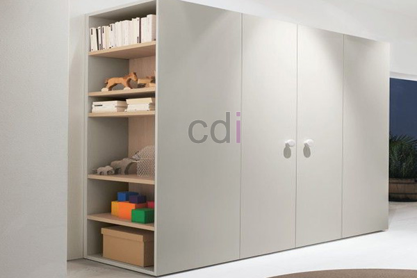

**Lemari Pakaian Pintu Geser: Solusi Penyimpanan Modern untuk Ruang Optimal** - Hai Mitra CDI! Pernahkah Anda merasakan tantangan saat menata kamar tidur? Terutama di kota-kota besar seperti (not detected), ruang seringkali menjadi komoditas berharga. Nah, lemari pakaian pintu geser hadir sebagai solusi cerdas untuk memaksimalkan ruang dan menciptakan area istirahat yang nyaman.

### Mengapa Memilih Lemari Pakaian Pintu Geser? Keunggulannya Dibanding Model Ayun

Pikirkan tentang efisiensi. Itulah keunggulan utama lemari pintu geser dibandingkan lemari tradisional dengan pintu ayun. Dengan sistem rel horizontalnya, lemari ini tidak memerlukan ruang ekstra untuk membuka tutup – sebuah keuntungan besar untuk kamar tidur berukuran terbatas di (not detected). Selain itu, desainnya yang ramping dan modern seringkali memberikan sentuhan estetika yang lebih segar pada ruangan. Kami dari Creative Design Interior sering menyarankan lemari pintu geser ini karena kepraktisannya.

Lebih dari itu, Mitra CDI bisa mendapatkan fleksibilitas tinggi dalam desain. Pilihan material, finishing, dan konfigurasi interior sangat beragam, memungkinkan Anda menciptakan lemari yang benar-benar personal dan sesuai kebutuhan. Material yang umum digunakan antara lain kayu solid, MDF (Medium-Density Fiberboard), dan *particle board*, bahkan bisa dikombinasikan dengan elemen kaca atau cermin.

### Material dan Desain Lemari Pakaian Pintu Geser: Apa yang Sedang Tren?

Saat ini, beberapa material dan desain lemari pintu geser sangat populer di kalangan Mitra CDI. Kayu solid, seperti jati atau mahoni, menawarkan kesan mewah dan daya tahan tinggi. Namun, perlu diingat bahwa harganya cenderung lebih mahal. Sementara itu, MDF dan *particle board* menjadi alternatif yang lebih ekonomis, namun tetap bisa menghasilkan tampilan menarik dengan lapisan finishing yang tepat.

Simak perbandingan material berikut ini:

<table class="table">
  <caption>Perbandingan Material Lemari Pakaian Pintu Geser</caption>
  <thead>
    <tr><th>Material</th><th>Kelebihan</th><th>Kekurangan</th><th>Estimasi Harga (per meter lari)</th></tr>
  </thead>
  <tbody>
    <tr><td>Kayu Solid (Jati/Mahoni)</td><td>Kuat, tahan lama, tampilan alami</td><td>Mahal, perawatan khusus</td><td>Rp 3.000.000 - Rp 7.000.000</td></tr>
    <tr><td>MDF</td><td>Permukaan halus, mudah dicat, harga terjangkau</td><td>Kurang tahan lama jika terkena air, lebih rentan terhadap kerusakan</td><td>Rp 1.500.000 - Rp 3.000.000</td></tr>
    <tr><td>Particle Board</td><td>Paling terjangkau, ringan</td><td>Kurang kuat, mudah rusak jika terkena air</td><td>Rp 800.000 - Rp 1.500.000</td></tr>
  </tbody>
</table>

Informasi harga bersifat estimasi dan dapat berubah. Untuk penawaran harga yang paling sesuai dengan kebutuhan proyek Anda di (not detected), jangan ragu untuk menghubungi Kami!

Dari sisi desain, lemari minimalis dengan warna netral seperti putih, abu-abu, atau cokelat masih menjadi pilihan utama. Tapi, kami juga melihat peningkatan tren penggunaan warna-warna cerah atau kombinasi unik untuk menambah karakter pada ruangan. Penambahan cermin pada pintu lemari juga seringkali menjadi solusi cerdas untuk memberikan kesan ruang yang lebih lapang.

### Bagaimana Cara Memilih Lemari Pakaian Pintu Geser yang Tepat?

Memilih lemari yang ideal membutuhkan sedikit perencanaan. Hal pertama yang perlu dilakukan adalah menentukan ukuran lemari yang sesuai dengan dimensi kamar tidur Anda. Lakukan pengukuran yang akurat, termasuk tinggi langit-langit. Kemudian, pertimbangkan kualitas material dan mekanisme pintu gesernya. Pastikan materialnya tahan lama dan sistem pintu bekerja dengan halus – hindari yang berisik atau seret.

### Tips Merawat Lemari Pakaian Pintu Geser Agar Tahan Lama

Perawatan rutin adalah kunci agar lemari pintu geser Anda tetap awet dan berfungsi optimal. Bersihkan permukaan lemari secara berkala menggunakan kain lembut dan larutan deterjen ringan. Hindari penggunaan bahan kimia keras yang dapat merusak finishing. Periksa dan lumasi rel pintu geser secara berkala untuk memastikan pergerakan yang lancar. Terakhir, perhatikan tingkat kelembaban ruangan, karena kelembaban tinggi dapat merusak material lemari.

Butuh konsultasi lebih lanjut? Jangan sungkan untuk menghubungi Kami melalui tombol **Telepon** atau **WhatsApp** di bawah. Kami dari Creative Design Interior (not detected) siap membantu! [Lemari Kayu 3 Pintu: Solusi Penyimpanan Optimal untuk Ruang Tidur Modern](/blog/lemari-kayu-3-pintu/) [Lemari Sliding 2 Pintu: Solusi Penyimpanan Efisien untuk Ruang Minimalis](/blog/lemari-sliding-2-pintu/)